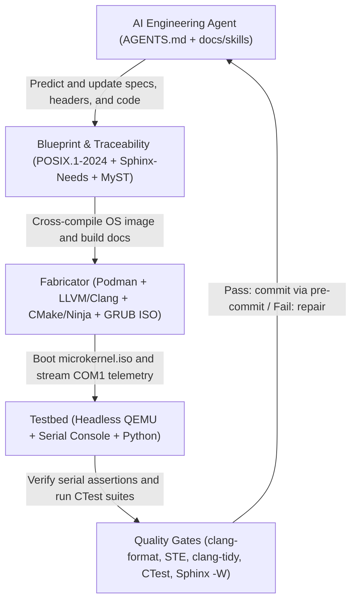
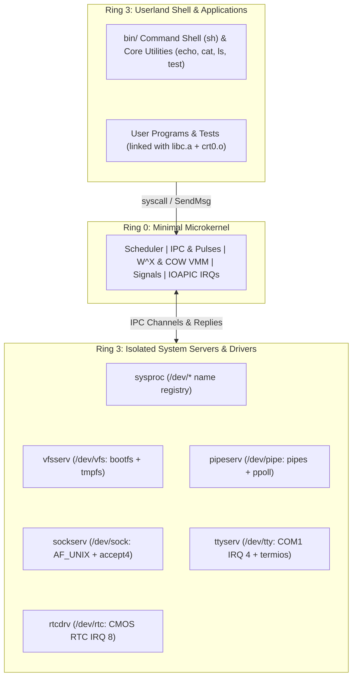

# Microkernel — Freestanding 64-Bit Microkernel

Microkernel is a preemptive, message-passing 64-bit operating system written in
freestanding C17. It currently targets `x86-64`, with future 64-bit ARM
(`arm64`) planned on the [roadmap](docs/records/ROADMAP.md). It is working
toward compatibility with interfaces from **POSIX.1-2024 (IEEE Std 1003.1-2024 /
ISO/IEC/IEEE 9945:2026)** in user space. The Ring 0 kernel stays minimal, while
system servers and applications run as isolated Ring 3 processes that
communicate over synchronous IPC channels.

The project uses a closed **Blueprint -> Fabricator -> Testbed -> Gates** loop
driven by AI engineering agents inside a deterministic **Podman** container
(`microkernel-dev`). Every change moves from traceable specifications to
cross-compiled ISO images, headless QEMU execution, static analysis, and
automated compatibility checks with zero host toolchain drift.

## Development architecture: the closed loop

Traditional operating system development breaks on host toolchain drift and
manual reboot cycles. This repository connects specification, compilation,
hardware emulation, and automated audits into one reproducible loop governed by
[AGENTS.md](AGENTS.md) and [docs/skills/](docs/skills/):



### 1. The Blueprint and bidirectional traceability

Before implementation begins, **POSIX.1-2024 (Issue 8)** and the microkernel ABI
define the system contract inside the Sphinx-Needs traceability model (`docs/`):

- **Microkernel boundary:** Ring 0 provides only boot bring-up, W^X and
  copy-on-write memory management, 256-level priority scheduling, and
  synchronous or scatter-gather IPC. It also handles IOAPIC IRQ pulse routing,
  signals, clocks/timers, futexes, and `syscall`/`sysret`. System servers
  (`sysproc`, `pipeserv`, `vfsserv`, `ttyserv`, `sockserv`, `ipcserv`, `rtcdrv`)
  and POSIX libraries run in isolated Ring 3 processes.
- **Two-tier bidirectional traceability:** Business decisions (`BDR_`),
  architecture and workflow decisions (`ADR_`, `WDR_`), and requirements
  (`SYS_`, `SWR_`) in ASD-STE100 Issue 9 carry `:posix:` links to IEEE Std
  1003.1-2024. Every public header carries an `ICD_` `need::` tag, every source
  module carries a `COMP_` tag, and every test file carries a `VER_` tag.
- **Build-enforced integrity:** `config/sphinx/need_tag_check.py` and
  `tools/traceability/check_needs_audit.py` fail the Sphinx `-W` build on broken
  links or unverified requirements. They also reject untagged active
  `ICD_`/`COMP_`/`VER_` items, untagged test files, and transient `TSK_`/`RDM_`
  IDs in source code. See [WDR_0002](docs/00-overview/wdr/WDR_0002.md),
  [BDR_0003](docs/10-product/bdr/BDR_0003.md),
  [ADR_0003](docs/30-architecture/adr/ADR_0003.md), and the [traceability and
  POSIX.1-2024 progress matrix](docs/60-verification/traceability.md).

### 2. The Fabricator (Podman, LLVM, and four-stage build)

**LLVM** (`clang`, `ld.lld`, `llvm-objdump`) with **CMake** and **Ninja**
(`cmake/clang-x86-64.cmake`, `cmake/arch/x86-64.cmake`) cross-compiles
freestanding C17 and platform assembly. The build runs inside the
`microkernel-dev` Podman image (`Containerfile`) with no host headers or host
libraries in four stages:

1. **Headers:** Public `libc/include/` headers and Clang freestanding headers
   install into `sysroot/usr/include`.
2. **C library:** `libc.a` and `crt0.o` compile against the sysroot into
   `sysroot/usr/lib`.
3. **User space:** Ring 3 servers (`servers/`) and test binaries (`tests/`) link
   statically against `libc.a` and pack into an uncompressed POSIX `ustar`
   archive (`build/boot.tar`).
4. **Kernel and ISO:** `kernel.elf` links at higher-half `0xFFFFFFFF80000000`,
   and `grub-mkrescue` packages `kernel.elf` and `boot.tar` into a bootable
   Multiboot2 ISO (`build/microkernel.iso`).

### 3. The Testbed (headless QEMU serial verification)

**QEMU** (`x86-64` `q35`, Local APIC, IOAPIC, CMOS RTC) boots
`build/microkernel.iso` headlessly inside the container with no KVM requirement.
The Python harness (`tests/test_runner.py`) reads `COM1` serial output and
asserts ordered `[OK]` patterns. The suite tests boot, W^X/COW faults, IPC name
lookup, signals, Ring 3 IRQ 8 driver pulses, clocks/timers, and pthreads/TLS. It
also tests `fork`/`execve`/`pipe2`/`ppoll`, `<aio.h>`, deferred cancellation,
`<stdio.h>` locks, and Issue 8 C17 `libc`. Any kernel panic or missing pattern
exits with code 1.

### 4. Quality gates and the agent workflow

AI agents follow the **Predict -> Act -> Verify** workflow in
[AGENTS.md](AGENTS.md), delegating tool procedures to skills in `docs/skills/`.
Before every commit, `./scripts/build-agent.sh` (and `.git/hooks/pre-commit`,
installed via `./scripts/install-hooks.sh`) enforces seven repository-wide
gates:

1. **Formatting:** `clang-format` across `kernel/`, `libc/`, `servers/`, and
   `tests/` (`./scripts/formatter-agent.sh`).
2. **Source text:** `check_text.py --root .` checks 80-column line limits,
   greedy prose packing, and Doxygen file headers.
3. **Controlled English:** `tools/check_ste.py --root .` checks ASD-STE100 Issue
   9 compliance across `README.md` and `docs/`.
4. **Build and docs:** Four-stage cross-build plus clean Sphinx `-W` HTML build.
5. **Hardware testbed:** Headless QEMU serial suite (`[OK]` assertions).
6. **Static analysis:** `clang-tidy` across all C sources and headers using
   `build/compile_commands.json`.
7. **CTest:** `posix.headers` checks standalone C17 headers under
   `_POSIX_C_SOURCE=202405L` and `_XOPEN_SOURCE=800`. `posix.symbol_diff` runs a
   Clang AST and `llvm-nm` diff against `issue8-manifest.tsv` and writes
   `build/posix-symbol-diff.txt`. That report lists implemented and missing
   POSIX.1-2024 Base headers, interfaces, and XCU utilities. It also lists
   active option groups and exported `libc.a` symbols.
   `posix.async_signal_safe`, `posix.cancellation`, `coverage.unit`,
   `traceability.unit`, `docs.html`, `docs.needs`, and `docs.audit` complete the
   suite.

## Containerized workflow and commands

Your host needs only Podman. The first `./scripts/env.sh` run builds the pinned
`microkernel-dev` image from `Containerfile`.

```bash
# Run the complete closed loop (format, text, STE, build, QEMU, lint, CTest)
./scripts/build-agent.sh

# Or run individual stages inside the Podman container:
./scripts/env.sh build
./scripts/env.sh test --timeout 120 \
    --expect '\[OK\] PMM/VMM/APIC initialized' \
    --expect 'name resolved /dev/echo' \
    --expect 'errno thread-local and preserved across success' \
    --expect 'signal handler entered'
./scripts/env.sh ctest --test-dir build --output-on-failure

# Inspect the generated POSIX.1-2024 header and interface progress report
head -n 20 build/posix-symbol-diff.txt

# Boot Microkernel interactively into the Ring 3 command shell (Ctrl-A X exits)
./scripts/env.sh run

# Generate on-demand LLVM HTML, LCOV, and text coverage in build-cov/coverage/
./scripts/env.sh coverage

# Open a development bash shell inside the Podman container
./scripts/enter-dev.sh
```

### Running Microkernel interactively in QEMU

Build the OS image once and launch an interactive serial session straight into
the Ring 3 command shell (`/boot/sh`):

```bash
./scripts/env.sh build
./scripts/env.sh run
```

`./scripts/env.sh run` builds `build/microkernel-shell.iso` with the Multiboot2
command line `init=sh`. It starts the Ring 3 system servers (`sysproc`,
`ttyserv`, `pipeserv`, `vfsserv`, `sockserv`, `rtcdrv`) plus `/boot/sh` and
connects `COM1` to your terminal (`-serial mon:stdio`). Once the `$ ` prompt
appears, you can run POSIX commands directly:

```sh
ls /boot
echo hello microkernel > /tmp/note.txt && cat /tmp/note.txt
cd /tmp && pwd
set -o pipefail; /boot/false | /boot/true; echo $?
```

Press `Ctrl-A` followed by `X` to exit QEMU cleanly. If `qemu-system-x86_64` is
installed directly on your host, you can also boot `build/microkernel-shell.iso`
without Podman:

```bash
qemu-system-x86_64 -machine q35 -cpu max -m 256M -smp 2 \
    -cdrom build/microkernel-shell.iso -serial mon:stdio -display none \
    -no-reboot
```

For full build and container procedures, see the [cmake
skill](docs/skills/cmake/SKILL.md) and the [dev-environment
skill](docs/skills/dev-environment/SKILL.md).

## System services

The kernel supplies these services:

- preemptive multi-core SMP scheduling of threads with 256 priority levels, ACPI
  `MADT` secondary CPU bring-up, per-CPU `GS.base` state, ticket spinlocks, and
  reschedule plus TLB shootdown IPIs
- synchronous and scatter-gather IPC with channels, connections, replies, and
  pulses
- threads, `FS.base` TLS, futexes, monotonic/realtime clocks, interval timers,
  and signals with user handlers
- memory management with four-level page tables, copy-on-write, and W^X policy
- IOAPIC IRQ-to-IPC pulse routing and `CAP_SYS_INTR`-gated port I/O
- fast system calls with the `syscall`/`sysret` instructions
- `x86-64-v3` minimum CPU verification (`AVX`, `AVX2`, `FMA`, `BMI1`, `BMI2`),
  `XSAVE`/`XRSTOR` per-thread vector state switching, and optional `AVX-512`
  detection (Ring 3 builds with `-march=x86-64-v3` while Ring 0 stays scalar)

W^X means: the system maps a page as writable or as code, but not the two
together.

The process `sysproc` is the first user process. It contains the name registry
of the system. Servers (`pipeserv`, `vfsserv`, `ttyserv`, `sockserv`, `ipcserv`,
`rtcdrv`) register a name with `sysproc`, and clients resolve endpoints by name.



## User-space functionality (current support)

User space is an ongoing effort working toward POSIX.1-2024 (`IEEE Std
1003.1-2024`) compatibility under [BDR_0003](docs/10-product/bdr/BDR_0003.md)
and [BDR_0004](docs/10-product/bdr/BDR_0004.md). The summary below describes
what interactive users and C17 programmers can do today.

### For interactive shell users

Booting with `./scripts/env.sh run` drops you into `/boot/sh` over the serial
terminal (`ttyserv`) with foreground `Ctrl-C` job control:

- **Run scripts and command pipelines:** Chain commands with pipes, redirections
  (`<`, `>`, `>>`, `2>&1`), `&&`/`||`/`;`, environment variables, and built-ins
  (`cd`, `pwd`, `export`, `unset`, `read`, `set`, `umask`, `ulimit`, `wait`,
  `exit`). The shell also targets Issue 8 `$'...'` quoting, `set -o pipefail`,
  and `read -d` with custom or NUL delimiters.
- **Work with read-only, temporary, and persistent files:** List, inspect, copy,
  move, link, and remove files across `/boot` (`/bin`), `/tmp` (`tmpfs`), and
  persistent disk storage at `/mnt` (`ext2` over `virtio-blk`). Manage file
  modes, ownership, links, FIFOs, and disk usage with standard XCU utilities
  (such as `ls`, `chmod`, `ln`, `mkfifo`, `df`, `du`, and `dd`).
- **Inspect and control processes, timing, credentials, and terminals:** View
  live processes with `ps` and check identity with `id` and `logname`. Adjust
  priority with `nice` and `renice`, and control execution with `sleep`, `time`,
  `timeout`, and `nohup`. Query POSIX limits with `getconf`, check system
  details with `uname` and `env`, and adjust terminal modes with `tty` and
  `stty`. Work with locales, character-set conversion, and message catalogs
  using `locale`, `localedef`, `iconv`, `gencat`, `msgfmt`, `gettext`, and
  `ngettext`.

### For C17 application programmers

You can write portable, standalone C17 programs packed into `boot.tar` and run
them in isolated Ring 3 address spaces across multiple CPU cores:

- **Processes, credentials, threads, signals, and timing:** Spawn processes with
  `fork`, `_Fork`, `execl*`, `execv*`, `fexecve`, `popen`/`pclose`, and
  `system`, and reap or inspect state with `waitpid` and `waitid`. Manage
  UIDs/GIDs, `<pwd.h>`/`<grp.h>`, and `<sys/resource.h>` limits. Run
  multithreaded code with pthreads (robust mutexes and `pthread_atfork`) and ISO
  C17 `<threads.h>`. Synchronize with unnamed and named semaphores, `sched_*`
  helpers, deferred cancellation, and thread-local `errno`. Use Base signals
  (`sigaction`, `sigsuspend`, `sigwait*`, `sigqueue`, `sig2str`/`str2sig`,
  `pause`), monotonic/realtime clocks, timers, and `<time.h>` calendar functions
  (`gmtime*`, `localtime*`, `mktime`, `strftime`, `tzset`/`tzname`, `clock`,
  `timespec_get`).
- **Files, links, FIFOs, IPC, terminals, and event loops:** Use buffered,
  wide-oriented, and memory-backed `<stdio.h>`/`<wchar.h>` streams (`fmemopen`,
  `open_memstream`, `open_wmemstream`, `freopen`, `fwide`, `*wprintf`,
  `*wscanf`, `scanf*`, `getline`, `dprintf`, `asprintf`, `fgetpos`/`fsetpos`).
  Use permissions, nanosecond timestamps (`futimens`, `utimensat`), hard and
  symbolic links, FIFOs, positional I/O, directory traversal (`posix_getdents`,
  `scandir`), `<sys/statvfs.h>`, and temp-file helpers. Communicate over pipes,
  `AF_UNIX` sockets, `<aio.h>`, and `<termios.h>`, and multiplex descriptors
  across servers with `poll`, `ppoll`, `select`, or `pselect`.
- **Memory, math, and standard C utilities:** Allocate memory from an
  `mmap`-backed coalescing heap (`malloc`, `aligned_alloc`, `reallocarray`), map
  shared memory (`shm_open`), enforce W^X page protections, or lock pages in RAM
  (`mlock`). Compute with `<fenv.h>`, `<math.h>`, `<complex.h>`, and
  `<tgmath.h>` compiled for `x86-64-v3` with hardware `FMA`. Locale, i18n, and
  wide text support covers `<locale.h>` (`C`/`C.UTF-8`, per-thread `uselocale`,
  `*_l` helpers), `<langinfo.h>`, `<monetary.h>`, `<iconv.h>`, `<nl_types.h>`,
  `<libintl.h>`, UTF-8 multibyte conversions, `<wctype.h>`, and `<wchar.h>`.
  Other helpers include `strtod*`, `quick_exit`, `qsort_r`, `getsubopt`,
  `stpcpy`/`memmem`/`strerror_r`, `getopt`, `fnmatch`, `<regex.h>`, `<glob.h>`,
  `<wordexp.h>`, `<tar.h>`, `<cpio.h>`, `<dlfcn.h>` (`ET_DYN` W^X dynamic
  loading), `setjmp`, `realpath`, `<stdatomic.h>`, and `<uchar.h>`.

### For system server and driver authors

Native microkernel headers (`<sys/ipc.h>`, `<sys/intr.h>`, `<sys/proc.h>`,
`<sys/thread.h>`, `<sys/vm.h>`, `<sys/blk.h>`) let you build isolated Ring 3 OS
services outside the kernel:

- Register named services with `sysproc` and handle synchronous or
  scatter-gather client messages and pulses across 256 priority levels with
  priority inheritance.
- Build privileged hardware drivers (`CAP_SYS_INTR`) with IOAPIC IRQ-to-IPC
  pulses, port I/O, MMIO mapping, DMA buffers, and PCI configuration access (as
  used by `rtcdrv`, `ttyserv`, and `blkdrv`).

### Exact inventory and what is next

- **Exact symbol and utility inventory:** Run `./scripts/env.sh ctest -R
  posix.symbol_diff` and open `build/posix-symbol-diff.txt` for the live list of
  POSIX.1-2024 Base headers, functions, and XCU utilities. See also the
  [traceability matrix](docs/60-verification/traceability.md).
- **Not available yet (planned next):** Remaining XCU shell grammar and
  utilities, and Ring 3 TCP/IP networking (`<netdb.h>`, `<netinet/in.h>`,
  `<arpa/inet.h>`, `<net/if.h>`, `<netinet/tcp.h>`). See
  [docs/records/TASKS.md](docs/records/TASKS.md) and
  [docs/records/ROADMAP.md](docs/records/ROADMAP.md).

## Source tree

- `kernel/` — Ring 0 kernel: boot code, platform HAL, and core subsystems
- `libc/` — freestanding C17 and POSIX.1-2024 user-space C library
- `servers/` — Ring 3 system servers (`sysproc`, `pipeserv`, `vfsserv`,
  `ttyserv`, `sockserv`, `ipcserv`, `rtcdrv`)
- `bin/` — Ring 3 command shell (`sh`) and core utilities (`echo`, `cat`, `ls`,
  `true`, `false`, `test`) targeting POSIX.1-2024 XCU interfaces
- `tests/` — QEMU harness (`test_runner.py`), Ring 3 tests (`ipccli`, `sigtest`,
  `proctest`, `drvtest`, `timetest`, `pthreadtest`, `forkpipetest`,
  `exechelper`, `aiotest`, `canceltest`, `libctest`, `heaptest`, `vfstest`,
  `shmtest`, `ttytest`, `stdiotest`, `socktest`, `shtest`), `posix/`, and
  `traceability/`
- `config/sphinx/`, `tools/` — Sphinx-Needs traceability model, tag scanner,
  auditor, and repository STE gate
- `scripts/` — container, build, format, hook, and `boot.tar` helper scripts
- `docs/` — Sphinx-Needs requirements, architecture, decisions, records, and
  agent skills
- `iso/` — GRUB Multiboot2 boot configuration
- `cmake/` — Clang cross-compilation toolchain for CMake
- `Containerfile` — reproducible Podman build and QEMU container definition

## Code rules

The kernel and the library use freestanding C17 with warnings as errors. Kernel
code runs without a C runtime and maps code read-only (W^X). The kernel never
dereferences user pointers directly. It validates page permissions and copies
through the physical direct map (HHDM) with SMAP active. File naming, source
text, ASD-STE100, traceability, and copyright rules live in
[docs/records/CONVENTIONS.md](docs/records/CONVENTIONS.md).

## Status

See [docs/records/TASKS.md](docs/records/TASKS.md) and
[docs/records/HISTORY.md](docs/records/HISTORY.md) for the milestone plan and
task records. The build completed milestones 1 to 6, POSIX clocks/timers,
pthreads/semaphores, and `fork`/`execve`/`pipe2`/`dup3`/`ppoll`. It also
completed `<aio.h>`, cancellation points, `<stdio.h>` locking, and Issue 8 C17
library functions. Recent milestones added the 4-gate POSIX harness,
`mmap`-backed heap reclamation, Ring 3 VFS (`bootfs`/`tmpfs`), and option-gated
`SHM`/`ML`/`MLR`. They also added Ring 3 COM1 TTY (`<termios.h>`), buffered
`<stdio.h>`, `setenv`/`unsetenv`, `execvp`, and core C17/POSIX headers.

Latest milestones added Ring 3 `AF_UNIX` local sockets (`accept4`), the Ring 3
command shell (`sh`) with job control, and `<sys/select.h>` leak-freedom stress
tests. They also added ACPI `MADT`/`SPCR` driver discovery, `x86-64` HAL
isolation, and opt-in LLVM coverage (`./scripts/env.sh coverage`). The newest
milestones enforce `x86-64-v3` with `XSAVE`/`XRSTOR`, add `<fenv.h>` and
`<math.h>` with `FMA`, and mount persistent `ext2` (`/mnt`) over Ring 3
`virtio-blk` (`/dev/blk`).

## Documentation

- [AGENTS.md](AGENTS.md): governance for AI agents (commit mode, workflow,
  pre-commit checklist)
- [docs/index.md](docs/index.md): the Sphinx-Needs requirements, architecture,
  and POSIX.1-2024 traceability model
- [docs/00-overview/context.md](docs/00-overview/context.md): system overview,
  directory structure, and integration points
- [docs/records/CONVENTIONS.md](docs/records/CONVENTIONS.md): file names, source
  text, ASD-STE100, traceability, and copyright rules
- [docs/30-architecture/adr/index.md](docs/30-architecture/adr/index.md),
  [docs/10-product/bdr/index.md](docs/10-product/bdr/index.md), and
  [docs/00-overview/wdr/index.md](docs/00-overview/wdr/index.md): architecture,
  business, and workflow decision records
- [docs/records/TASKS.md](docs/records/TASKS.md),
  [docs/records/ROADMAP.md](docs/records/ROADMAP.md), and
  [docs/records/HISTORY.md](docs/records/HISTORY.md): active tasks, roadmap, and
  completed milestones
- [docs/60-verification/qemu-harness.md](docs/60-verification/qemu-harness.md):
  headless QEMU test harness architecture, boot modes, and failure triage
- Skills:
  - [cmake](docs/skills/cmake/SKILL.md) — build, test, and user programs
  - [qemu-debug](docs/skills/qemu-debug/SKILL.md) — QEMU failure triage, monitor
    inspection, and kernel symbolization
  - [clang-format](docs/skills/clang-format/SKILL.md) — code formatting
  - [clang-tidy](docs/skills/clang-tidy/SKILL.md) — static analysis
  - [dev-environment](docs/skills/dev-environment/SKILL.md) — the container
    environment
  - [git](docs/skills/git/SKILL.md) — commits and branches
  - [state-management](docs/skills/state-management/SKILL.md) — tasks, history,
    decisions, notices
  - [keepachangelog](docs/skills/keepachangelog/SKILL.md) — the changelog format
  - [create-skill](docs/skills/create-skill/SKILL.md) — new agent skills

## License and trademarks

The MIT License governs this project. See [LICENSE.md](LICENSE.md).

Copyright (c) 2026 Deniz Eren <deniz.eren@outlook.com>

POSIX® is a registered trademark of the Institute of Electrical and Electronic
Engineers, Inc.

This project is an independent work in progress aiming to follow interfaces from
POSIX.1-2024 (IEEE Std 1003.1-2024 / ISO/IEC/IEEE 9945:2026) and is not
officially certified.

For third-party attributions, see
[docs/THIRD-PARTY-NOTICES.md](docs/THIRD-PARTY-NOTICES.md).
