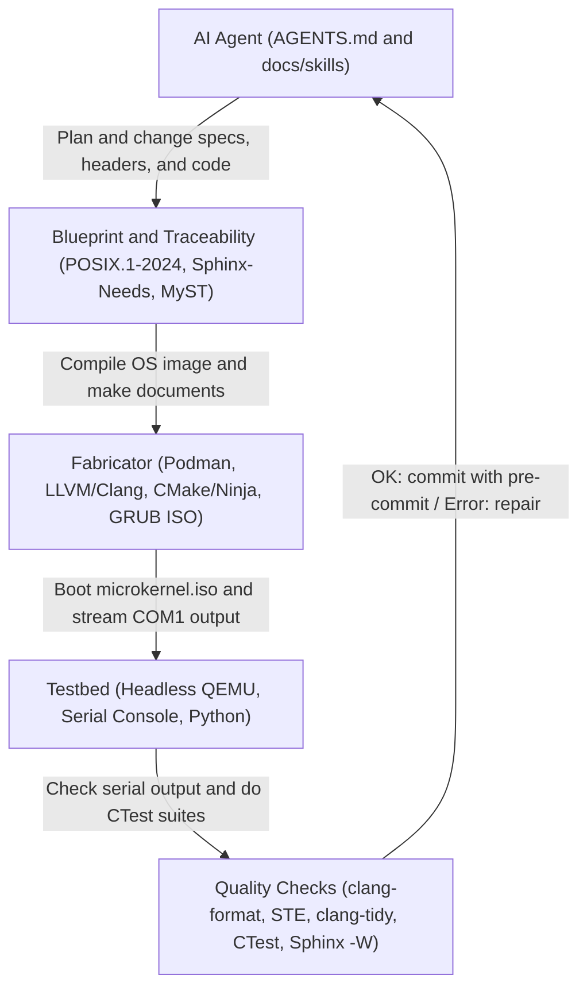
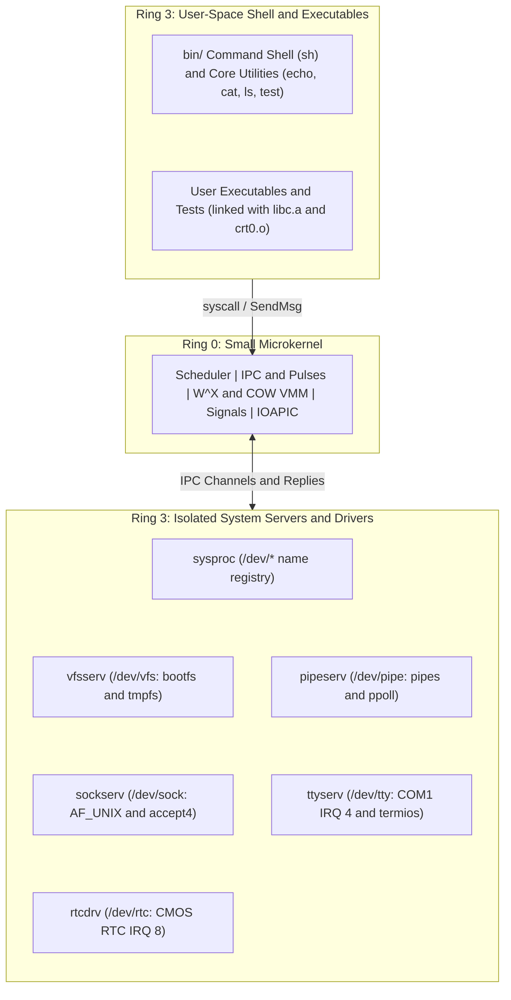

# Microkernel — Freestanding 64-Bit Microkernel

Microkernel is a preemptive 64-bit operating system in freestanding C17. At this
time, it targets `x86-64`, with future 64-bit ARM (`arm64`) on the
[roadmap](docs/records/ROADMAP.md). User space targets compatibility with
interfaces from **POSIX.1-2024 (IEEE Std 1003.1-2024 / ISO/IEC/IEEE
9945:2026)**. The Ring 0 kernel stays small. System servers and executables
operate as isolated Ring 3 processes that communicate through synchronous IPC
channels.

The project uses a closed **Blueprint -> Fabricator -> Testbed -> Checks** loop.
AI agents operate this loop in a repeatable **Podman** container
(`microkernel-dev`). Each change moves from traceable specifications to
target-compiled ISO images, headless QEMU tests, static analysis, and automatic
compatibility checks with no host toolchain change.

## Development architecture: the closed loop

Traditional operating system development stops on host toolchain changes and
manual reboot cycles. This repository connects specification, compilation,
hardware emulation, and automatic checks into one repeatable loop controlled by
[AGENTS.md](AGENTS.md) and [docs/skills/](docs/skills/):



### 1. The Blueprint and bidirectional traceability

Before code work starts, **POSIX.1-2024 (Issue 8)** and the microkernel ABI set
the system interface in the Sphinx-Needs traceability model (`docs/`):

- **Microkernel boundary:** Ring 0 gives only boot initialization, W^X and
  copy-on-write memory management, 256-level priority scheduling, and
  synchronous or scatter-gather IPC. It also gives IOAPIC IRQ pulses, signals,
  clocks, timers, futexes, and `syscall`/`sysret`. System servers (`sysproc`,
  `pipeserv`, `vfsserv`, `ttyserv`, `sockserv`, `ipcserv`, `rtcdrv`, `blkdrv`,
  `netserv`) and POSIX libraries operate in isolated Ring 3 processes.
- **Two-tier bidirectional traceability:** Business decisions (`BDR_`),
  architecture and workflow decisions (`ADR_`, `WDR_`), and requirements
  (`SYS_`, `SWR_`) have `:posix:` links to IEEE Std 1003.1-2024. Each public
  header has an `ICD_` `need::` marker. Each source module has a `COMP_` marker.
  Each test file has a `VER_` marker.
- **Build-enforced integrity:** `config/sphinx/need_tag_check.py` and
  `tools/traceability/check_needs_audit.py` stop the Sphinx `-W` build on broken
  links or requirements without tests. They also reject untagged active `ICD_`,
  `COMP_`, and `VER_` items, untagged test files, and temporary `TSK_` or `RDM_`
  IDs in source code. Refer to [WDR_0002](docs/00-overview/wdr/WDR_0002.md),
  [BDR_0003](docs/10-product/bdr/BDR_0003.md),
  [ADR_0003](docs/30-architecture/adr/ADR_0003.md), and the [traceability and
  POSIX.1-2024 status matrix](docs/60-verification/traceability.md).

### 2. The Fabricator (Podman, LLVM, and four-step build)

**LLVM** (`clang`, `ld.lld`, `llvm-objdump`) with **CMake** and **Ninja**
(`cmake/clang-x86-64.cmake`, `cmake/arch/x86-64.cmake`) compiles freestanding
C17 and platform assembly for the target. The build operates in the
`microkernel-dev` Podman image (`Containerfile`) with no host headers or host
libraries in four steps:

1. **Headers:** CMake installs public `libc/include/` headers and Clang
   freestanding headers into `sysroot/usr/include`.
2. **C library:** CMake compiles `libc.a` and `crt0.o` against the sysroot into
   `sysroot/usr/lib`.
3. **User space:** CMake links Ring 3 servers (`servers/`) and test executables
   (`tests/`) statically against `libc.a` and puts them into an uncompressed
   POSIX `ustar` archive (`build/boot.tar`).
4. **Kernel and ISO:** CMake links `kernel.elf` at higher-half
   `0xFFFFFFFF80000000`. Then `grub-mkrescue` puts `kernel.elf` and `boot.tar`
   into a bootable Multiboot2 ISO (`build/microkernel.iso`).

### 3. The Testbed (headless QEMU serial tests)

**QEMU** (`x86-64` `q35`, Local APIC, IOAPIC, CMOS RTC) boots
`build/microkernel.iso` headless in the container with no KVM requirement. The
Python harness (`tests/test_runner.py`) reads `COM1` serial output and makes
sure that ordered `[OK]` patterns show. The test suite does tests for boot, W^X
and COW page faults, IPC name lookup, and signals. It also does tests for Ring 3
IRQ 8 driver pulses, clocks, timers, pthreads, and TLS. It also does tests for
`fork`, `execve`, `pipe2`, `ppoll`, `<aio.h>`, deferred cancellation,
`<stdio.h>` mutexes, and Issue 8 C17 `libc`. A kernel panic or a missing pattern
gives exit code 1.

### 4. Quality checks and the agent workflow

AI agents obey the **Plan -> Do -> Check** workflow in [AGENTS.md](AGENTS.md)
and refer to tool procedures in `docs/skills/`. Before each commit,
`./scripts/build-agent.sh` (and `.git/hooks/pre-commit`, installed with
`./scripts/install-hooks.sh`) does seven repository-wide checks:

1. **Format:** `clang-format` across `kernel/`, `libc/`, `servers/`, and
   `tests/` (`./scripts/formatter-agent.sh`).
2. **Source text:** `check_text.py --root .` examines 80-column line limits,
   greedy prose layout, and Doxygen file headers.
3. **Technical text (optional):** `tools/check_ste.py --root .` does STE checks
   with `ste-writing-skill` across `README.md` and `docs/` when installed, and
   skips without error when missing.
4. **Build and documents:** Four-step target build with a clean Sphinx `-W` HTML
   build.
5. **Hardware testbed:** Headless QEMU serial suite (`[OK]` checks).
6. **Static analysis:** `clang-tidy` across all C sources and headers with
   `build/compile_commands.json`.
7. **CTest:** `posix.headers` examines standalone C17 headers with
   `_POSIX_C_SOURCE=202405L` and `_XOPEN_SOURCE=800`. `posix.symbol_diff`
   compares Clang AST and `llvm-nm` output against `issue8-manifest.tsv` and
   writes `build/posix-symbol-diff.txt`. That report shows added and missing
   POSIX.1-2024 Base headers, interfaces, and XCU utilities. It also shows
   active option groups and exported `libc.a` symbols.
   `posix.async_signal_safe`, `posix.cancellation`, `coverage.unit`,
   `traceability.unit`, `docs.html`, `docs.needs`, and `docs.audit` complete the
   suite.

## Container workflow and commands

Your host must have only Podman. The first `./scripts/env.sh` command makes the
pinned `microkernel-dev` image from `Containerfile`.

```bash
# Do the full closed loop (format, text, STE, build, QEMU, lint, CTest)
./scripts/build-agent.sh

# Or do individual steps in the Podman container:
./scripts/env.sh build
./scripts/env.sh test --timeout 120 \
    --expect '\[OK\] PMM/VMM/APIC initialized' \
    --expect 'name resolved /dev/echo' \
    --expect 'errno thread-local and preserved across success' \
    --expect 'signal handler entered'
./scripts/env.sh ctest --test-dir build --output-on-failure

# Examine the POSIX.1-2024 header and interface progress report
head -n 20 build/posix-symbol-diff.txt

# Boot Microkernel interactively into the Ring 3 command shell (Ctrl-A X exits)
./scripts/env.sh run

# Make on-demand LLVM HTML, LCOV, and text coverage in build-cov/coverage/
./scripts/env.sh coverage

# Open a development bash shell in the Podman container
./scripts/enter-dev.sh
```

### Start Microkernel interactively in QEMU

Make the OS image one time and start an interactive serial session directly in
the Ring 3 command shell (`/boot/sh`):

```bash
./scripts/env.sh build
./scripts/env.sh run
```

`./scripts/env.sh run` makes `build/microkernel-shell.iso` with the Multiboot2
command line `init=sh`. It starts the Ring 3 system servers (`sysproc`,
`ttyserv`, `pipeserv`, `vfsserv`, `sockserv`, `rtcdrv`, `blkdrv`, `netserv`) and
`/boot/sh`, and connects `COM1` to your terminal (`-serial mon:stdio`). It
forwards localhost TCP ports (`2222:22,8080:8080`) into the VM and starts
OpenSSH `sshd` automatically through `/boot/sshd-setup` on guest port 22. You
can change the port set with `MICROKERNEL_NET_PORTS` (or `none`). After `[OK]
sshd listening on port 22` and the `$ ` shell marker show, you can type commands
on the serial console or connect from the host through SSH:

```sh
# In the Microkernel serial console:
ls /boot
echo hello microkernel > /tmp/note.txt && cat /tmp/note.txt
ping -c 2 10.0.2.2
nc -l 8080   # connect from host: nc 127.0.0.1 8080
```

```bash
# From another terminal on your host (dev password: microkernel):
ssh -p 2222 -o StrictHostKeyChecking=no -o UserKnownHostsFile=/dev/null \
    root@127.0.0.1
```

To use public-key login as an alternative to the password, add your Ed25519,
ECDSA, or RSA host public key to `/mnt/root/.ssh/authorized_keys` (`chmod 600`)
in the VM. Host keys and `/mnt/etc/ssh` stay in `build/disk.img`.

Push `Ctrl-A` then `X` to stop QEMU cleanly. If `qemu-system-x86_64` is
installed directly on your host, you can also boot `build/microkernel-shell.iso`
without Podman:

```bash
qemu-system-x86_64 -machine q35 -cpu max -m 256M -smp 2 \
    -cdrom build/microkernel-shell.iso -serial mon:stdio -display none \
    -no-reboot
```

For full build and container procedures, refer to the [cmake
skill](docs/skills/cmake/SKILL.md) and the [dev-environment
skill](docs/skills/dev-environment/SKILL.md).

## System services

The kernel gives these services:

- preemptive multi-core SMP scheduling of threads with 256 priority levels, ACPI
  `MADT` secondary CPU startup, CPU-local `GS.base` state, ticket spinlocks, and
  reschedule and TLB shootdown IPIs
- synchronous and scatter-gather IPC with channels, connections, replies, and
  pulses
- threads, `FS.base` TLS, futexes, monotonic and realtime clocks, interval
  timers, and signals with user handlers
- memory management with four-level page tables, copy-on-write, and W^X rules
- IOAPIC IRQ-to-IPC pulses and `CAP_SYS_INTR`-gated port I/O
- fast syscalls with the `syscall`/`sysret` instructions
- `x86-64-v3` minimum CPU checks (`AVX`, `AVX2`, `FMA`, `BMI1`, `BMI2`),
  `XSAVE`/`XRSTOR` vector state changes for each thread, and optional `AVX-512`
  checks (Ring 3 compiles with `-march=x86-64-v3`, but Ring 0 stays scalar)

W^X means: the system maps a page as writable or as code, not the two together.

The process `sysproc` is the first user process. It keeps the name registry of
the system. Servers (`pipeserv`, `vfsserv`, `ttyserv`, `sockserv`, `ipcserv`,
`rtcdrv`) record a name with `sysproc`, and clients find endpoints by name.



## User-space functions (active status)

User space is an active project that targets POSIX.1-2024 (`IEEE Std
1003.1-2024`) compatibility with [BDR_0003](docs/10-product/bdr/BDR_0003.md) and
[BDR_0004](docs/10-product/bdr/BDR_0004.md). The summary that follows tells what
interactive users and C17 authors can do at this time.

### For interactive shell users

`./scripts/env.sh run` boots into `/boot/sh` on the serial terminal (`ttyserv`)
with foreground `Ctrl-C` job control:

- **Operate scripts and command pipelines:** Write POSIX.1-2024 scripts with
  `if`, `elif`, `else`, `for`, `while`, `until`, `case`, subshells, `{ ... }`
  groups, and functions. Use `$(...)` command substitution, `$((...))` math,
  parameter expansion, here-documents (`<<`, `<<-`), `<glob.h>` pattern match,
  and `trap`. Use standard built-ins (`.`, `:`, `alias`, `unalias`, `cd`,
  `command`, `eval`, `exec`, `exit`, `export`, `getopts`, `hash`, `pwd`, `read`,
  `readonly`, `return`, `set`, `shift`, `times`, `ulimit`, `umask`, `unset`,
  `wait`). The shell also targets Issue 8 `$'...'` syntax, `set -o pipefail`,
  and `read -d` with custom or NUL delimiters.
- **Operate on read-only, temporary, and disk-backed files:** Examine, copy,
  move, link, and remove files across `/boot` (`/bin`), `/tmp` (`tmpfs`), and
  disk-backed storage at `/mnt` (`ext2` on `virtio-blk`). Change file modes,
  ownership, links, FIFOs, and disk space with standard XCU utilities (for
  example `ls`, `chmod`, `ln`, `mkfifo`, `df`, `du`, `dd`, `find`, `xargs`).
  Find, change, sort, and select text streams with `grep`, `sed`, `awk`, `ed`,
  `sort`, `uniq`, `cut`, `tr`, `tail`, `tee`, `paste`, `join`, `expr`, and
  `printf`. Divide, format, calculate, and expand macros with `split`, `csplit`,
  `fold`, `expand`, `unexpand`, `pr`, `bc`, and `m4`. Compare, patch, archive,
  examine, and checksum files with `diff`, `cmp`, `comm`, `patch`, `pax`,
  `file`, `strings`, `tsort`, and `cksum`. Encode and decode files with
  `uuencode` and `uudecode`.
- **Connect through TCP/IP and OpenSSH:** Operate `ping` and `nc` (`-l`, `-k`,
  `-e`, `-u`) through Ring 3 `netserv` (`virtio-net`). Interactive `init=sh`
  boot starts `/boot/sshd-setup` to prepare `/mnt/etc/ssh` and make Ed25519,
  ECDSA, and RSA host keys with `/boot/ssh-keygen`. It then starts OpenSSH
  Portable `/boot/sshd` (linked with sysroot OpenSSL `3.0.15` and `zlib 1.3.1`)
  on TCP port 22 for RSA, ECDSA, Ed25519, compressed (`zlib@openssh.com`),
  password, and PTY logins.
- **Examine and control processes, clocks, credentials, and terminals:** Show
  active processes with `ps` and examine identity with `id` and `logname`. Set
  priority with `nice` and `renice`, and control execution with `sleep`, `time`,
  `timeout`, and `nohup`. Read POSIX limits with `getconf`, look up NSS entries
  with `getent`, and show system data with `uname` and `env`. Set terminal modes
  with `tty`, `stty`, `tput`, and `tabs`. Record messages, change groups, and
  send user messages with `logger`, `newgrp`, `mesg`, and `write`. Schedule
  jobs, spool print output, and send local mail with `at`, `batch`, `crontab`,
  `lp`, and `mailx`. Use locales, time zones, and message catalogs with
  `locale`, `localedef`, `iconv`, `gencat`, `msgfmt`, `gettext`, `ngettext`,
  `zic`, `zdump`, and `tzselect`. Create and extract `.tar` and `.tar.gz`
  archives with `tar`.

### For C17 software authors

You can write standalone C17 executables in `boot.tar` and operate them in
isolated Ring 3 address spaces across more than one CPU core:

- **Processes, credentials, threads, signals, and clocks:** Start processes with
  `fork`, `_Fork`, `execl*`, `execv*`, `fexecve`, `popen`, `pclose`, and
  `system`. Reap or examine status with `waitpid` and `waitid`. Set UIDs/GIDs
  (`setreuid`, `setregid`, `setresuid`, `setresgid`, `initgroups`), `<pwd.h>`
  and `<grp.h>` iterators, `crypt`, `daemon`, `chroot`, `<syslog.h>`, and
  `<sys/resource.h>` limits (`getrusage`). Operate multithreaded code with
  pthreads (robust mutexes and `pthread_atfork`) and ISO C17 `<threads.h>`.
  Coordinate threads with unnamed and named semaphores, `sched_*` helpers,
  deferred cancellation, and thread-local `errno`. Use Base signals
  (`sigaction`, `sigsuspend`, `sigwait*`, `sigqueue`, `sig2str`, `str2sig`,
  `pause`), monotonic and realtime clocks, timers, and `<time.h>` calendar
  functions (`gmtime*`, `localtime*`, `mktime`, `strftime`, `tzset`, `tzname`,
  `clock`, `timespec_get`).
- **Files, links, FIFOs, IPC, terminals, and event loops:** Use buffered,
  wide-oriented, and memory-backed `<stdio.h>` and `<wchar.h>` streams
  (`fmemopen`, `open_memstream`, `open_wmemstream`, `freopen`, `fwide`,
  `*wprintf`, `*wscanf`, `scanf*`, `getline`, `dprintf`, `asprintf`, `fgetpos`,
  `fsetpos`). Use permissions, nanosecond timestamps (`futimens`, `utimensat`),
  hard and symbolic links, FIFOs, positional I/O, directory reads
  (`posix_getdents`, `scandir`), `<sys/statvfs.h>`, and temp-file helpers.
  Communicate through pipes and `AF_UNIX`, `AF_INET`, and `AF_INET6` sockets
  (`sendmsg` and `recvmsg` with Ring 3 `SCM_RIGHTS` FD send, `sockatmark`). Use
  `<netinet/in.h>`, `<netinet/tcp.h>`, `<arpa/inet.h>`, `<net/if.h>`,
  `<netdb.h>` (`getaddrinfo`, `getnameinfo`, `get*ent`), `<aio.h>`,
  `<sys/uio.h>`, and `<sys/time.h>`. Open `/dev/null`, `/dev/zero`,
  `/dev/urandom`, Ring 3 PTYs (`/dev/ptmx`, `/dev/pts/N`, `<sys/ioctl.h>`), and
  `<termios.h>`. Poll descriptors across servers with `poll`, `ppoll`, `select`,
  or `pselect`.
- **Memory, math, and standard C utilities:** Allocate memory from an
  `mmap`-backed heap (`malloc`, `aligned_alloc`, `reallocarray`), map shared
  memory (`shm_open`), apply W^X page permissions, or lock pages in RAM
  (`mlock`). Calculate with `<fenv.h>`, `<math.h>`, `<complex.h>`, and
  `<tgmath.h>` compiled for `x86-64-v3` with hardware `FMA`. Locale, i18n, and
  wide text interfaces include `<locale.h>` (`C` and `C.UTF-8`, thread-local
  `uselocale`, `*_l` helpers), `<langinfo.h>`, `<monetary.h>`, `<iconv.h>`,
  `<nl_types.h>`, `<libintl.h>`, UTF-8 multibyte conversions, `<wctype.h>`, and
  `<wchar.h>`. Other helpers include `strtod*`, `quick_exit`, `qsort_r`,
  `getsubopt`, `stpcpy`, `memmem`, `strerror_r`, `getopt`, `fnmatch`,
  `<regex.h>`, `<glob.h>`, `<wordexp.h>`, `<tar.h>`, `<cpio.h>`, `<dlfcn.h>`
  (`ET_DYN` W^X dynamic load), `setjmp`, `realpath`, `<stdatomic.h>`, and
  `<uchar.h>`.
- **Dynamic ELF loader and sysroot libraries:** Link executables dynamically
  with `PT_INTERP=/boot/ld.so`. The freestanding Ring 3 dynamic linker reads
  `DT_NEEDED` shared libraries from `/dev/vfs` (in `LD_LIBRARY_PATH`,
  `/etc/ld.so.conf`, then `/boot`, `/lib`, and `/usr/lib`), applies `R_X86_64_*`
  relocations, obeys W^X, and starts `DT_INIT_ARRAY` constructors. Use
  `/usr/bin/ldd` (symlink to `/boot/ld.so`) or `LD_TRACE_LOADED_OBJECTS=1` to
  trace dependencies, and `/usr/sbin/ldconfig` to keep `DT_SONAME` symlinks.
  Link dynamically against shared `libc.so` (soname `libc.so`, included in the
  boot image). Dynamic executables send `dlopen`, `dlsym`, `dlclose`, and
  `dladdr` calls to `/boot/ld.so` through weak `ldso_*` exports. Link sysroot
  `zlib` (`libz.a`, shared `libz.so.1` with `libz.so` symlink, `<zlib.h>`) for
  DEFLATE and gzip compression. Link sysroot OpenSSL `3.0.15` (`libcrypto.a`,
  `libssl.a`, shared `libcrypto.so.3` and `libssl.so.3` with `libcrypto.so` and
  `libssl.so` symlinks, `<openssl/*.h>`) for SHA-256, AES-GCM, RSA, ECDSA,
  Ed25519, X.509, and TLS 1.3.

### For system server and driver authors

Native microkernel headers (`<sys/ipc.h>`, `<sys/intr.h>`, `<sys/proc.h>`,
`<sys/thread.h>`, `<sys/vm.h>`, `<sys/blk.h>`, `<sys/net.h>`) let you make
isolated Ring 3 OS services external to the kernel:

- Record named services with `sysproc` and process synchronous or scatter-gather
  client messages and pulses across 256 priority levels with priority
  inheritance.
- Make privileged hardware drivers (`CAP_SYS_INTR`) with IOAPIC IRQ-to-IPC
  pulses, port I/O, MMIO maps, DMA buffers, and PCI configuration access (as in
  `rtcdrv`, `ttyserv`, `blkdrv`, and `netserv`).
- Use `/dev/net` (`netserv`) for PCI `virtio-net` Ethernet, ARP, and IPv4
  traffic. It also gives dual-stack IPv4/IPv6 loopback, ICMP, UDP, and TCP
  sockets.

### Accurate inventory and next plans

- **Accurate symbol and utility inventory:** Do `./scripts/env.sh ctest -R
  posix.symbol_diff` and open `build/posix-symbol-diff.txt` for the active
  inventory of POSIX.1-2024 Base headers, functions, and XCU utilities. Refer
  also to the [traceability matrix](docs/60-verification/traceability.md).
- **Planned next:** All 70 POSIX.1-2024 Base C headers, all 1037 Base C
  interfaces, and all 108 Base XCU utilities are active. Kernel `PT_INTERP`
  load, the Ring 3 dynamic linker `/boot/ld.so`, shared `libc.so`, shared
  `libz.so.1`, and shared `libcrypto.so.3` and `libssl.so.3` are active. OpenSSH
  Portable and `bin/` utilities link dynamically. Refer to
  [docs/records/TASKS.md](docs/records/TASKS.md) and
  [docs/records/ROADMAP.md](docs/records/ROADMAP.md).
- **Hardware-in-the-loop startup (queued):** The roadmap adds a four-step
  QEMU-to-HIL workflow. It boots Raspberry Pi 400 (BCM2711) bare metal in RAM
  through one USB-C cable. The interim console is a USB CDC-ACM device. Refer to
  the [HIL test document](docs/60-verification/hil-testing.md) and the
  [Raspberry Pi 400 document](docs/60-verification/hil-rpi400.md).

## Source tree

- `kernel/` — Ring 0 kernel: boot code, platform HAL, and core subsystems
- `libc/` — freestanding C17 and POSIX.1-2024 user-space C library
- `servers/` — Ring 3 system servers (`sysproc`, `pipeserv`, `vfsserv`,
  `ttyserv`, `sockserv`, `ipcserv`, `rtcdrv`, `blkdrv`, `netserv`)
- `bin/` — Ring 3 command shell (`sh`) and core utilities (`echo`, `cat`, `ls`,
  `true`, `false`, `test`) for POSIX.1-2024 XCU interfaces
- `tests/` — QEMU harness (`test_runner.py`), Ring 3 tests (`ipccli`, `sigtest`,
  `proctest`, `drvtest`, `timetest`, `pthreadtest`, `forkpipetest`,
  `exechelper`, `aiotest`, `canceltest`, `libctest`, `heaptest`, `vfstest`,
  `shmtest`, `ttytest`, `stdiotest`, `socktest`, `shtest`), `posix/`, and
  `traceability/`
- `config/sphinx/`, `tools/` — Sphinx-Needs traceability model, code marker
  scanner, model auditor, and repository STE check
- `scripts/` — container, build, format, pre-commit, and `boot.tar` helper
  scripts
- `docs/` — Sphinx-Needs requirements, architecture, decisions, records, HIL
  test documents, and agent skills
- `iso/` — GRUB Multiboot2 boot configuration
- `cmake/` — Clang target toolchain for CMake
- `Containerfile` — repeatable Podman build and QEMU container file

## Code rules

The kernel and the library use freestanding C17 with warnings as errors. Kernel
code operates without a C runtime and maps code read-only (W^X). The kernel does
not dereference user pointers directly. It examines page permissions and makes
copies through the physical HHDM map with SMAP active. File names, source text,
STE rules, traceability, and copyright rules stay in
[docs/records/CONVENTIONS.md](docs/records/CONVENTIONS.md).

## Status

Refer to [docs/records/TASKS.md](docs/records/TASKS.md) and
[docs/records/HISTORY.md](docs/records/HISTORY.md) for the milestone plan and
task records. The build completed milestones 1 to 6, POSIX clocks and timers,
pthreads and semaphores, and `fork`, `execve`, `pipe2`, `dup3`, and `ppoll`. It
also completed `<aio.h>`, cancellation points, `<stdio.h>` mutexes, and Issue 8
C17 library functions. Milestones after that added the 4-check POSIX harness,
`mmap`-backed heap reclamation, Ring 3 VFS (`bootfs` and `tmpfs`), and
option-gated `SHM`, `ML`, and `MLR`. They also added Ring 3 COM1 TTY
(`<termios.h>`), buffered `<stdio.h>`, `setenv`, `unsetenv`, `execvp`, and core
C17 and POSIX headers.

Newer milestones added Ring 3 `AF_UNIX` local sockets (`accept4`), the Ring 3
command shell (`sh`) with job control, and `<sys/select.h>` leak tests. They
also added ACPI `MADT`/`SPCR` driver discovery, isolated `x86-64` HAL code, and
optional LLVM coverage (`./scripts/env.sh coverage`). The newest milestones must
have `x86-64-v3` with `XSAVE`/`XRSTOR`, add `<fenv.h>` and `<math.h>` with
`FMA`, and mount disk-backed `ext2` (`/mnt`) on Ring 3 `virtio-blk`
(`/dev/blk`).

## Documents

- [AGENTS.md](AGENTS.md): governance for AI agents (commit mode, workflow,
  pre-commit checklist)
- [docs/index.md](docs/index.md): the Sphinx-Needs requirements, architecture,
  and POSIX.1-2024 traceability model
- [docs/00-overview/context.md](docs/00-overview/context.md): system overview,
  directory structure, and integration points
- [docs/records/CONVENTIONS.md](docs/records/CONVENTIONS.md): file names, source
  text, STE rules, traceability, and copyright rules
- [docs/30-architecture/adr/index.md](docs/30-architecture/adr/index.md),
  [docs/10-product/bdr/index.md](docs/10-product/bdr/index.md), and
  [docs/00-overview/wdr/index.md](docs/00-overview/wdr/index.md): architecture,
  business, and workflow decision records
- [docs/records/TASKS.md](docs/records/TASKS.md),
  [docs/records/ROADMAP.md](docs/records/ROADMAP.md), and
  [docs/records/HISTORY.md](docs/records/HISTORY.md): active tasks, roadmap, and
  completed milestones
- [docs/60-verification/qemu-harness.md](docs/60-verification/qemu-harness.md):
  headless QEMU test harness architecture, boot modes, and error triage
- Skills:
  - [cmake](docs/skills/cmake/SKILL.md) — build, tests, and user executables
  - [qemu-debug](docs/skills/qemu-debug/SKILL.md) — QEMU error triage, monitor
    checks, and kernel symbols
  - [clang-format](docs/skills/clang-format/SKILL.md) — code format checks
  - [clang-tidy](docs/skills/clang-tidy/SKILL.md) — static analysis
  - [dev-environment](docs/skills/dev-environment/SKILL.md) — the container
    environment
  - [git](docs/skills/git/SKILL.md) — commits and branches
  - [state-management](docs/skills/state-management/SKILL.md) — tasks, history,
    decisions, notices
  - [keepachangelog](docs/skills/keepachangelog/SKILL.md) — the changelog format
  - [create-skill](docs/skills/create-skill/SKILL.md) — new agent skills

## License and trademarks

The MIT License controls this project. Refer to [LICENSE.md](LICENSE.md).

Copyright (c) 2026 Deniz Eren <deniz.eren@outlook.com>

POSIX® is a registered trademark of the Institute of Electrical and Electronic
Engineers, Inc.

This project operates independently, targets interfaces from POSIX.1-2024 (IEEE
Std 1003.1-2024 / ISO/IEC/IEEE 9945:2026), and is not officially certified.

For third-party attributions, refer to
[docs/THIRD-PARTY-NOTICES.md](docs/THIRD-PARTY-NOTICES.md).
