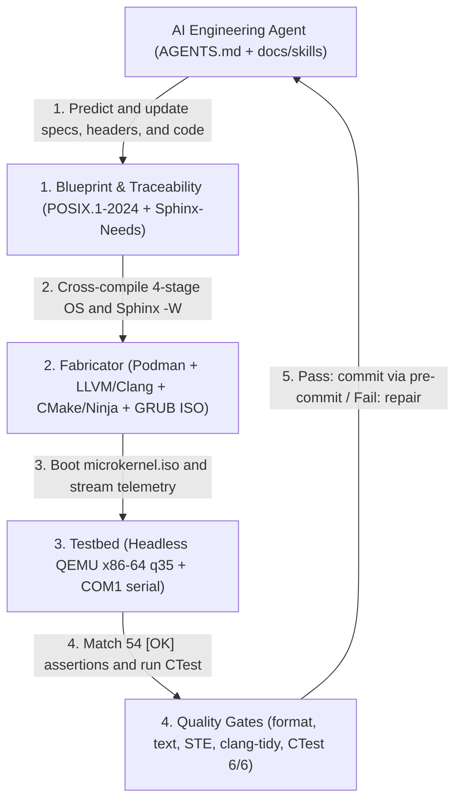

# Microkernel — POSIX.1-2024 x86-64 Microkernel

Microkernel is a preemptive, message-passing x86-64 operating system written in
freestanding C17. It targets **POSIX.1-2024 (IEEE Std 1003.1-2024, Issue 8)
Base** compliance in user space. The Ring 0 kernel stays minimal, while system
servers and applications run as isolated Ring 3 processes that communicate over
synchronous IPC channels.

The project uses a closed **Blueprint -> Fabricator -> Testbed -> Gates** loop
driven by AI engineering agents inside a deterministic **Podman** container
(`microkernel-dev`). Every change moves from traceable specifications to
cross-compiled ISO images, headless QEMU execution, static analysis, and
automated conformance tests with zero host toolchain drift.

## Development architecture: the closed loop

Traditional operating system development breaks on host toolchain drift and
manual reboot cycles. This repository connects specification, compilation,
hardware emulation, and automated audits into one reproducible loop governed by
[AGENTS.md](AGENTS.md) and [docs/skills/](docs/skills/):



### 1. The Blueprint and bidirectional traceability

Before implementation begins, **POSIX.1-2024 (Issue 8)** and the microkernel ABI
define the system contract inside the Sphinx-Needs traceability model (`docs/`):

- **Microkernel boundary:** Ring 0 provides only boot bring-up, W^X and
  copy-on-write memory management, 256-level priority scheduling, and
  synchronous or scatter-gather IPC. It also handles IOAPIC IRQ pulse routing,
  signals, clocks/timers, futexes, and `syscall`/`sysret`. System servers
  (`sysproc`, `pipeserv`, `ipcserv`, `rtcdrv`) and POSIX libraries run in
  isolated Ring 3 processes.
- **Two-tier bidirectional traceability:** Business decisions (`BDR_`),
  architecture and workflow decisions (`ADR_`, `WDR_`), and requirements
  (`SYS_`, `SWR_`) in ASD-STE100 Issue 9 carry `:posix:` links to IEEE Std
  1003.1-2024. Every public header carries an `ICD_` `need::` tag, every source
  module carries a `COMP_` tag, and every test file carries a `VER_` tag.
- **Build-enforced integrity:** `config/sphinx/need_tag_check.py` and
  `tools/traceability/check_needs_audit.py` fail the Sphinx `-W` build on broken
  links or unverified requirements. They also reject untagged active
  `ICD_`/`COMP_`/`VER_` items, untagged test files, and transient `TSK_`/`RDM_`
  IDs in source code. See [WDR_0002](docs/00-overview/wdr/WDR_0002.md),
  [BDR_0003](docs/10-product/bdr/BDR_0003.md),
  [ADR_0003](docs/30-architecture/adr/ADR_0003.md), and the [traceability and
  POSIX.1-2024 compliance matrix](docs/60-verification/traceability.md).

### 2. The Fabricator (Podman, LLVM, and four-stage build)

**LLVM** (`clang`, `ld.lld`, `llvm-objdump`) with **CMake** and **Ninja**
(`cmake/clang-x86_64.cmake`) cross-compiles freestanding C17 and x86-64
assembly. The build runs inside the `microkernel-dev` Podman image
(`Containerfile`) with no host headers or host libraries in four stages:

1. **Headers:** Public `libc/include/` headers and Clang freestanding headers
   install into `sysroot/usr/include`.
2. **C library:** `libc.a` and `crt0.o` compile against the sysroot into
   `sysroot/usr/lib`.
3. **User space:** Ring 3 servers (`servers/`) and test binaries (`tests/`) link
   statically against `libc.a` and pack into an uncompressed POSIX `ustar`
   archive (`build/boot.tar`).
4. **Kernel and ISO:** `kernel.elf` links at higher-half `0xFFFFFFFF80000000`,
   and `grub-mkrescue` packages `kernel.elf` and `boot.tar` into a bootable
   Multiboot2 ISO (`build/microkernel.iso`).

### 3. The Testbed (headless QEMU serial verification)

**QEMU** (`x86-64` `q35`, Local APIC, IOAPIC, CMOS RTC) boots
`build/microkernel.iso` headlessly inside the container with no KVM requirement.
The Python harness (`tests/test_runner.py`) reads `COM1` serial output and
asserts 54 ordered `[OK]` patterns. The suite tests boot, W^X/COW faults, IPC
name lookup, signals, Ring 3 IRQ 8 driver pulses, clocks/timers, and
pthreads/TLS. It also tests `fork`/`execve`/`pipe2`/`ppoll`, `<aio.h>`, deferred
cancellation, `<stdio.h>` locks, and Issue 8 C17 `libc`. Any kernel panic or
missing pattern exits with code 1.

### 4. Quality gates and the agent workflow

AI agents follow the **Predict -> Act -> Verify** workflow in
[AGENTS.md](AGENTS.md), delegating tool procedures to skills in `docs/skills/`.
Before every commit, `./scripts/build-agent.sh` (and `.git/hooks/pre-commit`,
installed via `./scripts/install-hooks.sh`) enforces seven repository-wide
gates:

1. **Formatting:** `clang-format` across `kernel/`, `libc/`, `servers/`, and
   `tests/` (`./scripts/formatter-agent.sh`).
2. **Source text:** `check_text.py --root .` checks 80-column line limits,
   greedy prose packing, and Doxygen file headers.
3. **Controlled English:** `tools/check_ste.py --root .` checks ASD-STE100 Issue
   9 compliance across `README.md` and `docs/`.
4. **Build and docs:** Four-stage cross-build plus clean Sphinx `-W` HTML build.
5. **Hardware testbed:** Headless QEMU serial suite (`54 [OK]` assertions).
6. **Static analysis:** `clang-tidy` across all C sources and headers using
   `build/compile_commands.json`.
7. **CTest (`6/6`):** `posix.headers` (standalone C17 matrix under
   `_POSIX_C_SOURCE=202405L` and `_XOPEN_SOURCE=800`), `posix.async_signal_safe`
   (`llvm-objdump -dr` call-graph audit on `libc.a`), `traceability.unit`,
   `docs.html`, `docs.needs`, and `docs.audit`.

## Containerized workflow and commands

Your host needs only Podman. The first `./scripts/env.sh` run builds the pinned
`microkernel-dev` image from `Containerfile`.

```bash
# Run the complete closed loop (format, text, STE, build, QEMU, lint, CTest)
./scripts/build-agent.sh

# Or run individual stages inside the Podman container:
./scripts/env.sh build
./scripts/env.sh test --timeout 120 \
    --expect '\[OK\] PMM/VMM/APIC initialized' \
    --expect 'name resolved /dev/echo' \
    --expect 'errno thread-local and preserved across success' \
    --expect 'signal handler entered'
./scripts/env.sh ctest --test-dir build --output-on-failure

# Open an interactive shell inside the container
./scripts/enter-dev.sh
```

For full build and container procedures, see the [cmake
skill](docs/skills/cmake/SKILL.md) and the [dev-environment
skill](docs/skills/dev-environment/SKILL.md).

## System services

The kernel supplies these services:

- preemptive scheduling of threads with 256 priority levels
- synchronous and scatter-gather IPC with channels, connections, replies, and
  pulses
- threads, `FS.base` TLS, futexes, monotonic/realtime clocks, interval timers,
  and signals with user handlers
- memory management with four-level page tables, copy-on-write, and W^X policy
- IOAPIC IRQ-to-IPC pulse routing and `CAP_SYS_INTR`-gated port I/O
- fast system calls with the `syscall`/`sysret` instructions

W^X means: the system maps a page as writable or as code, but not the two
together.

The process `sysproc` is the first user process. It contains the name registry
of the system. Servers (`pipeserv`, `ipcserv`, `rtcdrv`) register a name with
`sysproc`, and clients resolve endpoints by name.

## User-space functionality (current support)

Developers can build Ring 3 C17 servers and applications packed into `boot.tar`.
The headers below show all user-space functions available at this time:

- **POSIX core (`<unistd.h>`):** `_POSIX_VERSION` and `_POSIX2_VERSION`
  (`202405L`), `fork` (COW), `execve` (bootfs `argv`/`envp`), `getpid`,
  `getppid`, and `getentropy`. Also `pipe`/`pipe2`, `dup`/`dup2`/`dup3`,
  `close`, `write`, `read`, `_exit`, `sleep`, `environ`, and `STD*_FILENO`
- **POSIX descriptors and polling (`<fcntl.h>`, `<poll.h>`):** `fcntl`
  (`F_DUPFD`, `F_DUPFD_CLOEXEC`, `F_GETFD`, `F_SETFD`, `F_GETFL`, `F_SETFL`),
  `O_CLOEXEC`, `O_NONBLOCK`, `O_SYNC`, `O_DSYNC`, `poll`, and `ppoll` (finite
  timeout and atomic `sigmask`) backed by Ring 3 `pipeserv` (`/dev/pipe`)
- **POSIX asynchronous I/O (`<aio.h>`):** `aio_read`, `aio_write`, `aio_fsync`,
  `aio_cancel`, `lio_listio` (`LIO_WAIT`/`LIO_NOWAIT`, `SIGEV_SIGNAL`), and
  async-signal-safe `aio_error`, `aio_return`, and `aio_suspend` backed by a
  Ring 3 worker thread over `SYS_FUTEX`
- **Thread-local errors (`<errno.h>`):** O(1) `FS.base` TLS `errno`
  (`__errno_location`, with lock-free fallback) and POSIX.1-2024 `E*` constants
- **POSIX signals (`<signal.h>`):** async-signal-safe `sigaction`,
  `sigprocmask`, `sigpending`, `pthread_sigmask`, `kill`, `pthread_kill`,
  `raise`, `signal`, `sigemptyset`, `sigfillset`, `sigaddset`, `sigdelset`,
  `sigismember`, `SIGKILL`/`SIGSTOP` `EINVAL`, and mask reload across
  `SYS_SIGRETURN`
- **POSIX memory mapping (`<sys/mman.h>`):** W^X-enforced anonymous `mmap`,
  `mprotect`, `msync`, and `munmap` (`PROT_*`, `MAP_PRIVATE`, `MAP_ANONYMOUS`,
  `MAP_FIXED`, `MS_*`)
- **POSIX process wait (`<sys/wait.h>`):** async-signal-safe `wait`, `waitpid`
  (`WNOHANG`), and exit/signal status macros (`WIFEXITED`, `WEXITSTATUS`,
  `WIFSIGNALED`, `WTERMSIG`)
- **POSIX clocks and timers (`<time.h>`):** `CLOCK_MONOTONIC`, `CLOCK_REALTIME`,
  `TIMER_ABSTIME`, `clock_getres`, `clock_gettime`, `clock_settime`,
  `clock_nanosleep`, `nanosleep`, `timer_create`, `timer_settime`,
  `timer_gettime`, `timer_getoverrun`, and `timer_delete`
- **POSIX threads and semaphores (`<pthread.h>`, `<semaphore.h>`):**
  `pthread_create`, `pthread_join`, `pthread_detach`, `pthread_exit`,
  `pthread_once`, TSD keys, deferred cancellation (`pthread_cancel`,
  `pthread_setcancelstate`, `pthread_setcanceltype`, `pthread_testcancel`,
  `pthread_cleanup_push`/`pop`), mutexes (`NORMAL`/`ERRORCHECK`/`RECURSIVE`),
  `pthread_cond_*`, `pthread_cond_clockwait`, barriers, spinlocks, rwlocks, and
  `sem_*` (with async-signal-safe `sem_post`)
- **Formatted I/O (`<stdio.h>`):** `FILE` (`stdin`/`stdout`/`stderr`), recursive
  stream locking (`flockfile`, `ftrylockfile`, `funlockfile`), `printf`,
  `fprintf`, `snprintf`, `puts`, `fputs`, `putchar`, `putchar_unlocked`,
  `fputc`, `fflush`
- **Heap and exit (`<stdlib.h>`):** `malloc`, `free`, `calloc`, `realloc`,
  `reallocarray`, `getenv`, `secure_getenv`, `exit`, `_Exit`, `abort`, `strtol`,
  `atoi`
- **Memory and strings (`<string.h>`):** `memset`, `memcpy`, `memmove`,
  `memcmp`, `strlen`, `strcmp`, `strncmp`, `strcpy`, `strncpy`, `strlcpy`,
  `strlcat`, `strchr`
- **Freestanding C17 and Unicode headers:** `<stdint.h>`, `<stddef.h>`,
  `<stdbool.h>`, `<stdarg.h>`, `<limits.h>`, `<stdatomic.h>`, `<stdalign.h>`,
  and `<uchar.h>` (`mbrtoc16`, `c16rtomb`, `mbrtoc32`, `c32rtomb`)
- **Synchronous IPC (`<sys/ipc.h>`):** `CreateChannel`, `DestroyChannel`,
  `OpenConnection`, `CloseConnection`, `SendMsg`, `ReceiveMsg`, `ReplyMsg`,
  `ReadMsgV`, `WriteMsgV`, `SendPulse`, and `sysproc` name registry
  (`NAME_MSG_ATTACH`, `NAME_MSG_QUERY`)
- **Hardware IRQs and port I/O (`<sys/intr.h>`):** `AttachIntrEvent` (IOAPIC
  IRQ-to-IPC pulses), `IntrUnmask`, `IOPLSet` (`CAP_SYS_INTR` guarded), and Ring
  3 `port_in*`/`port_out*` helpers
- **Native processes and VM (`<sys/proc.h>`, `<sys/vm.h>`):** `ProcCreate` (from
  `boot.tar`), `ProcWait`, `VMMap`, `VMUnmap`, `VMProtect`, and `VMCloneCow`
  (copy-on-write page sharing between parent and child)
- **Native threads (`<sys/thread.h>`):** `NewThread`, `ThreadReset`,
  `ThreadSpawn`, `ThreadGetCtx`, `ThreadGetTid` (256 priority levels with IPC
  priority inheritance)

What you can build today:

- isolated Ring 3 client and server processes that find each other by name
  through `sysproc` and send synchronous or scatter-gather messages and pulses
- privileged Ring 3 hardware device drivers (for example `rtcdrv` at `/dev/rtc`)
  using port I/O and IOAPIC IRQ-to-IPC pulse delivery
- parent and child Ring 3 processes (`fork`/`execve`, `ProcCreate`) with COW
  memory, Ring 3 pipes (`pipe2`/`ppoll`), and `waitpid`
- multithreaded Ring 3 applications with `FS.base` TLS `errno`, pthreads,
  deferred cancellation, `<aio.h>`, recursive `<stdio.h>` locks, and POSIX
  clocks/timers and signals
- freestanding C17 console tools and protocol services packed into `boot.tar`

Not available at this time (next tasks): 4-gate Issue 8 symbol diff, `mmap` heap
reclamation, Ring 3 VFS/`tmpfs`, option-gated `SHM`/`ML`, TTY `stdin`, POSIX
`sh`, and `AF_UNIX` sockets. See [docs/records/TASKS.md](docs/records/TASKS.md)
and [docs/records/ROADMAP.md](docs/records/ROADMAP.md).

## Source tree

- `kernel/` — Ring 0 kernel: boot code, x86-64 architecture, and core subsystems
- `libc/` — freestanding C17 and POSIX.1-2024 user-space C library
- `servers/` — Ring 3 system servers (`sysproc`, `pipeserv`, `ipcserv`,
  `rtcdrv`)
- `tests/` — QEMU harness (`test_runner.py`), Ring 3 tests (`ipccli`, `sigtest`,
  `proctest`, `drvtest`, `timetest`, `pthreadtest`, `forkpipetest`,
  `exechelper`, `aiotest`, `canceltest`, `libctest`), `posix/`, and
  `traceability/`
- `config/sphinx/`, `tools/` — Sphinx-Needs traceability model, tag scanner,
  auditor, and repository STE gate
- `scripts/` — container, build, format, hook, and `boot.tar` helper scripts
- `docs/` — Sphinx-Needs requirements, architecture, decisions, records, and
  agent skills
- `iso/` — GRUB Multiboot2 boot configuration
- `cmake/` — Clang cross-compilation toolchain for CMake
- `Containerfile` — reproducible Podman build and QEMU container definition

## Code rules

The kernel and the library use freestanding C17 with warnings as errors. Kernel
code runs without a C runtime and maps code read-only (W^X). The kernel never
dereferences user pointers directly. It validates page permissions and copies
through the physical direct map (HHDM) with SMAP active. File naming, source
text, ASD-STE100, traceability, and copyright rules live in
[docs/records/CONVENTIONS.md](docs/records/CONVENTIONS.md).

## Status

See [docs/records/TASKS.md](docs/records/TASKS.md) and
[docs/records/HISTORY.md](docs/records/HISTORY.md) for the milestone plan and
task records. The build completed milestones 1 to 6, POSIX clocks/timers,
pthreads/semaphores, and `fork`/`execve`/`pipe2`/`dup3`/`ppoll`. It also
completed `<aio.h>`, cancellation points, `<stdio.h>` locking, and Issue 8 C17
library functions. Next tasks add the 4-gate POSIX harness, `mmap` heap
reclamation, Ring 3 VFS, `SHM`/`ML`, TTY, POSIX `sh`, and `AF_UNIX` sockets.

## Documentation

- [AGENTS.md](AGENTS.md): governance for AI agents (commit mode, workflow,
  pre-commit checklist)
- [docs/index.md](docs/index.md): the Sphinx-Needs requirements, architecture,
  and POSIX.1-2024 traceability model
- [docs/00-overview/context.md](docs/00-overview/context.md): system overview,
  directory structure, and integration points
- [docs/records/CONVENTIONS.md](docs/records/CONVENTIONS.md): file names, source
  text, ASD-STE100, traceability, and copyright rules
- [docs/30-architecture/adr/index.md](docs/30-architecture/adr/index.md),
  [docs/10-product/bdr/index.md](docs/10-product/bdr/index.md), and
  [docs/00-overview/wdr/index.md](docs/00-overview/wdr/index.md): architecture,
  business, and workflow decision records
- [docs/records/TASKS.md](docs/records/TASKS.md),
  [docs/records/ROADMAP.md](docs/records/ROADMAP.md), and
  [docs/records/HISTORY.md](docs/records/HISTORY.md): active tasks, roadmap, and
  completed milestones
- Skills:
  - [cmake](docs/skills/cmake/SKILL.md) — build, test, and user programs
  - [clang-format](docs/skills/clang-format/SKILL.md) — code formatting
  - [clang-tidy](docs/skills/clang-tidy/SKILL.md) — static analysis
  - [dev-environment](docs/skills/dev-environment/SKILL.md) — the container
    environment
  - [git](docs/skills/git/SKILL.md) — commits and branches
  - [state-management](docs/skills/state-management/SKILL.md) — tasks, history,
    decisions, notices
  - [keepachangelog](docs/skills/keepachangelog/SKILL.md) — the changelog format
  - [create-skill](docs/skills/create-skill/SKILL.md) — new agent skills

## License

The MIT License governs this project. See [LICENSE.md](LICENSE.md).

Copyright (c) 2026 Deniz Eren <deniz.eren@outlook.com>

For third-party attributions, see
[docs/THIRD-PARTY-NOTICES.md](docs/THIRD-PARTY-NOTICES.md).
