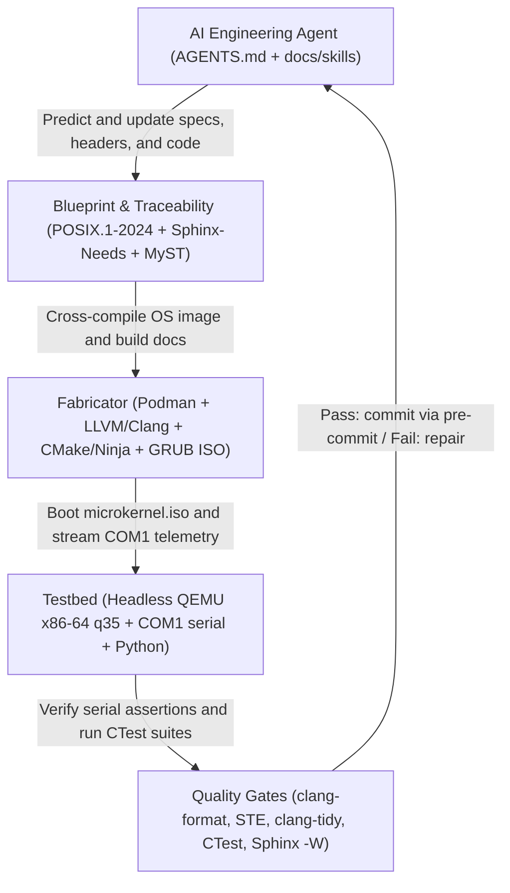
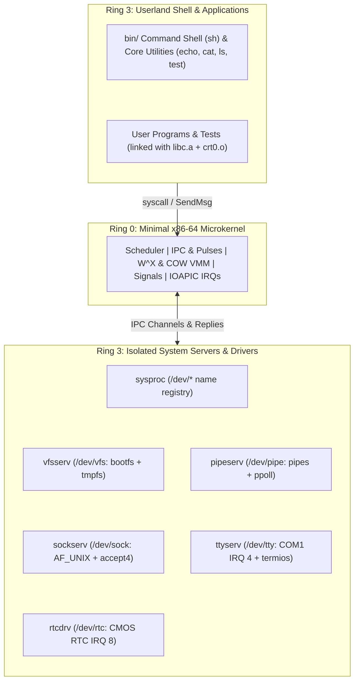

# Microkernel — Freestanding 64-Bit Microkernel

Microkernel is a preemptive, message-passing 64-bit operating system written in
freestanding C17. It currently targets `x86-64`, with future 64-bit ARM
(`arm64`) planned on the [roadmap](docs/records/ROADMAP.md). It is working
toward compatibility with interfaces from **POSIX.1-2024 (IEEE Std 1003.1-2024 /
ISO/IEC/IEEE 9945:2026)** in user space. The Ring 0 kernel stays minimal, while
system servers and applications run as isolated Ring 3 processes that
communicate over synchronous IPC channels.

The project uses a closed **Blueprint -> Fabricator -> Testbed -> Gates** loop
driven by AI engineering agents inside a deterministic **Podman** container
(`microkernel-dev`). Every change moves from traceable specifications to
cross-compiled ISO images, headless QEMU execution, static analysis, and
automated compatibility checks with zero host toolchain drift.

## Development architecture: the closed loop

Traditional operating system development breaks on host toolchain drift and
manual reboot cycles. This repository connects specification, compilation,
hardware emulation, and automated audits into one reproducible loop governed by
[AGENTS.md](AGENTS.md) and [docs/skills/](docs/skills/):



### 1. The Blueprint and bidirectional traceability

Before implementation begins, **POSIX.1-2024 (Issue 8)** and the microkernel ABI
define the system contract inside the Sphinx-Needs traceability model (`docs/`):

- **Microkernel boundary:** Ring 0 provides only boot bring-up, W^X and
  copy-on-write memory management, 256-level priority scheduling, and
  synchronous or scatter-gather IPC. It also handles IOAPIC IRQ pulse routing,
  signals, clocks/timers, futexes, and `syscall`/`sysret`. System servers
  (`sysproc`, `pipeserv`, `vfsserv`, `ttyserv`, `sockserv`, `ipcserv`, `rtcdrv`)
  and POSIX libraries run in isolated Ring 3 processes.
- **Two-tier bidirectional traceability:** Business decisions (`BDR_`),
  architecture and workflow decisions (`ADR_`, `WDR_`), and requirements
  (`SYS_`, `SWR_`) in ASD-STE100 Issue 9 carry `:posix:` links to IEEE Std
  1003.1-2024. Every public header carries an `ICD_` `need::` tag, every source
  module carries a `COMP_` tag, and every test file carries a `VER_` tag.
- **Build-enforced integrity:** `config/sphinx/need_tag_check.py` and
  `tools/traceability/check_needs_audit.py` fail the Sphinx `-W` build on broken
  links or unverified requirements. They also reject untagged active
  `ICD_`/`COMP_`/`VER_` items, untagged test files, and transient `TSK_`/`RDM_`
  IDs in source code. See [WDR_0002](docs/00-overview/wdr/WDR_0002.md),
  [BDR_0003](docs/10-product/bdr/BDR_0003.md),
  [ADR_0003](docs/30-architecture/adr/ADR_0003.md), and the [traceability and
  POSIX.1-2024 progress matrix](docs/60-verification/traceability.md).

### 2. The Fabricator (Podman, LLVM, and four-stage build)

**LLVM** (`clang`, `ld.lld`, `llvm-objdump`) with **CMake** and **Ninja**
(`cmake/clang-x86-64.cmake`, `cmake/arch/x86-64.cmake`) cross-compiles
freestanding C17 and x86-64 assembly. The build runs inside the
`microkernel-dev` Podman image (`Containerfile`) with no host headers or host
libraries in four stages:

1. **Headers:** Public `libc/include/` headers and Clang freestanding headers
   install into `sysroot/usr/include`.
2. **C library:** `libc.a` and `crt0.o` compile against the sysroot into
   `sysroot/usr/lib`.
3. **User space:** Ring 3 servers (`servers/`) and test binaries (`tests/`) link
   statically against `libc.a` and pack into an uncompressed POSIX `ustar`
   archive (`build/boot.tar`).
4. **Kernel and ISO:** `kernel.elf` links at higher-half `0xFFFFFFFF80000000`,
   and `grub-mkrescue` packages `kernel.elf` and `boot.tar` into a bootable
   Multiboot2 ISO (`build/microkernel.iso`).

### 3. The Testbed (headless QEMU serial verification)

**QEMU** (`x86-64` `q35`, Local APIC, IOAPIC, CMOS RTC) boots
`build/microkernel.iso` headlessly inside the container with no KVM requirement.
The Python harness (`tests/test_runner.py`) reads `COM1` serial output and
asserts ordered `[OK]` patterns. The suite tests boot, W^X/COW faults, IPC name
lookup, signals, Ring 3 IRQ 8 driver pulses, clocks/timers, and pthreads/TLS. It
also tests `fork`/`execve`/`pipe2`/`ppoll`, `<aio.h>`, deferred cancellation,
`<stdio.h>` locks, and Issue 8 C17 `libc`. Any kernel panic or missing pattern
exits with code 1.

### 4. Quality gates and the agent workflow

AI agents follow the **Predict -> Act -> Verify** workflow in
[AGENTS.md](AGENTS.md), delegating tool procedures to skills in `docs/skills/`.
Before every commit, `./scripts/build-agent.sh` (and `.git/hooks/pre-commit`,
installed via `./scripts/install-hooks.sh`) enforces seven repository-wide
gates:

1. **Formatting:** `clang-format` across `kernel/`, `libc/`, `servers/`, and
   `tests/` (`./scripts/formatter-agent.sh`).
2. **Source text:** `check_text.py --root .` checks 80-column line limits,
   greedy prose packing, and Doxygen file headers.
3. **Controlled English:** `tools/check_ste.py --root .` checks ASD-STE100 Issue
   9 compliance across `README.md` and `docs/`.
4. **Build and docs:** Four-stage cross-build plus clean Sphinx `-W` HTML build.
5. **Hardware testbed:** Headless QEMU serial suite (`[OK]` assertions).
6. **Static analysis:** `clang-tidy` across all C sources and headers using
   `build/compile_commands.json`.
7. **CTest:** `posix.headers` (standalone C17 matrix under
   `_POSIX_C_SOURCE=202405L` and `_XOPEN_SOURCE=800`), `posix.symbol_diff`
   (Clang AST and `llvm-nm` diff against `issue8-manifest.tsv`),
   `posix.async_signal_safe` and `posix.cancellation` (`llvm-objdump -dr`
   call-graph audits on `libc.a`), `traceability.unit`, `docs.html`,
   `docs.needs`, and `docs.audit`.

## Containerized workflow and commands

Your host needs only Podman. The first `./scripts/env.sh` run builds the pinned
`microkernel-dev` image from `Containerfile`.

```bash
# Run the complete closed loop (format, text, STE, build, QEMU, lint, CTest)
./scripts/build-agent.sh

# Or run individual stages inside the Podman container:
./scripts/env.sh build
./scripts/env.sh test --timeout 120 \
    --expect '\[OK\] PMM/VMM/APIC initialized' \
    --expect 'name resolved /dev/echo' \
    --expect 'errno thread-local and preserved across success' \
    --expect 'signal handler entered'
./scripts/env.sh ctest --test-dir build --output-on-failure

# Boot Microkernel interactively into the Ring 3 command shell (Ctrl-A X exits)
./scripts/env.sh run

# Open a development bash shell inside the Podman container
./scripts/enter-dev.sh
```

### Running Microkernel interactively in QEMU

Build the OS image once and launch an interactive serial session straight into
the Ring 3 command shell (`/boot/sh`):

```bash
./scripts/env.sh build
./scripts/env.sh run
```

`./scripts/env.sh run` builds `build/microkernel-shell.iso` with the Multiboot2
command line `init=sh`. It starts the Ring 3 system servers (`sysproc`,
`ttyserv`, `pipeserv`, `vfsserv`, `sockserv`, `rtcdrv`) plus `/boot/sh` and
connects `COM1` to your terminal (`-serial mon:stdio`). Once the `$ ` prompt
appears, you can run POSIX commands directly:

```sh
ls /boot
echo hello microkernel > /tmp/note.txt && cat /tmp/note.txt
cd /tmp && pwd
set -o pipefail; /boot/false | /boot/true; echo $?
```

Press `Ctrl-A` followed by `X` to exit QEMU cleanly. If `qemu-system-x86_64` is
installed directly on your host, you can also boot `build/microkernel-shell.iso`
without Podman:

```bash
qemu-system-x86_64 -machine q35 -cpu qemu64,+smap,+smep -m 256M -smp 2 \
    -cdrom build/microkernel-shell.iso -serial mon:stdio -display none \
    -no-reboot
```

For full build and container procedures, see the [cmake
skill](docs/skills/cmake/SKILL.md) and the [dev-environment
skill](docs/skills/dev-environment/SKILL.md).

## System services

The kernel supplies these services:

- preemptive scheduling of threads with 256 priority levels
- synchronous and scatter-gather IPC with channels, connections, replies, and
  pulses
- threads, `FS.base` TLS, futexes, monotonic/realtime clocks, interval timers,
  and signals with user handlers
- memory management with four-level page tables, copy-on-write, and W^X policy
- IOAPIC IRQ-to-IPC pulse routing and `CAP_SYS_INTR`-gated port I/O
- fast system calls with the `syscall`/`sysret` instructions

W^X means: the system maps a page as writable or as code, but not the two
together.

The process `sysproc` is the first user process. It contains the name registry
of the system. Servers (`pipeserv`, `vfsserv`, `ttyserv`, `sockserv`, `ipcserv`,
`rtcdrv`) register a name with `sysproc`, and clients resolve endpoints by name.



## User-space functionality (current support)

Developers can build Ring 3 C17 servers and applications packed into `boot.tar`.
User-space libraries and utilities are an ongoing effort working toward
POSIX.1-2024 (IEEE Std 1003.1-2024) compatibility. The headers below list the
subset available at this time:

- **Core process and descriptor calls (`<unistd.h>`):** `_POSIX_VERSION` and
  `_POSIX2_VERSION` (`202405L`), `fork` (COW), `execve`/`execv`/`execvp` (`PATH`
  lookup and bootfs `argv`/`envp`), `getpid`, `getppid`, and `getentropy`. Also
  `pipe`/`pipe2`, `dup`/`dup2`/`dup3`, `close`, `write`, `read`, `lseek`,
  `ftruncate`, `unlink`/`unlinkat`, `rmdir`, `chdir`/`fchdir`, `getcwd`,
  `access`, `isatty`, `_exit`, `sleep`, `environ`, and `STD*_FILENO`
- **Descriptor control and multiplexing (`<fcntl.h>`, `<poll.h>`,
  `<sys/select.h>`):** `open`, `openat`, `creat`, and `fcntl` (`F_DUPFD`,
  `F_DUPFD_CLOEXEC`, `F_GETFD`, `F_SETFD`, `F_GETFL`, `F_SETFL`). Also
  `O_CLOEXEC`, `O_NONBLOCK`, `O_DIRECTORY`, `O_SYNC`, `O_DSYNC`, `poll`,
  multi-server `ppoll`, `select`, `pselect`, `fd_set`, and `FD_*` backed by Ring
  3 `pipeserv`, `vfsserv`, `ttyserv`, and `sockserv`
- **Local sockets (`<sys/socket.h>`, `<sys/un.h>`):** `AF_UNIX` `SOCK_STREAM`
  and `SOCK_DGRAM` sockets (`socket`, `socketpair`, `bind`, `listen`, `accept`,
  `accept4`, `connect`, `send`, `recv`). Also `sendto`, `recvfrom`, `shutdown`,
  `getsockname`, `getpeername`, `getsockopt`, and `setsockopt` with atomic
  `SOCK_CLOEXEC` and `SOCK_NONBLOCK` over `sockserv` (`/dev/sock`)
- **Terminal I/O (`<termios.h>`):** `tcgetattr`, `tcsetattr`, `tcflush`,
  `tcdrain`, `tcflow`, `tcsendbreak`, `cfgetispeed`/`cfsetispeed`,
  `cfgetospeed`/`cfsetospeed`, canonical line editing (`ICANON`, `VERASE`,
  `VKILL`, `ICRNL`, `VEOF`), and raw mode backed by COM1 IRQ 4 `ttyserv`
- **Filesystem and directories (`<sys/stat.h>`, `<dirent.h>`):** `stat`,
  `fstat`, `lstat`, `fstatat`, `mkdir`, `mkdirat`, `umask`, `opendir`,
  `fdopendir`, `readdir`, `rewinddir`, `closedir`, and `dirfd` backed by Ring 3
  `vfsserv` (`/boot` read-only `bootfs` and `/tmp` writable `tmpfs`)
- **Asynchronous I/O (`<aio.h>`):** `aio_read`, `aio_write`, `aio_fsync`,
  `aio_cancel`, `lio_listio` (`LIO_WAIT`/`LIO_NOWAIT`, `SIGEV_SIGNAL`), and
  async-signal-safe `aio_error`, `aio_return`, and `aio_suspend` backed by a
  Ring 3 worker thread over `SYS_FUTEX`
- **Thread-local errors (`<errno.h>`):** O(1) `FS.base` TLS `errno`
  (`__errno_location`, with lock-free fallback) and POSIX.1-2024 `E*` constants
- **Signals (`<signal.h>`):** async-signal-safe `sigaction`, `sigprocmask`,
  `sigpending`, `pthread_sigmask`, `kill`, `pthread_kill`, `raise`, `signal`,
  `sigemptyset`, `sigfillset`, `sigaddset`, `sigdelset`, `sigismember`,
  `SIGKILL`/`SIGSTOP` `EINVAL`, and mask reload across `SYS_SIGRETURN`
- **Memory mapping (`<sys/mman.h>`):** W^X-enforced `mmap` (`MAP_PRIVATE`,
  `MAP_SHARED`, `MAP_ANONYMOUS`, `MAP_FIXED`), `mprotect`, `msync`, `munmap`,
  option-gated `shm_open`/`shm_unlink` (`SHM`), and
  `mlock`/`munlock`/`mlockall`/`munlockall` (`ML`/`MLR`, `MCL_CURRENT`,
  `MCL_FUTURE`)
- **Process wait (`<sys/wait.h>`):** async-signal-safe `wait`, `waitpid`
  (`WNOHANG`), and exit/signal status macros (`WIFEXITED`, `WEXITSTATUS`,
  `WIFSIGNALED`, `WTERMSIG`)
- **Clocks and timers (`<time.h>`):** `CLOCK_MONOTONIC`, `CLOCK_REALTIME`,
  `TIMER_ABSTIME`, `clock_getres`, `clock_gettime`, `clock_settime`,
  `clock_nanosleep`, `nanosleep`, `timer_create`, `timer_settime`,
  `timer_gettime`, `timer_getoverrun`, and `timer_delete`
- **Threads and semaphores (`<pthread.h>`, `<semaphore.h>`):** `pthread_create`,
  `pthread_join`, `pthread_detach`, `pthread_exit`, `pthread_once`, TSD keys,
  deferred cancellation (`pthread_cancel`, `pthread_setcancelstate`,
  `pthread_setcanceltype`, `pthread_testcancel`, `pthread_cleanup_push`/`pop`),
  mutexes (`NORMAL`/`ERRORCHECK`/`RECURSIVE`), `pthread_cond_*`,
  `pthread_cond_clockwait`, barriers, spinlocks, rwlocks, and `sem_*` (with
  async-signal-safe `sem_post`)
- **Buffered and formatted I/O (`<stdio.h>`):** `FILE`
  (`stdin`/`stdout`/`stderr`), `fopen`, `fdopen`, `fclose`, `fread`, `fwrite`,
  `fgets`, `fgetc`, `getc`/`getc_unlocked`, `getchar`/`getchar_unlocked`, and
  `ungetc`. Also `fseek`/`fseeko`, `ftell`/`ftello`, `rewind`, `feof`, `ferror`,
  `clearerr`, `fileno`, `setvbuf`, `setbuf`, `fflush`, and recursive stream
  locks (`flockfile`, `ftrylockfile`, `funlockfile`). Formatted output covers
  `printf`/`vprintf`, `fprintf`/`vfprintf`, `snprintf`/`vsnprintf`,
  `sprintf`/`vsprintf`, `puts`, `fputs`, `putchar`/`putchar_unlocked`, `fputc`,
  `putc`/`putc_unlocked`, and `perror`
- **Heap, environment, and exit (`<stdlib.h>`):** `mmap`/`munmap`-backed
  thread-safe coalescing `malloc`, `free`, `calloc`, `realloc`, and
  `reallocarray`. Also `getenv`, `secure_getenv`, `setenv`, `unsetenv`, `exit`,
  `_Exit`, `abort`, `strtol`/`strtoul`/`strtoll`/`strtoull`,
  `atoi`/`atol`/`atoll`, and `abs`/`labs`/`llabs`
- **Memory, strings, and character classes (`<string.h>`, `<strings.h>`,
  `<ctype.h>`):** `memset`, `memcpy`, `memmove`, `memcmp`, `memchr`, `strlen`,
  `strnlen`, `strcmp`, `strncmp`, `strcasecmp`, `strncasecmp`, `strcpy`,
  `strncpy`, `strcat`, and `strncat`. Also `strlcpy`, `strlcat`, `strchr`,
  `strrchr`, `strstr`, `strspn`, `strcspn`, `strpbrk`, `strtok`, `strtok_r`,
  `strdup`, `strndup`, `strerror`, and C locale `<ctype.h>` helpers
- **Freestanding C17, limits, and Unicode headers:** `<stdint.h>`, `<stddef.h>`,
  `<stdbool.h>`, `<stdarg.h>`, `<assert.h>`, `<inttypes.h>` (`PRI*`/`SCN*`,
  `imaxabs`, `imaxdiv`, `strtoimax`, `strtoumax`), `<limits.h>` (C17 and POSIX
  `PATH_MAX`, `NAME_MAX`, `OPEN_MAX`, `PIPE_BUF`, `ARG_MAX`, `SSIZE_MAX`),
  `<stdatomic.h>`, `<stdalign.h>`, and `<uchar.h>` (`mbrtoc16`, `c16rtomb`,
  `mbrtoc32`, `c32rtomb`)
- **Synchronous IPC (`<sys/ipc.h>`):** `CreateChannel`, `DestroyChannel`,
  `OpenConnection`, `CloseConnection`, `SendMsg`, `ReceiveMsg`, `ReplyMsg`,
  `ReadMsgV`, `WriteMsgV`, `SendPulse`, and `sysproc` name registry
  (`NAME_MSG_ATTACH`, `NAME_MSG_QUERY`)
- **Hardware IRQs and port I/O (`<sys/intr.h>`):** `AttachIntrEvent` (IOAPIC
  IRQ-to-IPC pulses), `IntrUnmask`, `IOPLSet` (`CAP_SYS_INTR` guarded), and Ring
  3 `port_in*`/`port_out*` helpers
- **Command shell and core utilities (`bin/`):** Ring 3 `/boot/sh` targeting
  POSIX.1-2024 XCU features (`-c`, script files, interactive `isatty()` input,
  pipelines, redirections `<`/`>`/`>>`/`2>&1`, `&&`/`||`/`;`, `$VAR`/`$?`,
  `$'...'` ANSI-C quoting, `set -o pipefail`, `read -d` custom/NUL delimiters,
  and built-ins `cd`/`pwd`/`export`/`unset`/`exit`). Standalone `/boot/`
  utilities: `echo`, `cat`, `ls`, `true`, `false`, and `test`
- **Native processes and VM (`<sys/proc.h>`, `<sys/vm.h>`):** `ProcCreate` (from
  `boot.tar`), `ProcWait`, `VMMap`, `VMUnmap`, `VMProtect`, and `VMCloneCow`
  (copy-on-write page sharing between parent and child)
- **Native threads (`<sys/thread.h>`):** `NewThread`, `ThreadReset`,
  `ThreadSpawn`, `ThreadGetCtx`, `ThreadGetTid` (256 priority levels with IPC
  priority inheritance)

What you can build today:

- isolated Ring 3 client and server processes that find each other by name
  through `sysproc` and send synchronous or scatter-gather messages and pulses
- privileged Ring 3 hardware device drivers (for example `rtcdrv` at `/dev/rtc`)
  using port I/O and IOAPIC IRQ-to-IPC pulse delivery
- parent and child Ring 3 processes (`fork`/`execve`, `ProcCreate`) with COW
  memory, Ring 3 pipes (`pipe2`/`ppoll`), and `waitpid`
- multithreaded Ring 3 applications with `FS.base` TLS `errno`, pthreads,
  deferred cancellation, `<aio.h>`, recursive `<stdio.h>` locks, and POSIX
  clocks/timers and signals
- freestanding C17 console tools and protocol services packed into `boot.tar`

Not available at this time (next task): `<sys/select.h>` (`select`, `pselect`)
and cross-subsystem stress and leak hardening. See
[docs/records/TASKS.md](docs/records/TASKS.md) and
[docs/records/ROADMAP.md](docs/records/ROADMAP.md).

## Source tree

- `kernel/` — Ring 0 kernel: boot code, x86-64 architecture, and core subsystems
- `libc/` — freestanding C17 and POSIX.1-2024 user-space C library
- `servers/` — Ring 3 system servers (`sysproc`, `pipeserv`, `vfsserv`,
  `ttyserv`, `sockserv`, `ipcserv`, `rtcdrv`)
- `bin/` — Ring 3 command shell (`sh`) and core utilities (`echo`, `cat`, `ls`,
  `true`, `false`, `test`) targeting POSIX.1-2024 XCU interfaces
- `tests/` — QEMU harness (`test_runner.py`), Ring 3 tests (`ipccli`, `sigtest`,
  `proctest`, `drvtest`, `timetest`, `pthreadtest`, `forkpipetest`,
  `exechelper`, `aiotest`, `canceltest`, `libctest`, `heaptest`, `vfstest`,
  `shmtest`, `ttytest`, `stdiotest`, `socktest`, `shtest`), `posix/`, and
  `traceability/`
- `config/sphinx/`, `tools/` — Sphinx-Needs traceability model, tag scanner,
  auditor, and repository STE gate
- `scripts/` — container, build, format, hook, and `boot.tar` helper scripts
- `docs/` — Sphinx-Needs requirements, architecture, decisions, records, and
  agent skills
- `iso/` — GRUB Multiboot2 boot configuration
- `cmake/` — Clang cross-compilation toolchain for CMake
- `Containerfile` — reproducible Podman build and QEMU container definition

## Code rules

The kernel and the library use freestanding C17 with warnings as errors. Kernel
code runs without a C runtime and maps code read-only (W^X). The kernel never
dereferences user pointers directly. It validates page permissions and copies
through the physical direct map (HHDM) with SMAP active. File naming, source
text, ASD-STE100, traceability, and copyright rules live in
[docs/records/CONVENTIONS.md](docs/records/CONVENTIONS.md).

## Status

See [docs/records/TASKS.md](docs/records/TASKS.md) and
[docs/records/HISTORY.md](docs/records/HISTORY.md) for the milestone plan and
task records. The build completed milestones 1 to 6, POSIX clocks/timers,
pthreads/semaphores, and `fork`/`execve`/`pipe2`/`dup3`/`ppoll`. It also
completed `<aio.h>`, cancellation points, `<stdio.h>` locking, and Issue 8 C17
library functions. Recent milestones added the 4-gate POSIX harness,
`mmap`-backed heap reclamation, Ring 3 VFS (`bootfs`/`tmpfs`), and option-gated
`SHM`/`ML`/`MLR`. They also added Ring 3 COM1 TTY (`<termios.h>`), buffered
`<stdio.h>`, `setenv`/`unsetenv`, `execvp`, and core C17/POSIX headers.

Latest milestones added Ring 3 `AF_UNIX` local sockets (`accept4`) and the Ring
3 command shell (`sh`) with core utilities. They also added ACPI `MADT`/`SPCR`
driver discovery, Ring 3 `OPOST` TX, and interactive `./scripts/env.sh run`
boot. The remaining task adds `<sys/select.h>` and cross-subsystem hardening.

## Documentation

- [AGENTS.md](AGENTS.md): governance for AI agents (commit mode, workflow,
  pre-commit checklist)
- [docs/index.md](docs/index.md): the Sphinx-Needs requirements, architecture,
  and POSIX.1-2024 traceability model
- [docs/00-overview/context.md](docs/00-overview/context.md): system overview,
  directory structure, and integration points
- [docs/records/CONVENTIONS.md](docs/records/CONVENTIONS.md): file names, source
  text, ASD-STE100, traceability, and copyright rules
- [docs/30-architecture/adr/index.md](docs/30-architecture/adr/index.md),
  [docs/10-product/bdr/index.md](docs/10-product/bdr/index.md), and
  [docs/00-overview/wdr/index.md](docs/00-overview/wdr/index.md): architecture,
  business, and workflow decision records
- [docs/records/TASKS.md](docs/records/TASKS.md),
  [docs/records/ROADMAP.md](docs/records/ROADMAP.md), and
  [docs/records/HISTORY.md](docs/records/HISTORY.md): active tasks, roadmap, and
  completed milestones
- Skills:
  - [cmake](docs/skills/cmake/SKILL.md) — build, test, and user programs
  - [clang-format](docs/skills/clang-format/SKILL.md) — code formatting
  - [clang-tidy](docs/skills/clang-tidy/SKILL.md) — static analysis
  - [dev-environment](docs/skills/dev-environment/SKILL.md) — the container
    environment
  - [git](docs/skills/git/SKILL.md) — commits and branches
  - [state-management](docs/skills/state-management/SKILL.md) — tasks, history,
    decisions, notices
  - [keepachangelog](docs/skills/keepachangelog/SKILL.md) — the changelog format
  - [create-skill](docs/skills/create-skill/SKILL.md) — new agent skills

## License and trademarks

The MIT License governs this project. See [LICENSE.md](LICENSE.md).

Copyright (c) 2026 Deniz Eren <deniz.eren@outlook.com>

POSIX® is a registered trademark of the Institute of Electrical and Electronic
Engineers, Inc.

This project is an independent work in progress aiming to follow interfaces from
POSIX.1-2024 (IEEE Std 1003.1-2024 / ISO/IEC/IEEE 9945:2026) and is not
officially certified.

For third-party attributions, see
[docs/THIRD-PARTY-NOTICES.md](docs/THIRD-PARTY-NOTICES.md).
