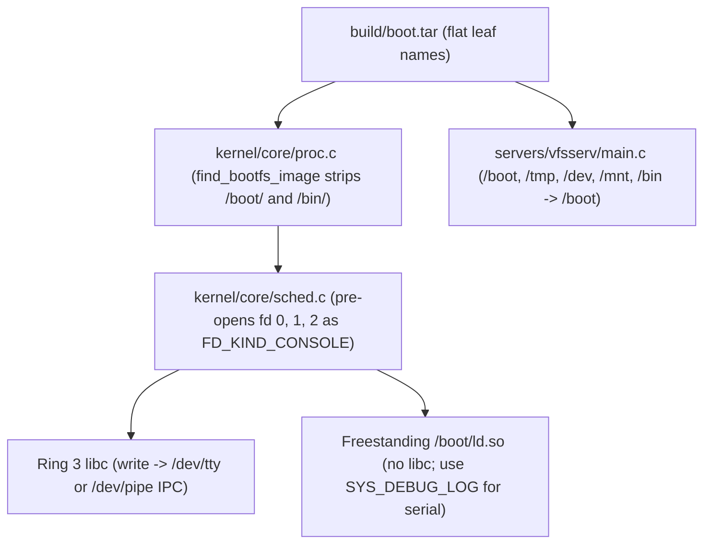

# Codebase Map and Implementation Rules

This reference gives the core build paths, memory layout, startup flow, and
checklists for `microkernel`. Read this map before you examine the repository so
you know the core layout rules.

## Build Targets and Output Paths

- Root `CMakeLists.txt` compiles `libc`, `libc.so`, `crt0.o`, `ld.so`,
  `boot.tar`, `kernel.elf`, and `microkernel.iso`. There is no
  `libc/CMakeLists.txt` file.
- `bin/CMakeLists.txt` compiles the shell (`sh`) and Ring 3 utilities with
  `microkernel_add_user_dynamic_executable`.
- `cmake/zlib.cmake`, `cmake/openssl.cmake`, and `cmake/openssh.cmake` compile
  out-of-tree ports for the Ring 3 sysroot.
- Key build outputs stay at these paths:
  - Kernel ELF: `build/kernel.elf`
  - Boot archive and ISO: `build/boot.tar`, `build/microkernel.iso`
  - Dynamic linker and C library: `build/ld.so`, `build/libc.so`,
    `sysroot/usr/lib/libc.a`
  - Shared port libraries: `build/libz.so.1`,
    `build/openssl-build/libcrypto.so.3`, `build/openssl-build/libssl.so.3`
  - Ring 3 test executables: `build/tests/<name>/<name>` (for example
    `build/tests/zlibtest/zlibtest`)

## Boot Archive, VFS, and Process Startup

`boot.tar` stores flat leaf names with no directory prefixes (for example
`ld.so`, `libc.so`, `sh`, `zlibtest`). The kernel and the Ring 3 VFS server see
those entries through two separate paths:

- **Kernel `execve` and boot spawn:** `find_bootfs_image()` in
  `kernel/core/proc.c` removes `/boot/` or `/bin/` prefixes and finds exact leaf
  names in `boot.tar`. `proc_spawn_init()` in `kernel/core/proc.c` starts all
  Ring 3 servers and test executables during automatic QEMU tests.
- **Ring 3 VFS tree:** `servers/vfsserv/main.c` puts `boot.tar` entries in
  `/boot`, makes `/tmp`, `/dev`, and `/mnt`, and adds `/bin` as a symlink to
  `/boot`.

## File Descriptors, Syscalls, and Freestanding Debug Output

- `kernel/core/sched.c` initializes `fd 0`, `fd 1`, and `fd 2` to
  `FD_KIND_CONSOLE` for each new process.
- Regular Ring 3 programs write to `stdout` through `libc/src/fd.c` and
  `libc/src/tty.c`, which send IPC messages to `/dev/tty` or `/dev/pipe`.
- `/boot/ld.so` (`libc/ldso/ldso.c`) is freestanding and does not link `libc`.
  To write temporary debug output directly to serial when a test connects `fd 1`
  to a pipe, call `__sys2(SYS_DEBUG_LOG, (long)(uintptr_t)msg, len)`.
- Syscall numbers (`SYS_*`) stay in `libc/include/sys/microkernel.h`.
- Inline syscall wrappers (`__sys0` through `__sys5`) stay in
  `libc/arch/x86-64/include/sys/arch/syscall.h`.
- FD table operations (`FD_OP_*`, `FD_KIND_*`) stay in `libc/include/sys/fd.h`.

## User Virtual Memory and Fault Rules

- `ELF_DYN_BASE` (`0x400000`) is the load bias for `ET_DYN` primary executables
  (defined in `kernel/include/kernel/elf.h`).
- `ELF_INTERP_BASE` (`0x18000000`) is the load bias for `/boot/ld.so` when it
  loads as `PT_INTERP`.
- `USER_MMAP_BASE` (`0x20000000`) is the start address for `VMMap` anonymous
  allocations (defined in `kernel/core/vmm.c`).
- `vmm_handle_page_fault()` in `kernel/core/vmm.c` handles only copy-on-write
  writes on present pages (`(err & 0x7) == 0x7`). Other Ring 3 page faults write
  `!!! kernel exception` and stop the virtual machine.
- Use `llvm-addr2line` in the container to map a fault `rip` to source code as
  an alternative to manual disassembly offsets:
  - Ring 0 (`rip >= 0xFFFFFFFF80000000`): `./scripts/env.sh llvm-addr2line -e
    build/kernel.elf -f -i 0x<rip>`
  - Ring 3 `ET_DYN`: subtract `0x400000` (or `0x18000000` for `PT_INTERP`) and
    start `./scripts/env.sh llvm-addr2line -e build/<elf> -f -i 0x<offset>`.

## Checklist: Add a Ring 3 Utility or QEMU Test

When you add a native Ring 3 utility in `bin/` or a new QEMU test in `tests/`:

1. Add the source file with the MIT Doxygen header (`CNV_0003`) and a `need::`
   marker (`COMP_` for utilities, `VER_` for tests).
2. Add a new utility in `bin/CMakeLists.txt` with
   `microkernel_add_user_dynamic_executable`. If the utility is not in the
   POSIX.1-2024 base set, add it to the extension allowlist in
   `tests/posix/test_symbol_diff.py`.
3. Add a new test directory in root `CMakeLists.txt` and start it from
   `proc_spawn_init()` in `kernel/core/proc.c`. Then add its serial regex to
   `scripts/qemu-expects.txt` and its `VER_` ID to `tests/test_runner.py`.
4. Start `./scripts/env.sh next-ids` to get the next `SWR_`, `COMP_`, and `VER_`
   IDs before you edit `docs/20-system/`, `docs/50-components/`, and
   `docs/60-verification/`.
5. Start `./scripts/formatter-agent.sh --fix` and `./scripts/build-agent.sh`
   before you commit.
