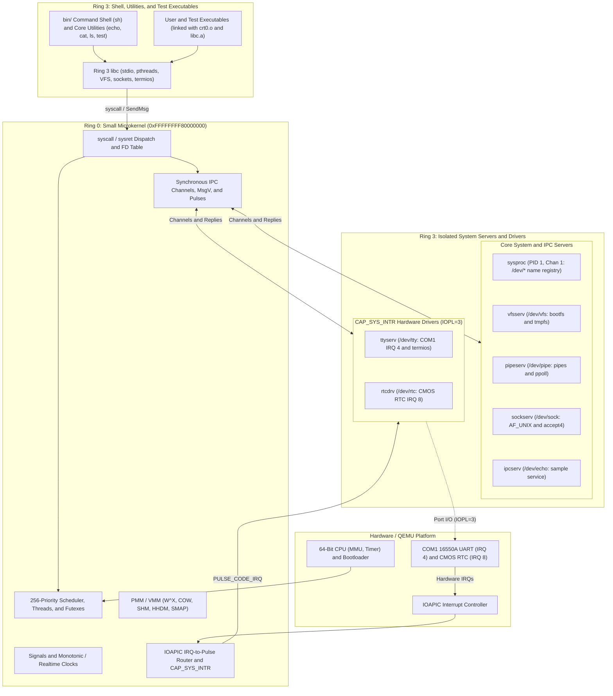

# System Context

## System Overview

`microkernel` is a small 64-bit operating system. Its user space targets
compatibility with interfaces from POSIX.1-2024 (IEEE Std 1003.1-2024 /
ISO/IEC/IEEE 9945:2026). The Ring 0 kernel operates at the higher-half virtual
address `0xFFFFFFFF80000000`. It gives preemptive 256-priority scheduling,
synchronous and scatter-gather IPC, threads, `FS.base` TLS, and futexes. It also
gives clocks and timers, signals, W^X and copy-on-write page tables, IOAPIC IRQ
pulses, and `syscall`/`sysret` dispatch.

GRUB boots the kernel with the Multiboot2 protocol. The kernel starts in 32-bit
mode, makes 64-bit higher-half page tables, and jumps to long mode. The kernel
loads the first user process `sysproc` from a `ustar` archive (`boot.tar`) on
the boot ISO. `sysproc` keeps the system name registry so that servers record
service names and clients find them. All other system services and device
drivers operate as isolated Ring 3 processes.

## System Topology

The diagram that follows shows how user executables, Ring 3 system servers,
privileged Ring 3 device drivers, the Ring 0 kernel, and platform hardware
connect.



## Directory Structure

```text
/
├── AGENTS.md                   <- Governance for AI agents (highest authority)
├── README.md                   <- Entry point and active user-space status
├── CHANGELOG.md                <- Release and unreleased change log
├── LICENSE.md                  <- MIT License (immutable)
├── .agent-scaffolding.yml      <- Agent governance configuration
├── .docs-traceability-setup.yml<- Sphinx-Needs model and check configuration
├── .editorconfig               <- Line length, encoding, and header rules
├── .clang-format               <- C format configuration (80 columns)
├── .clang-tidy                 <- Static analysis configuration
├── Containerfile               <- Podman build container image file
├── CMakeLists.txt              <- Four-step build and CTest integration
├── allowed_phrases.txt         <- Project multi-word technical phrases
├── technical_terms.txt         <- Project technical nouns and verbs
├── kernel/                     <- Ring 0 kernel (arch, core, include, lib)
├── libc/                       <- Freestanding C17 / POSIX.1-2024 user library
├── servers/                    <- Ring 3 system servers and device drivers
├── bin/                        <- Ring 3 command shell (sh) and core utilities
├── tests/                      <- QEMU harness, Ring 3, POSIX, and doc tests
├── config/sphinx/              <- Sphinx-Needs model, config, and tag scanner
├── tools/                      <- Traceability audit, POSIX audit, STE check
├── scripts/                    <- Container, build, format, hook, tar scripts
├── iso/                        <- GRUB Multiboot2 boot configuration
├── cmake/                      <- Clang cross-compilation toolchain
├── build/, sysroot/            <- Out-of-source build outputs
└── docs/
    ├── index.md                <- Sphinx-Needs document root
    ├── 00-overview/            <- Context, glossary, and WDRs
    ├── 10-product/             <- Product vision and BDRs
    ├── 20-system/              <- System and software requirements (SYS_, SWR_)
    ├── 30-architecture/        <- Architecture items (ARC_) and ADRs
    ├── 40-interfaces/          <- Interface Control Documents (ICD_)
    ├── 50-components/          <- White-box component specifications (COMP_)
    ├── 60-verification/        <- Verification specs (VER_) and matrices
    ├── records/                <- Conventions, tasks, roadmap, and history
    ├── THIRD-PARTY-NOTICES.md  <- Legal third-party attributions
    ├── agents/                 <- Build and format subagent files
    └── skills/                 <- Agent tool and workflow skills
```

## Component Descriptions

- `kernel/arch/x86-64/`: CPU and platform startup (`boot.S`), HAL (`arch.c`,
  `arch_trapframe.h`), GDT, IDT, interrupt stubs, LAPIC timer, serial port,
  linker script, and context switch.
- `kernel/core/`: Core subsystems for memory (`pmm`, `vmm`, `shm`, `kheap`),
  scheduling and processes (`sched`, `proc`, `time`, `entropy`), IPC and IRQs
  (`ipc`, `channel`, `intr`), signals (`signal`), syscalls (`syscall`), and boot
  (`elf`, `ustar`, `multiboot`).
- `kernel/include/`, `kernel/lib/`: Kernel-internal headers and freestanding
  helpers included through `kernel/` CMake include paths.
- `libc/`: Freestanding Ring 3 C17 and POSIX.1-2024 library (`crt0`, `errno`,
  `signal`, `time`, `pthread`, `semaphore`, `fd`, `vfs`, `tty`, `socket`, `aio`,
  `mman`, `malloc`, `wait`, `uchar`, `ctype`, `stdatomic`, `stdio`, `stdlib`,
  `string`, `unistd`, and `include/sys/` syscall wrappers).
- `servers/sysproc/`: First Ring 3 process (PID 1, channel 1). It keeps the
  service name registry for all Ring 3 servers.
- `servers/pipeserv/`: Ring 3 pipe and `ppoll` server recorded at `/dev/pipe`.
- `servers/vfsserv/`: Ring 3 virtual filesystem server recorded at `/dev/vfs`.
  It gives read-only `bootfs` at `/boot` and writable `tmpfs` at `/` and `/tmp`.
- `servers/ttyserv/`: Privileged Ring 3 COM1 serial TTY server recorded at
  `/dev/tty` with `CAP_SYS_INTR` IRQ 4 pulses and `<termios.h>` line mode.
- `servers/sockserv/`: Ring 3 `AF_UNIX` local sockets server recorded at
  `/dev/sock` with `SOCK_STREAM`, `SOCK_DGRAM`, `accept4`, and `ppoll`.
- `servers/ipcserv/`: Ring 3 sample echo server recorded at `/dev/echo`.
- `servers/rtcdrv/`: Privileged Ring 3 MC146818 CMOS RTC driver recorded at
  `/dev/rtc` with `CAP_SYS_INTR` port I/O and IOAPIC IRQ 8 pulses.
- `bin/`: Ring 3 command shell (`sh`) and standalone core utilities (`echo`,
  `cat`, `ls`, `true`, `false`, `test`) for POSIX.1-2024 XCU interfaces packed
  into `boot.tar`.
- `tests/`: `test_runner.py` (headless QEMU serial check harness, recorded in
  `docs/60-verification/qemu-harness.md` and `docs/skills/qemu-debug/SKILL.md`),
  Ring 3 test executables (`ipccli`, `sigtest`, `proctest`, `procchild`,
  `drvtest`, `timetest`, `pthreadtest`, `forkpipetest`, `exechelper`, `aiotest`,
  `canceltest`, `libctest`, `heaptest`, `vfstest`, `shmtest`, `ttytest`,
  `stdiotest`, `socktest`, `shtest`, `utilstest`, `jobtest`, `simdtest`,
  `mathtest`, `blktest`, `ext2test`, `smptest`, `stresstest`), `posix/`
  compatibility checks, and `traceability/` unit tests.
- `config/sphinx/`, `tools/`: Sphinx-Needs model (`needs_model.py`), code marker
  checker (`need_tag_check.py`), `check_needs_audit.py`, `audit_lib.py`, and
  `check_ste.py`.
- `scripts/`: `env.sh` (Podman workflow), `enter-dev.sh` (interactive shell),
  `mk_boot_tar.py` (ustar packer), `build-agent.sh` (all pre-commit checks),
  `formatter-agent.sh`, and `install-hooks.sh`.
- `cmake/clang-x86-64.cmake`, `cmake/arch/x86-64.cmake`: Clang target toolchain
  and platform build options (`-DMICROKERNEL_ARCH=x86-64`, LLD, LLVM binutils).
- `Containerfile`: Debian container with Clang, LLD, CMake, Ninja, GRUB tools,
  xorriso, mtools, QEMU, Python 3, `clang-format`, and `clang-tidy`.

## Integration Points

- `AGENTS.md`: Highest agent governance that links to `docs/skills/` and
  `docs/records/`.
- `.agents/skills`: Symlink to `docs/skills` for platform-neutral skill
  discovery.
- `scripts/env.sh`: Controls `Containerfile` (`microkernel-dev`), CMake, QEMU,
  `clang-format`, `clang-tidy`, and CTest.
- `CMakeLists.txt`: Controls the four-step OS build (`libc/`, `servers/`,
  `tests/`, `kernel/`, `scripts/mk_boot_tar.py`, `iso/boot/grub/grub.cfg`) and
  connects `docs/` and CTest.
- `build/boot.tar`: Keeps Ring 3 servers and test executables for the kernel ELF
  loader.
- `build/compile_commands.json`: Exported at configure time for `clang-tidy`.
- `scripts/build-agent.sh` and `scripts/install-hooks.sh`: Start format checks,
  `check_text.py --root .`, `tools/check_ste.py --root .`, build with Sphinx
  `-W`, headless QEMU tests, `clang-tidy`, and full CTest.
- `technical_terms.txt` and `allowed_phrases.txt`: Project term files that
  optional `tools/check_ste.py` (`ste-writing-skill`) uses.
