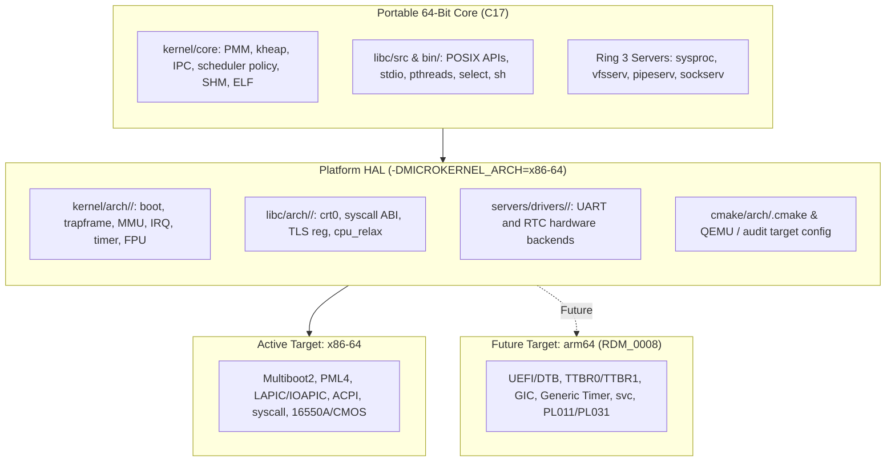

# ADR_0024 — Platform Abstraction Layout (x86-64 Active, Future arm64)

```{adr} Platform abstraction layout (x86-64 active, future arm64)
:id: ADR_0024
:status: accepted

Keep `x86-64` as the only active platform and plan future 64-bit ARM (`arm64`)
support without legacy 32-bit `x86`. Standardize architecture-specific folders
on `x86-64` and `arm64` behind a clean kernel, `libc`, driver, and build HAL.
```

## Context

`microkernel` currently targets `x86-64`. Most of `kernel/core/`, `libc/src/`,
`bin/`, and hardware-free Ring 3 servers (`sysproc`, `pipeserv`, `vfsserv`,
`sockserv`, `ipcserv`) are already portable 64-bit C17. However, CPU tables,
page-table bit masks, `trapframe_t` fields, `syscall`/`sysret` stubs, `FS.base`
TLS reads, `IOPLSet` port I/O, and QEMU flags remain directly coupled to
`x86-64`.

## Architecture Split



## Decision

- Keep `x86-64` as the only active target today and plan 64-bit ARM (`arm64`) in
  `RDM_0008`. Do not support 32-bit `x86` or other legacy platforms.
- Standardize platform directory names on `x86-64` and `arm64` across
  `kernel/arch/<arch>/`, `libc/arch/<arch>/`, hardware driver backends, and
  `cmake/arch/<arch>.cmake`, selected with `-DMICROKERNEL_ARCH=x86-64`.
- Isolate platform specifics behind clean interfaces: `arch_boot_parse()`,
  `trapframe_t` accessors, `arch_mmu_*` page-table operations, `arch_fpu_*` and
  `arch_set_tls_base()`, IRQ controller routing, `arch_entropy_sample()`,
  `arch_timer_now_ns()`, and `libc` `crt0`/syscall/TLS/`cpu_relax` stubs.
- Keep Ring 3 server line discipline and VFS logic portable while isolating
  hardware register access (`16550A`/CMOS port I/O on `x86-64` vs MMIO
  `PL011`/`PL031` on `arm64`).

## Rejected alternatives

- Supporting 32-bit `x86` or mixed 32/64-bit ABIs, which adds legacy complexity
  for no project value.
- Sprinkling `#ifdef __x86_64__` blocks throughout `kernel/core/` and `libc/`
  instead of using dedicated `x86-64` and `arm64` platform folders.

## Consequences

- `x86-64` remains the sole tested and built target until `arm64` bring-up
  begins under `RDM_0008`.
- Upcoming driver (`TSK_0024`) and SMP (`TSK_0025`) milestones can build on the
  clean `x86-64` HAL boundary after `TSK_0026`.
