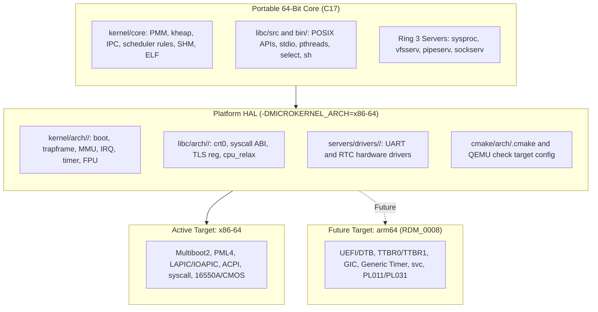

# ADR_0024 — Platform Abstraction Layout (x86-64 Active, Future arm64)

```{adr} Platform abstraction layout (x86-64 active, future arm64)
:id: ADR_0024
:status: accepted

The project keeps `x86-64` as the only active platform and plans future 64-bit
ARM (`arm64`) operation without older 32-bit `x86`. Architecture directories use
`x86-64` and `arm64` behind a clean kernel, `libc`, driver, and build HAL.
```

## Context

`microkernel` targets `x86-64` at this time. Most of `kernel/core/`,
`libc/src/`, `bin/`, and hardware-free Ring 3 servers (`sysproc`, `pipeserv`,
`vfsserv`, `sockserv`, `ipcserv`) are portable 64-bit C17. But CPU tables,
page-table bit masks, `trapframe_t` fields, `syscall`/`sysret` stubs, `FS.base`
TLS reads, `IOPLSet` port I/O, and QEMU flags stay coupled to `x86-64`.

## Architecture Division



## Decision

- The project keeps `x86-64` as the only active target at this time and plans
  64-bit ARM (`arm64`) in `RDM_0008`. It does not target 32-bit `x86` or other
  older platforms.
- Platform directories use `x86-64` and `arm64` across `kernel/arch/<arch>/`,
  `libc/arch/<arch>/`, hardware driver layers, and `cmake/arch/<arch>.cmake`,
  selected with `-DMICROKERNEL_ARCH=x86-64`.
- The HAL isolates platform code behind clean interfaces: `arch_boot_parse()`,
  `trapframe_t` accessors, `arch_mmu_*` page-table calls, `arch_fpu_*`,
  `arch_set_tls_base()`, IRQ control, `arch_entropy_sample()`,
  `arch_timer_now_ns()`, and `libc` `crt0`/syscall/TLS/`cpu_relax` stubs.
- Ring 3 server line discipline and VFS logic stay portable, and hardware
  register access stays isolated (`16550A`/CMOS port I/O on `x86-64` compared
  with MMIO `PL011`/`PL031` on `arm64`).

## Rejected alternatives

- 32-bit `x86` or mixed 32/64-bit ABIs, which add complexity for no project
  benefit.
- `#ifdef __x86_64__` blocks across `kernel/core/` and `libc/` as an alternative
  to isolated `x86-64` and `arm64` directories.

## Results

- `x86-64` stays the only target with builds and tests until `arm64` work starts
  in `RDM_0008`.
- Driver (`TSK_0024`) and SMP (`TSK_0025`) milestones can use the clean `x86-64`
  HAL boundary after `TSK_0026`.
