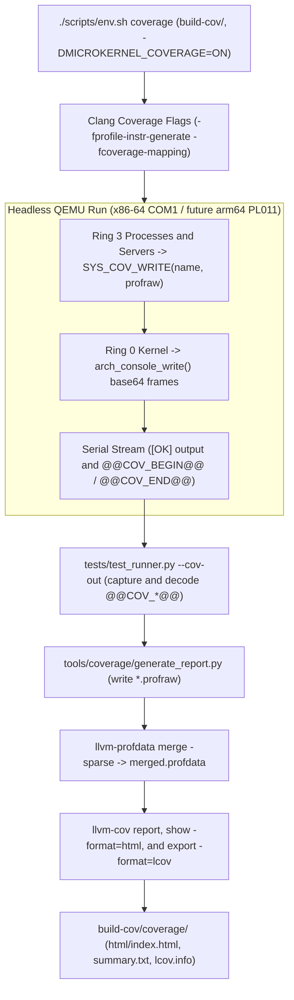

# ADR_0025 — Optional LLVM Coverage Through Portable Console Frames

```{adr} Optional LLVM coverage through portable console frames
:id: ADR_0025
:status: accepted

The project adds optional `-DMICROKERNEL_COVERAGE=ON` LLVM source coverage for
Ring 0 and Ring 3. It writes freestanding `profraw` v8 data as base64 lines
through `arch_console_write()` when a developer operates `./scripts/env.sh
coverage`.
```

## Context

`microkernel` does checks of requirement links (`docs.audit`), POSIX.1-2024
symbol counts (`posix.symbol_diff`), and QEMU serial output. It does not record
line, function, region, or conditional coverage for C source files. Ring 0
intentionally has no filesystem driver, and Ring 3 has no disk filesystem at
this time. The coverage output path must stay portable across `x86-64` and
future `arm64` without x86-only ISA ports such as `isa-debugcon`.

## Coverage Pipeline



## Decision

- Standard `build/` and `./scripts/build-agent.sh` builds stay uninstrumented
  (`MICROKERNEL_COVERAGE=OFF`). Coverage operates when necessary in an isolated
  `build-cov/` directory through `./scripts/env.sh coverage`.
- `kernel/arch/x86-64/linker.ld` and `libc/arch/x86-64/user.ld` mark
  `__llvm_prf_data`, `__llvm_prf_cnts`, and `__llvm_prf_names` with start and
  stop symbols.
- `MICROKERNEL_COVERAGE=ON` compiles a freestanding LLVM `profraw` v8 writer
  with no host `compiler-rt` library. Ring 3 processes flush coverage data on
  exit and on server flush calls through `SYS_COV_WRITE`. The kernel writes
  base64 `@@COV_BEGIN@@` and `@@COV_END@@` records and the kernel coverage data
  through `arch_console_write()`. Thus `x86-64` (`COM1`), `arm64` (`PL011`), and
  hardware share one output path.
- `tests/test_runner.py --cov-out` captures `@@COV_*@@` lines, and
  `tools/coverage/generate_report.py` writes `.profraw` files. `llvm-profdata`
  and `llvm-cov` then make HTML, LCOV, and text summary reports.

## Rejected alternatives

- x86-only `isa-debugcon` (port `0xE9`), which `arm64` QEMU `virt` does not
  have.
- A Ring 3 disk filesystem (`TSK_0024`), which adds disk I/O while Ring 0 cannot
  write `.profraw` files.
- Host-only mocked unit tests, which miss syscalls, VMM copy-on-write page
  faults, IPC channels, and hardware IRQ paths.
- QEMU TCG PC records, which do not have conditional coverage and do not isolate
  shared user virtual addresses across processes.

## Results

- Automatic line, region, function, and conditional coverage includes Ring 0 and
  Ring 3 (`libc`, servers, utilities) with no manual report work and no more
  container packages.
- Coverage output operates identically on `x86-64`, future `arm64`, and hardware
  with no more QEMU devices.
- Standard release builds and pre-commit check times stay unchanged.
