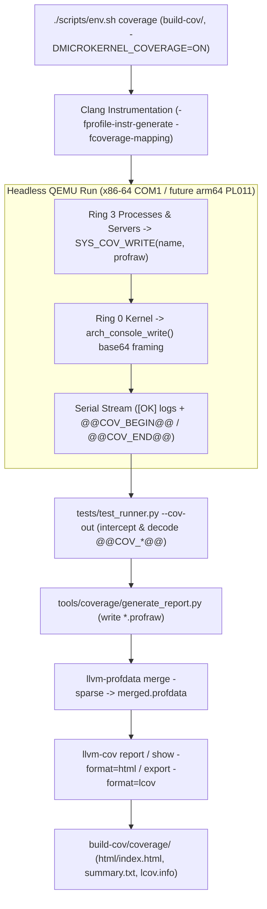

# ADR_0025 — Opt-In LLVM Coverage Over Portable Console Framing

```{adr} Opt-in LLVM coverage over portable console framing
:id: ADR_0025
:status: accepted

Add opt-in `-DMICROKERNEL_COVERAGE=ON` LLVM source-based coverage for Ring 0 and
Ring 3. Stream freestanding Raw Profile v8 data as base64 lines over
`arch_console_write()`, driven on demand by `./scripts/env.sh coverage`.
```

## Context

`microkernel` verifies requirement links (`docs.audit`), POSIX.1-2024 symbol
counts (`posix.symbol_diff`), and QEMU serial assertions. It does not yet record
line, function, region, or branch coverage for C sources. Ring 0 intentionally
has no file system driver, and Ring 3 does not yet mount a disk file system.
Coverage transport must also stay portable across `x86-64` and future `arm64`
without x86-only ISA ports such as `isa-debugcon`.

## Coverage Pipeline



## Decision

- Keep default `build/` and `./scripts/build-agent.sh` runs completely
  uninstrumented (`MICROKERNEL_COVERAGE=OFF`). Run coverage on demand in an
  isolated `build-cov/` directory via `./scripts/env.sh coverage`.
- Anchor `__llvm_prf_data`, `__llvm_prf_cnts`, and `__llvm_prf_names` with start
  and stop symbols in `kernel/arch/x86-64/linker.ld` and
  `libc/arch/x86-64/user.ld`.
- Build a freestanding LLVM Raw Profile v8 emitter with no host `compiler-rt`
  dependency under `MICROKERNEL_COVERAGE=ON`. Flush Ring 3 profiles on process
  exit and on a server flush trigger through `SYS_COV_WRITE`. Emit base64-framed
  `@@COV_BEGIN@@` / `@@COV_END@@` records and the kernel profile over
  `arch_console_write()`, so `x86-64` (`COM1`), `arm64` (`PL011`), and bare
  metal share one transport.
- Intercept `@@COV_*@@` lines in `tests/test_runner.py --cov-out` and decode
  `.profraw` files in `tools/coverage/generate_report.py`. Run `llvm-profdata`
  and `llvm-cov` to produce HTML, LCOV, and text summary reports.

## Rejected alternatives

- Using x86-only `isa-debugcon` (port `0xE9`), which `arm64` QEMU `virt` does
  not support.
- Waiting for a Ring 3 disk file system (`TSK_0024`), which still leaves Ring 0
  unable to write `.profraw` files directly and adds disk I/O overhead.
- Host-only mocked unit tests, which miss real syscalls, VMM copy-on-write
  faults, IPC channels, and hardware IRQ paths.
- QEMU TCG PC traces, which lack branch coverage and struggle with shared user
  virtual addresses across processes.

## Consequences

- Automated line, region, function, and branch coverage covers both Ring 0 and
  Ring 3 (`libc`, servers, utilities). It needs zero manual report work and zero
  extra container packages.
- Coverage transport works identically on `x86-64`, future `arm64`, and bare
  metal with zero extra QEMU devices.
- Default release builds and pre-commit gate latency stay unchanged.
