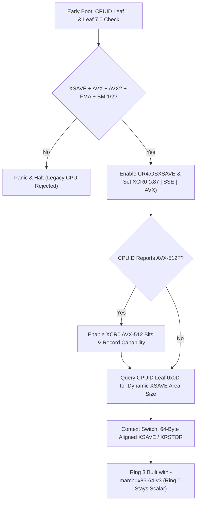

# ADR_0026 — Minimum x86-64-v3 Baseline, XSAVE Contexts, and Optional AVX-512

```{adr} Minimum x86-64-v3 baseline, XSAVE contexts, and optional AVX-512
:id: ADR_0026
:status: accepted

Require `x86-64-v3` (`XSAVE`, `AVX`, `AVX2`, `FMA`, `BMI1`, `BMI2`) on `x86-64`
boot and fail on legacy CPUs. Switch extended vector state with `XSAVE`/`XRSTOR`
and enable `AVX-512` opportunistically when present, never as a minimum.
```

## Context

Supporting pre-AVX legacy `x86-64` CPUs carries complexity and blocks modern
vectorized `libc`, `<math.h>`, and `<fenv.h>` code generation. Legacy 512-byte
`fxsave`/`fxrstor` saves only x87 and 128-bit `XMM` registers and can corrupt
256-bit `YMM` (`AVX`/`AVX2`) or 512-bit `ZMM` (`AVX-512`) state across thread
switches. At the same time, `AVX-512` is absent on many modern CPUs and QEMU TCG
emulation, so `AVX-512` must stay optional.

## Boot and Vector State Flow



## Decision

- Standardize the minimum `x86-64` CPU level on **`x86-64-v3`** (`XSAVE`, `AVX`,
  `AVX2`, `FMA`, `BMI1`, `BMI2`, `F16C`, `MOVBE`, `POPCNT`). Reject CPUs missing
  mandatory features cleanly during early `kernel/arch/x86-64/` boot.
- Detect `AVX-512` dynamically via `CPUID` and enable its `XCR0` state bits when
  present so Ring 3 libraries can dispatch `AVX-512` fast paths on demand. Never
  require `AVX-512` to boot or run tests.
- Replace fixed 512-byte `fxsave`/`fxrstor` in `kernel/arch/x86-64/switch.S`
  with dynamically sized, 64-byte-aligned `xsave`/`xrstor` using `CPUID` leaf
  `0x0D`.
- Compile Ring 3 user space (`libc`, `servers`, `bin`, `tests`) with
  `-march=x86-64-v3`. Keep Ring 0 strictly scalar (`-mno-mmx -mno-sse -mno-sse2
  -mno-avx -mno-avx2`) so fast syscalls incur zero vector save overhead.
- Update the `x86-64` QEMU test profile to expose `x86-64-v3` features plus
  `SMAP`/`SMEP`, and add a negative boot test confirming legacy CPUs fail fast.

## Rejected alternatives

- Supporting baseline `x86-64-v1` (SSE2 only), which adds legacy baggage and
  forfeits hardware `FMA` and 256-bit `AVX2` code generation.
- Requiring `AVX-512` as a boot minimum, which breaks on consumer `x86-64` CPUs
  and containerized QEMU TCG emulation.
- Keeping 512-byte `fxsave`/`fxrstor`, which silently corrupts `YMM` and `ZMM`
  registers across preemptive switches.

## Consequences

- Ring 3 user space gains full `AVX`, `AVX2`, `FMA`, and `BMI1`/`BMI2` code
  generation with safe per-thread extended register switching.
- Future `<math.h>` and `<fenv.h>` implementations can rely on hardware `FMA`
  and IEEE-754 `MXCSR` preservation across threads.
- Future SMP secondary CPU bring-up (`SWR_PROC_0009`) must apply the same
  `CR4.OSXSAVE` and `XCR0` initialization on every AP.
