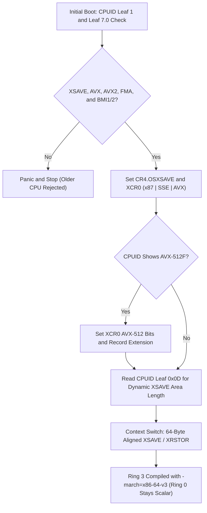

# ADR_0026 — Minimum x86-64-v3 Baseline, XSAVE Contexts, and Optional AVX-512

```{adr} Minimum x86-64-v3 baseline, XSAVE contexts, and optional AVX-512
:id: ADR_0026
:status: accepted

Boot on `x86-64` must find `x86-64-v3` (`XSAVE`, `AVX`, `AVX2`, `FMA`, `BMI1`,
`BMI2`) and stop on older CPUs. Each context switch uses `XSAVE` and `XRSTOR`
for extended vector state, and activates `AVX-512` only when the CPU has it.
```

## Context

Pre-AVX older `x86-64` CPUs add complexity and prevent vectorized `libc`,
`<math.h>`, and `<fenv.h>` code generation. Older 512-byte `fxsave` and
`fxrstor` keep only x87 and 128-bit `XMM` registers. They can corrupt 256-bit
`YMM` (`AVX` and `AVX2`) or 512-bit `ZMM` (`AVX-512`) state during a context
switch. Many modern CPUs and QEMU TCG do not have `AVX-512`, and `AVX-512` must
stay optional.

## Boot and Vector State Flow



## Decision

- The minimum `x86-64` CPU level is **`x86-64-v3`** (`XSAVE`, `AVX`, `AVX2`,
  `FMA`, `BMI1`, `BMI2`, `F16C`, `MOVBE`, `POPCNT`). Initial
  `kernel/arch/x86-64/` boot rejects CPUs with missing extensions.
- The kernel finds `AVX-512` dynamically through `CPUID` and sets its `XCR0`
  state bits when the CPU has it. Ring 3 libraries can then use `AVX-512` fast
  paths, and boot and tests operate without `AVX-512`.
- `kernel/arch/x86-64/switch.S` replaces fixed 512-byte `fxsave` and `fxrstor`
  with dynamically allocated, 64-byte-aligned `xsave` and `xrstor` from `CPUID`
  leaf `0x0D`.
- The build compiles Ring 3 user space (`libc`, `servers`, `bin`, `tests`) with
  `-march=x86-64-v3`. Ring 0 stays scalar (`-mno-mmx -mno-sse -mno-sse2 -mno-avx
  -mno-avx2`). Thus fast syscalls have no vector context work.
- The `x86-64` QEMU test configuration includes `x86-64-v3` extensions with
  `SMAP` and `SMEP`. A negative boot test makes sure that older CPUs stop
  immediately.

## Rejected alternatives

- Baseline `x86-64-v1` (SSE2 only), which adds older code paths and prevents
  hardware `FMA` and 256-bit `AVX2` code generation.
- `AVX-512` as a boot minimum, which stops on consumer `x86-64` CPUs and
  containerized QEMU TCG.
- 512-byte `fxsave` and `fxrstor`, which silently corrupt `YMM` and `ZMM`
  registers during a preemptive context switch.

## Results

- Ring 3 user space can use full `AVX`, `AVX2`, `FMA`, and `BMI1`/`BMI2` code
  generation with a safe extended register context switch for each thread.
- Future `<math.h>` and `<fenv.h>` code can use hardware `FMA` and IEEE-754
  `MXCSR` state across threads.
- Future SMP secondary CPU start (`SWR_PROC_0009`) must apply the same
  `CR4.OSXSAVE` and `XCR0` configuration on each AP.
