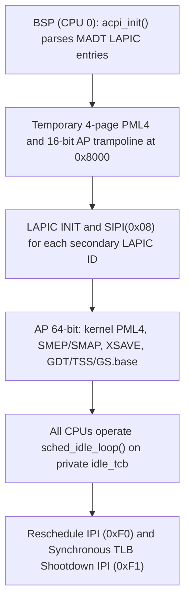

# ADR_0027 — Multi-Core SMP Start, CPU State, and Spinlock Sequence

```{adr} Multi-core SMP start, CPU state, and spinlock sequence
:id: ADR_0027
:status: accepted

Secondary CPUs start behind portable HAL interfaces (`INIT`/`SIPI` and `GS.base`
on `x86-64`, prepared for `PSCI` and `TPIDR_EL1` on future `arm64`). The kernel
uses global 256-priority ready queues with private `idle_tcb` threads, fair
ticket spinlocks, reschedule IPIs, and deadlock-free synchronous TLB shootdown
IPIs.
```

## Context

For `SWR_PROC_0009`, the kernel must operate across more than one CPU core in
QEMU (`-smp 2` and `-smp 4`). Before this decision, only CPU 0 (BSP) operated
while secondary CPUs stayed stopped. Kernel subsystems (`pmm`, `kheap`, `vmm`,
`sched`, `ipc`, `futex`, `time`, `signal`, `shm`, `intr`, `proc`, `printk`) also
used unlocked globals and one `g_current` pointer.

## SMP Architecture



## Decision

- `kernel/core/acpi.c` parses `MADT` Processor Local APIC entries (type `0`) up
  to `SMP_MAX_CPUS` (`16`).
- Portable `kernel/include/kernel/arch.h` interfaces isolate AP start
  (`arch_smp_boot_aps()`, `arch_ap_cpu_init()`, `arch_set_cpu_local()`,
  `arch_get_cpu_local()`, `arch_smp_send_resched_ipi()`, and
  `arch_smp_send_tlb_shootdown_ipi()`).
- On `x86-64`, the kernel writes `ap_trampoline.S` to `0x8000` and makes a
  temporary 4-frame trampoline PML4. It wakes each AP with `INIT` and `SIPI`,
  loads `g_kernel_pml4`, and sets `SMEP`/`SMAP` and `x86-64-v3` `XSAVE`/`XCR0`
  (`ADR_0026`). Each AP installs its own GDT, TSS, `GS.base`, and `swapgs` in
  `isr.S`/`switch.S`, and starts its LAPIC timer from the BSP period.
- The scheduler keeps shared 256-level ready queues (`g_sched_lock`) and a
  private `idle_tcb` for each CPU. It keeps `g_sched_lock` locked across
  `switch_to()` and completes the previous thread in `sched_post_switch()`. Two
  CPUs do not share a kernel stack or XSAVE area.
- The kernel obeys a fixed spinlock sequence (`g_proc_lock ->
  g_ipc_lock/g_shm_lock -> g_kheap_lock -> g_vmm_lock -> g_pmm_lock`, with leaf
  spinlocks `g_sched_lock` and `g_console_lock`). `vmm_tlb_shootdown()` operates
  only with no `irqsave` spinlocks locked and local interrupts active (`IF=1`).
- `boot_info_t.cpu_count` and `struct __k_sys_stats.online_cpus` show active CPU
  counts.

## Rejected alternatives

- Private ready queues for each CPU with periodic work migration, which add
  complexity and weaken global 256-priority scheduling and IPC priority
  inheritance on 2 to 16 cores.
- TLB shootdown IPIs with `irqsave` spinlocks locked, which deadlock when two
  CPUs flush TLB entries at the same time.

## Results

- All Ring 3 tests and `tests/smptest/` operate on 2 active CPUs in standard
  runs. CTest `proc.smp_cores` (`VER_PROC_0007`) operates tests on 4 CPUs.
- `kernel/core/` stays architecture-neutral for future `arm64` `PSCI` start.
