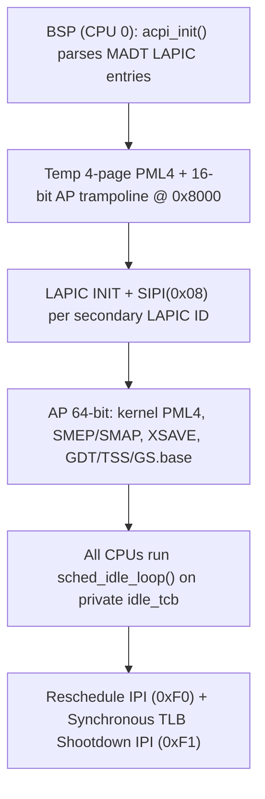

# ADR_0027 — Multi-Core SMP Bring-Up, Per-CPU State, and Lock Hierarchy

```{adr} Multi-core SMP bring-up, per-CPU state, and lock hierarchy
:id: ADR_0027
:status: accepted

Start secondary CPUs behind portable HAL hooks (`INIT`/`SIPI` and `GS.base` on
`x86-64`, ready for `PSCI` and `TPIDR_EL1` on future `arm64`). Use a global
256-priority runqueue with per-CPU idle threads, fair ticket spinlocks,
reschedule IPIs, and deadlock-free synchronous TLB shootdown IPIs.
```

## Context

`SWR_PROC_0009` requires symmetric multiprocessing across multiple CPU cores
under QEMU (`-smp 2` and `-smp 4`). Previously, only CPU 0 (BSP) ran while
secondary CPUs stayed halted, and kernel subsystems (`pmm`, `kheap`, `vmm`,
`sched`, `ipc`, `futex`, `time`, `signal`, `shm`, `intr`, `proc`, `printk`) used
unprotected globals and a single `g_current` pointer.

## SMP Architecture



## Decision

- Parse `MADT` Processor Local APIC entries (type `0`) in `kernel/core/acpi.c`
  up to `SMP_MAX_CPUS` (`16`).
- Isolate AP bring-up behind portable `kernel/include/kernel/arch.h` hooks
  (`arch_smp_boot_aps()`, `arch_ap_cpu_init()`, `arch_set_cpu_local()`,
  `arch_get_cpu_local()`, `arch_smp_send_resched_ipi()`, and
  `arch_smp_send_tlb_shootdown_ipi()`).
- On `x86-64`, copy `ap_trampoline.S` to `0x8000` and build a temporary 4-frame
  trampoline PML4. Wake each AP with `INIT`/`SIPI`, switch to `g_kernel_pml4`,
  and enable `SMEP`/`SMAP` plus `x86-64-v3` `XSAVE`/`XCR0` (`ADR_0026`). Install
  per-CPU GDT/TSS/GS.base and `swapgs` in `isr.S`/`switch.S`, then start each AP
  LAPIC timer from the BSP-calibrated period.
- Keep a shared 256-level priority runqueue (`g_sched_lock`) with a private
  per-CPU `idle_tcb`. Hold `g_sched_lock` across `switch_to()` and finalize the
  outgoing thread in `sched_post_switch()`. Two CPUs never share a kernel stack
  or XSAVE area.
- Enforce a strict lock hierarchy (`g_proc_lock -> g_ipc_lock/g_shm_lock ->
  g_kheap_lock -> g_vmm_lock -> g_pmm_lock`, with leaf locks `g_sched_lock` and
  `g_console_lock`) and run `vmm_tlb_shootdown()` only with no `irqsave` locks
  held and local interrupts enabled (`IF=1`).
- Expose online CPU counts in `boot_info_t.cpu_count` and `struct
  __k_sys_stats.online_cpus`.

## Rejected alternatives

- Per-CPU runqueues with periodic work stealing, which adds complexity and
  weakens strict global 256-priority scheduling and IPC priority inheritance on
  2 to 16 cores.
- Running TLB shootdown IPIs while holding `irqsave` spinlocks, which deadlocks
  when two CPUs shoot down simultaneously.

## Consequences

- All Ring 3 tests and `tests/smptest/` run concurrently across 2 active CPUs by
  default and across 4 CPUs in CTest `proc.smp_cores` (`VER_PROC_0007`).
- `kernel/core/` stays architecture-neutral for future `arm64` `PSCI` bring-up.
