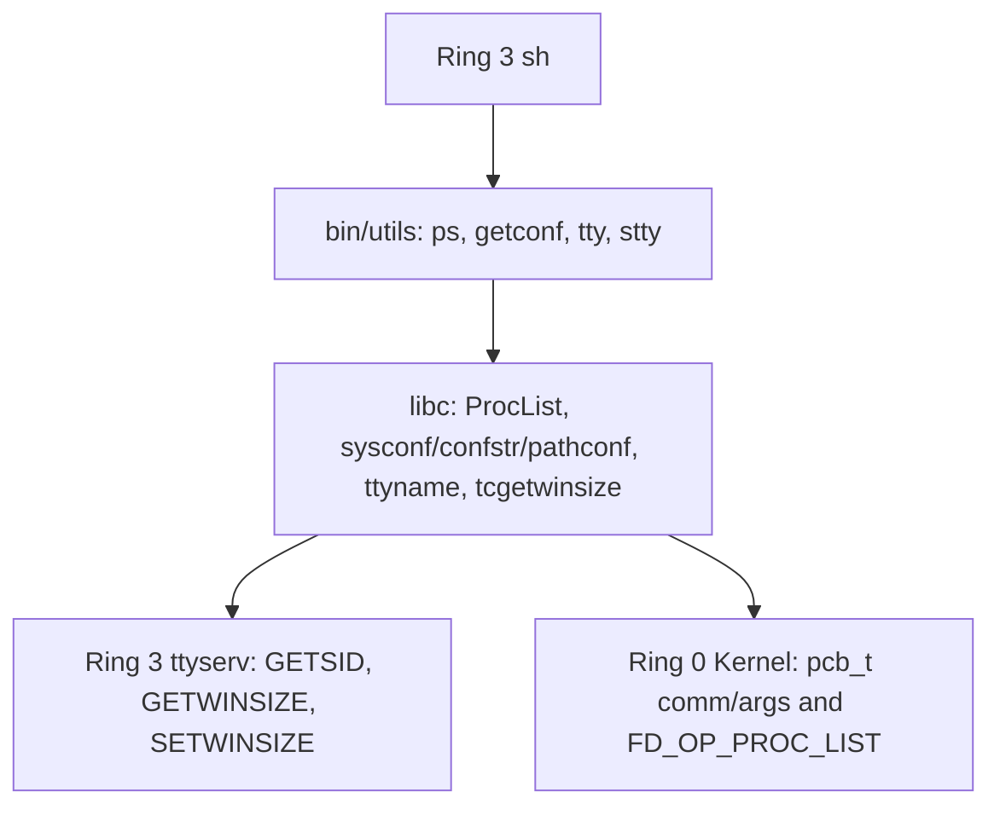

# ADR_0028 — Read-Only Process Snapshot ABI and POSIX.1-2024 Utilities

```{adr} Read-only process snapshot ABI and POSIX.1-2024 utilities
:id: ADR_0028
:status: accepted

Ring 3 POSIX.1-2024 `ps` uses a bounded, read-only kernel snapshot
(`FD_OP_PROC_LIST` with `ProcList`) as an alternative to a Linux `/proc`
filesystem. `sysconf`, `confstr`, `pathconf`, `fpathconf`, `getconf`, `tty`, and
`stty` stay in POSIX.1-2024 Base interfaces (`BDR_0004`).
```

## Context

For `SWR_PROC_0010`, the system must give process inspection (`ps`), system
configuration queries (`sysconf`, `confstr`, `pathconf`, `fpathconf`,
`getconf`), and terminal name and window-dimension controls (`ttyname`,
`ctermid`, `tcgetsid`, `tcgetwinsize`, `tcsetwinsize`, `tty`, `stty`). To obey
`BDR_0004`, public user space does not include Linux `/proc`, GNU `nproc`, or
non-standard `_SC_*` constants.

## Architecture



## Decision

1. **Kernel process metadata:** `pcb_t` keeps `comm[32]` and `args[64]`. The
   kernel fills them on bootfs start, makes a copy across `fork`, and changes
   them after `execve` loads the new image.
2. **Bounded snapshot:** `sys_fd_op()` processes `FD_OP_PROC_LIST` (`13u`). It
   writes up to `PROC_LIST_MAX` (`64`) active and zombie entries into a heap
   buffer with `g_proc_lock` locked, unlocks, and writes them to user space with
   `copy_to_user()`.
3. **Isolated headers:** `<sys/proc.h>` keeps `struct __k_proc_info` and
   `ProcList()`. `<unistd.h>` and other POSIX headers do not include
   `<sys/proc.h>`.
4. **Terminal state:** `/dev/tty` (`ttyserv`) adds `TTY_OP_GETSID`,
   `TTY_OP_GETWINSIZE`, and `TTY_OP_SETWINSIZE`. Thus `tcgetsid`,
   `tcgetwinsize`, `tcsetwinsize`, and `stty` stay in Ring 3.
5. **Base configuration:** `<unistd.h>` declares only POSIX.1-2024 Base `_SC_*`,
   `_CS_*`, and `_PC_*` names. Configuration calls keep `errno` unchanged on
   correct indeterminate `-1` results.

## Results

- `ps`, `getconf`, `tty`, and `stty` operate in Ring 3 with no `/proc`
  complexity.
- `posix.headers` makes sure that non-POSIX `_SC_NPROCESSORS_ONLN` is missing
  from `<unistd.h>`.
- `posix.symbol_diff` counts header-defined standard macros with `libc.a`
  exports and makes sure that headers obey namespace rules.
