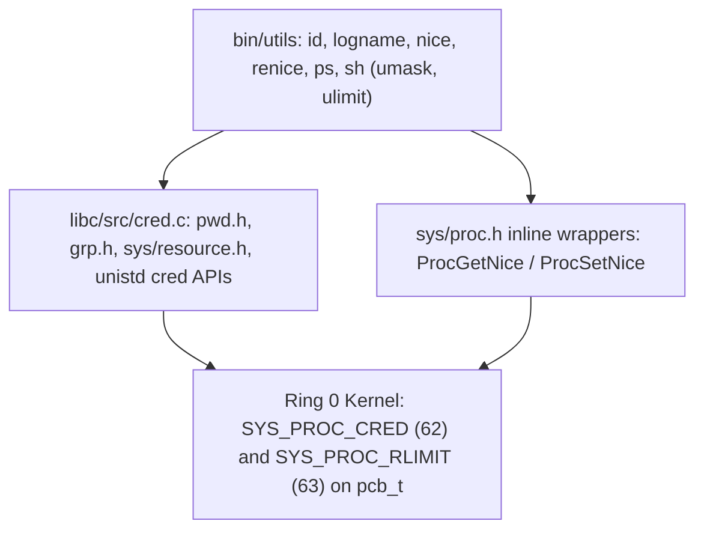

# ADR_0029 — Process Credentials, Nice Values, and Resource Limits

```{adr} Process credentials, nice values, and resource limits
:id: ADR_0029
:status: accepted

`pcb_t` keeps POSIX.1-2024 user and group credentials (`uid`/`euid`/`suid`,
`gid`/`egid`/`sgid`, supplementary groups), process `nice`, and `rlimit` limits.
`SYS_PROC_CRED` and `SYS_PROC_RLIMIT` give access to them, and `<pwd.h>`,
`<grp.h>`, and `<sys/resource.h>` stay in Base Issue 8 (`BDR_0004`).
```

## Context

For `SWR_PROC_0011`, the system must give Base process credentials, `<pwd.h>`,
`<grp.h>`, `<sys/resource.h>`, and utilities (`id`, `logname`, `nice`, `renice`,
`umask`, `ulimit`). To obey `BDR_0004`, `XSI`-only interfaces (`getpwent`,
`getgrent`, `getpriority`, `setpriority`, `nice()`, `getrusage`) must stay out
of `libc.a` until `XSI` is gated.

## Architecture



## Decision

1. **Kernel state:** `pcb_t` adds `uid`/`euid`/`suid`, `gid`/`egid`/`sgid`,
   `groups[8]`, `nice` (`-20` to `19`), and `rlimits[7]`. `fork` inherits these
   fields, and `sys_fd_op()` obeys `RLIMIT_NOFILE`.
2. **Syscalls:** The kernel adds `SYS_PROC_CRED` (`62`) for UID, GID, group, and
   `nice` operations with POSIX `EPERM` checks on non-root callers. It also adds
   `SYS_PROC_RLIMIT` (`63`) for `getrlimit` and `setrlimit`.
3. **Base headers:** `<pwd.h>`, `<grp.h>`, `<sys/resource.h>`, and `<unistd.h>`
   declare only POSIX.1-2024 Base functions. `nice` and `renice` use inline
   `ProcGetNice` and `ProcSetNice` wrappers in `<sys/proc.h>`.
4. **Built-in user and group tables:** Reentrant `getpw*_r` and `getgr*_r`
   functions give `root` (`0`) and `nobody` (`65534`) with groups `root` (`0`),
   `wheel` (`10`), and `nogroup` (`65534`).

## Results

- `headers_base_implemented` increases to 47/70, `interfaces_base_implemented`
  adds 21 Base functions, and `utilities_base_implemented` adds 6 XCU Base
  utilities.
- `ps` shows process UIDs, group names, and `nice` values from `ProcList()`.
- Non-root processes cannot increase hard limits, get back removed UIDs, or
  decrease `nice` values.
