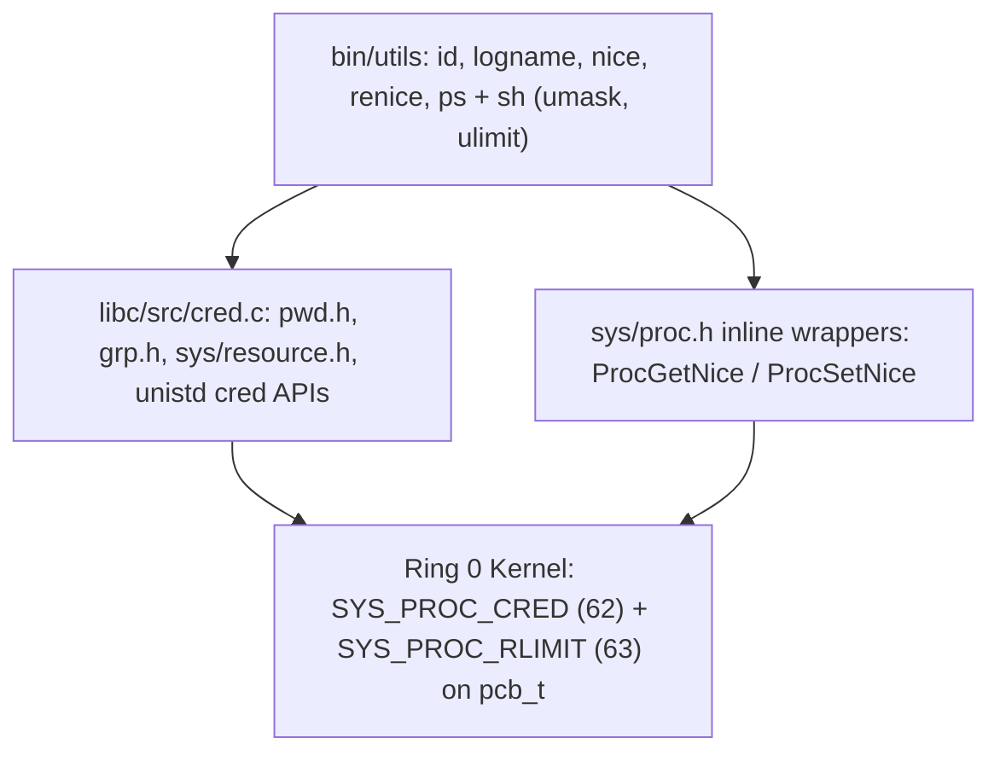

# ADR_0029 — Process Credentials, Nice Values, and Resource Limits

```{adr} Process credentials, nice values, and resource limits
:id: ADR_0029
:status: accepted

Store POSIX.1-2024 user/group credentials (`uid`/`euid`/`suid`,
`gid`/`egid`/`sgid`, supplementary groups), process `nice`, and `rlimit` bounds
on `pcb_t`. Expose them through `SYS_PROC_CRED` and `SYS_PROC_RLIMIT`, keeping
`<pwd.h>`, `<grp.h>`, and `<sys/resource.h>` strictly within Base Issue 8
(`BDR_0004`).
```

## Context

`SWR_PROC_0011` requires Base process credentials, `<pwd.h>`, `<grp.h>`,
`<sys/resource.h>`, and utilities (`id`, `logname`, `nice`, `renice`, `umask`,
`ulimit`). Under `BDR_0004`, `XSI`-only interfaces (`getpwent`, `getgrent`,
`getpriority`, `setpriority`, `nice()`, `getrusage`) must stay out of `libc.a`
until `XSI` is explicitly gated.

## Architecture



## Decision

1. **Kernel state:** Add `uid`/`euid`/`suid`, `gid`/`egid`/`sgid`, `groups[8]`,
   `nice` (`-20` to `19`), and `rlimits[7]` to `pcb_t`. Inherit them across
   `fork` and enforce `RLIMIT_NOFILE` in `sys_fd_op()`.
2. **Syscalls:** Add `SYS_PROC_CRED` (`62`) for UID/GID/groups/nice operations
   with POSIX `EPERM` checks for non-root callers, and `SYS_PROC_RLIMIT` (`63`)
   for `getrlimit`/`setrlimit`.
3. **Strict Base headers:** Declare only POSIX.1-2024 Base functions in
   `<pwd.h>`, `<grp.h>`, `<sys/resource.h>`, and `<unistd.h>`. Back `nice` and
   `renice` with inline `ProcGetNice`/`ProcSetNice` wrappers in `<sys/proc.h>`.
4. **Built-in user/group tables:** Serve `root` (`0`) and `nobody` (`65534`)
   plus `root` (`0`), `wheel` (`10`), and `nogroup` (`65534`) through reentrant
   `getpw*_r` and `getgr*_r` helpers.

## Consequences

- `headers_base_implemented` advances to 47/70, `interfaces_base_implemented`
  adds 21 Base functions, and `utilities_base_implemented` adds 6 XCU Base
  utilities.
- `ps` displays real process UIDs, group names, and nice values from
  `ProcList()`.
- Non-root processes cannot raise hard limits, regain dropped UIDs, or lower
  nice values.
