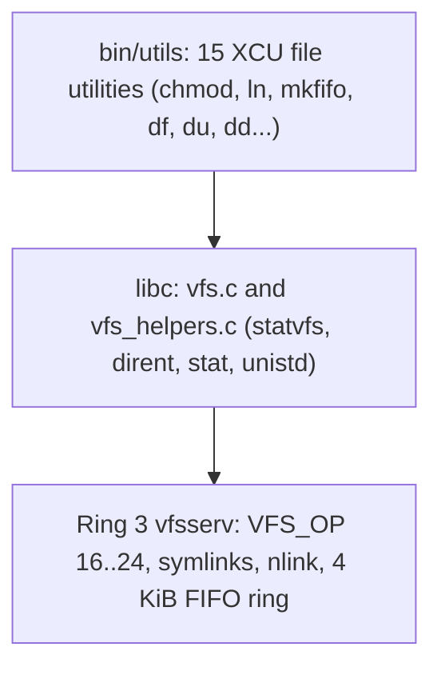

# ADR_0030 — VFS Links, Permissions, FIFOs, Positional I/O, and statvfs

```{adr} VFS links, permissions, FIFOs, positional I/O, and statvfs
:id: ADR_0030
:status: accepted

The Ring 3 `vfsserv` protocol and `libc` add POSIX.1-2024 Base permissions,
ownership, links, FIFOs, positional I/O, `posix_getdents`, and
`<sys/statvfs.h>`. `XSI`-only APIs stay out of `libc.a` (`BDR_0004`).
```

## Context

For `SWR_IPC_0012`, the system must give POSIX.1-2024 Base permissions, links,
FIFOs, positional I/O, `posix_getdents`, `<sys/statvfs.h>`, temp-file functions,
and 15 XCU file utilities. To obey `BDR_0004`, `XSI`-only functions
(`utimensat`, `futimens`, `<libgen.h>` `basename` and `dirname`) must stay out
of `libc.a` until `XSI` is gated.

## Architecture



## Decision

1. **VFS protocol (`<sys/vfs.h>`):** The protocol adds `VFS_OP_CHMOD` through
   `VFS_OP_STATVFS` (`16` to `24`), `VFS_FLAG_BY_FD`, and `VFS_READDIR_NEXT`
   with `DT_*` entry types in reply metadata.
2. **Symlinks and hard links:** `vfsserv` adds `resolve_path_ex()` with loop
   checks (`VFS_SYMLOOP_MAX = 8`, `-ELOOP`), `O_NOFOLLOW`, and
   `AT_SYMLINK_NOFOLLOW`. `unlink` and `rename` decrease `nlink`. Thus hard
   links stay correct when one path is removed.
3. **In-server FIFOs:** FIFO inodes in `vfsserv` keep a 4096-byte ring buffer
   and waiter queue. `open` blocks until a reader and a writer attach unless
   `O_NONBLOCK` is set. Asynchronous write-only `open` with no reader gives
   `-ENXIO`, and write with no reader gives `-EPIPE` (`SIGPIPE` in `libc`).
4. **Positional I/O and directory reads:** `VFS_OP_PREAD` and `VFS_OP_PWRITE` do
   not change the open file offset and give `-ESPIPE` on FIFOs. `<dirent.h>`
   adds `posix_getdents`, `scandir`, `alphasort`, and `readdir_r`, and
   `<sys/statvfs.h>` adds `statvfs` and `fstatvfs`.
5. **Base interface boundary:** `touch`, `basename`, and `dirname` operate as
   standalone Ring 3 utilities without `XSI` functions in `libc.a`.

## Results

- `headers_base_implemented` increases to 48/70, `interfaces_base_implemented`
  adds 32 Base functions, and `utilities_base_implemented` adds 15 XCU Base
  utilities.
- Named pipes, symbolic links, hard links, permissions, and positional I/O
  operate across `/tmp` and `/boot` without new kernel syscalls.
