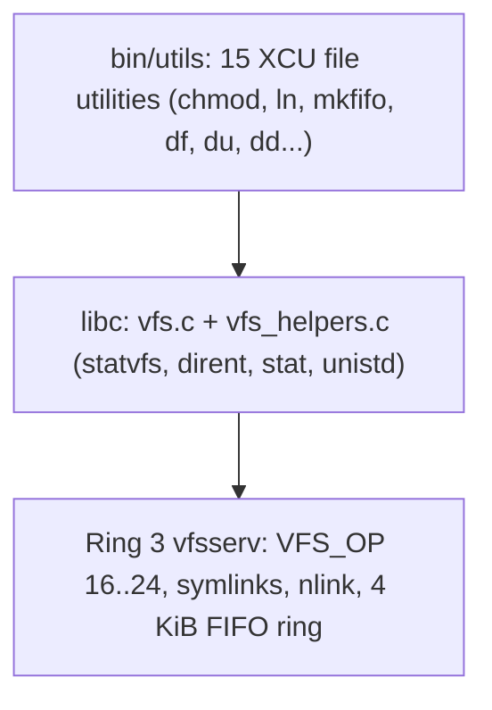

# ADR_0030 — VFS Links, Permissions, FIFOs, Positional I/O, and statvfs

```{adr} VFS links, permissions, FIFOs, positional I/O, and statvfs
:id: ADR_0030
:status: accepted

Extend the Ring 3 `vfsserv` protocol and `libc` with POSIX.1-2024 Base
permissions, ownership, links, FIFOs, positional I/O, `posix_getdents`, and
`<sys/statvfs.h>`. Keep `XSI`-only APIs out of `libc.a` (`BDR_0004`).
```

## Context

`SWR_IPC_0012` requires POSIX.1-2024 Base permissions, links, FIFOs, positional
I/O, `posix_getdents`, `<sys/statvfs.h>`, temp-file helpers, and 15 XCU file
utilities. Under `BDR_0004`, `XSI`-only functions (`utimensat`, `futimens`,
`<libgen.h>` `basename` and `dirname`) must stay out of `libc.a` until `XSI` is
explicitly gated.

## Architecture



## Decision

1. **VFS protocol (`<sys/vfs.h>`):** Add `VFS_OP_CHMOD` through `VFS_OP_STATVFS`
   (`16` to `24`), `VFS_FLAG_BY_FD`, and `VFS_READDIR_NEXT` carrying `DT_*`
   entry types in reply metadata.
2. **Symlinks and hard links:** Add `resolve_path_ex()` in `vfsserv` with loop
   detection (`VFS_SYMLOOP_MAX = 8`, `-ELOOP`), `O_NOFOLLOW`, and
   `AT_SYMLINK_NOFOLLOW`. Decrement `nlink` on `unlink` and `rename` so hard
   links stay valid when one path is removed.
3. **In-server FIFOs:** Store a 4096-byte ring buffer and waiter queue on FIFO
   inodes in `vfsserv`. Block `open` until both reader and writer attach unless
   `O_NONBLOCK` is set. Return `-ENXIO` on non-blocking write-only open with no
   reader. Return `-EPIPE` (mapped to `SIGPIPE` in `libc`) on write with no
   reader.
4. **Positional I/O and directory enumeration:** Implement `VFS_OP_PREAD` and
   `VFS_OP_PWRITE` without changing the open file offset, returning `-ESPIPE` on
   FIFOs. Expose `posix_getdents`, `scandir`, `alphasort`, and `readdir_r` in
   `<dirent.h>` plus `statvfs` and `fstatvfs` in `<sys/statvfs.h>`.
5. **Strict Base compliance:** Keep `touch`, `basename`, and `dirname` as
   standalone Ring 3 utilities without exporting `XSI` functions in `libc.a`.

## Consequences

- `headers_base_implemented` advances to 48/70, `interfaces_base_implemented`
  adds 32 Base functions, and `utilities_base_implemented` adds 15 XCU Base
  utilities.
- Cross-process named pipes, symbolic links, hard links, permissions, and
  positional I/O work across `/tmp` and `/boot` without adding kernel syscalls.
