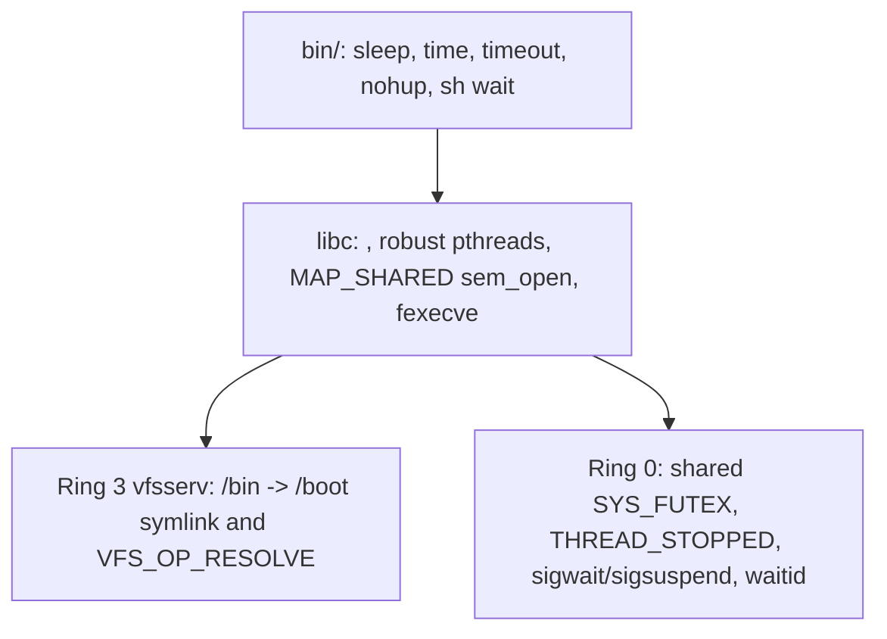

# ADR_0031 — Base Signals, waitid, Shared-Futex Semaphores, and <threads.h>

```{adr} Base signals, waitid, shared-futex semaphores, and <threads.h>
:id: ADR_0031
:status: accepted

Implement named semaphores in Ring 3 over `MAP_SHARED` SHM and shared-keyed
`SYS_FUTEX`. Resolve `fexecve` through `vfsserv`, and add `THREAD_STOPPED` plus
Base signal and `waitid` syscalls (`ADR_0002`, `ADR_0010`, `ADR_0017`,
`BDR_0004`).
```

## Context

`SWR_PROC_0012` requires POSIX.1-2024 Base signal waits (`sigsuspend`,
`sigwait*`, `sigqueue`), job-control `waitid`, `_Fork`, `execl*`, `fexecve`,
`popen`, and `system`. It also requires `<threads.h>`, remaining Base
`pthread_*` and `sched_*` helpers, named `sem_*`, `sleep`, `time`, `timeout`,
`nohup`, and `sh` `wait`. Placing a named semaphore registry or VFS path cache
in Ring 0 inflates the kernel and duplicates `shm.c` and `vfsserv` (`ADR_0002`,
`ADR_0010`).

## Architecture



## Decision

1. **Shared-futex named semaphores (`ADR_0010`, `ADR_0017`):** Extend
   `sys_futex()` in `kernel/core/sched.c` to key `VMM_SHARED` pages by physical
   frame address across processes. Implement `sem_open`, `sem_close`, and
   `sem_unlink` in Ring 3 `libc/src/semaphore.c` over `SYS_SHM_OP` and
   `MAP_SHARED`. Cache open handles per process so repeated `sem_open` calls
   return the same address and `sem_post` stays async-signal-safe.
2. **Base signals and job-control `THREAD_STOPPED`:** Add `SYS_SIGTIMEDWAIT`
   (`64`), `SYS_SIGSUSPEND` (`65`), and `SYS_SIGQUEUE` (`66`) in
   `kernel/core/signal.c`. Save and restore the caller signal mask across
   `sigsuspend`, and use monotonic relative durations in `sigtimedwait`. Park
   stopped processes in `THREAD_STOPPED`, and post `SIGCHLD` when the parent
   catches or blocks it.
3. **Extended `SYS_PROC_WAIT` and flat `siginfo_t`:** Add `PROC_WAIT_STOP`,
   `PROC_WAIT_CONT`, `PROC_WAIT_EXT`, `PROC_WAIT_NOWAIT`, and `PROC_WAIT_EXITED`
   for `waitid`, copying results to user space before reaping zombies. Use a
   flat `siginfo_t` layout in `<signal.h>` with no non-POSIX macros.
4. **Ring 3 `fexecve` and `/bin` symlink:** Resolve open descriptors via
   existing `VFS_OP_RESOLVE` in `vfsserv` instead of storing paths in kernel
   PCBs. Expose a `/bin` to `/boot` symlink in `vfsserv` so `/bin/sh` and
   `/bin/*` resolve through VFS.
5. **ISO C17 `<threads.h>` and robust pthreads:** Share internal layouts via
   `<sys/_pthread_types.h>` so `<threads.h>` never leaks `<pthread.h>` symbols.
   Implement LIFO `pthread_atfork` preparation, `_Fork`, and real
   `PTHREAD_MUTEX_ROBUST` (`EOWNERDEAD` and `ENOTRECOVERABLE`).

## Rejected alternatives

- Adding a bespoke Ring 0 named-semaphore registry syscall (`SYS_SEM_OP`) and
  `THREAD_SEM_BLOCKED` state, which inflates the microkernel and contradicts
  `ADR_0010`.
- Caching 64-byte file paths in every kernel `struct __k_fd_entry`, which bloats
  every PCB and truncates `PATH_MAX` paths.
- Including `<pthread.h>` directly inside `<threads.h>`, which leaks POSIX
  identifiers into ISO C17 translation units.

## Consequences

- `headers_base_implemented` adds `<threads.h>` (49/70), and `libc.a` adds the
  Base signal, process, thread, scheduling, and named semaphore APIs. Ring 3
  adds `sleep`, `time`, `timeout`, `nohup`, and `sh` `wait`.
- Cross-process `MAP_SHARED` futex wakes work in Ring 0 without adding a
  semaphore subsystem or extra syscalls.
