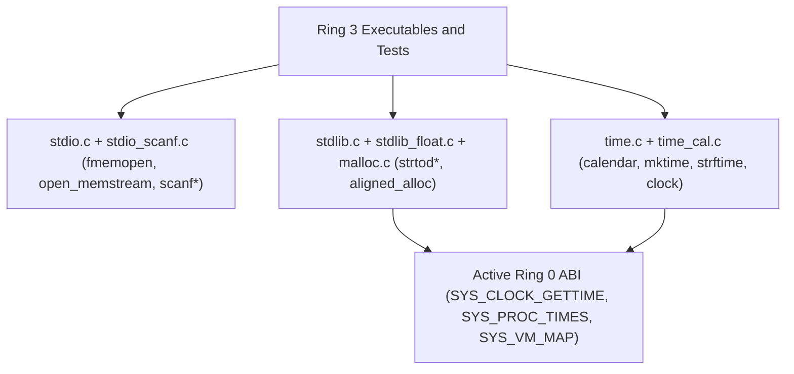

# ADR_0032 — Ring 3 Base stdio, stdlib, string, and time Functions

```{adr} Ring 3 Base stdio, stdlib, string, and time functions
:id: ADR_0032
:status: accepted

Ring 3 `libc` adds Base `<stdio.h>` memory streams and `scanf*`, IEEE-754
`strtod*`, `aligned_alloc`, and `<time.h>` calendar functions with no Ring 0
expansion (`ADR_0002`, `ADR_0019`, `BDR_0004`).
```

## Context

`SWR_LIBC_0010` includes the remaining POSIX.1-2024 Base functions in
`<stdio.h>`, `<stdlib.h>`, `<string.h>`, and `<time.h>`. All of these interfaces
operate on the active Ring 3 heap, descriptor, clock, and process-time syscalls
without new kernel mechanisms (`ADR_0002`, `CNV_0007`).

## Architecture



## Decision

1. **Memory-backed `FILE` streams in `libc/src/stdio.c`:** `struct
   __microkernel_file` adds stream type flags (`STDIO_KIND_FD`,
   `STDIO_KIND_MEM`, and `STDIO_KIND_MEMSTREAM`) for `fmemopen` and
   `open_memstream`. `fread`, `fwrite`, `fgetc`, `ungetc`, `fseeko`, `ftello`,
   `fflush`, `freopen`, and `fclose` use the same stream mutex.
   `libc/src/stdio_scanf.c` adds `scanf*` on an internal unlocked stream and
   string source.
2. **Accurate IEEE-754 decimal and hex conversion in
   `libc/src/stdlib_float.c`:** `strtod`, `strtof`, `strtold`, and `atof` parse
   values with a stack large-integer binary converter for usual and subnormal
   ranges. The code uses `long double` scale values for very high exponents,
   `inf` and `nan`, and `ERANGE` errors.
3. **Aligned heap blocks in `libc/src/malloc.c`:** `aligned_alloc` aligns
   allocations above 16 bytes with a `BLK_FLAG_ALIGNED` header before the
   aligned payload. That header points back to the base `malloc` block. Thus,
   standard `free` and `realloc` operations stay unchanged.
4. **Ring 3 calendar time in `libc/src/time_cal.c` and `time.c`:** `libc` adds
   `gmtime*`, `localtime*`, `mktime`, `asctime*`, `ctime*`, and `strftime` with
   civil-day arithmetic, POSIX `TZ` offset values, and Issue 8 `tm_gmtoff` and
   `tm_zone` fields. `time`, `stpcpy`, and `stpncpy` stay async-signal-safe, and
   `clock` calculates CPU time from `times` with `CLOCKS_PER_SEC` set to
   `1000000L`. `libc` keeps `XSI`-only `tzset`, `tzname`, `timezone`, and
   `daylight` out of the Base set.

## Rejected alternatives

- A Ring 0 calendar-time or process-CPU-clock syscall does not obey `CNV_0007`
  because `SYS_CLOCK_GETTIME` and `SYS_PROC_TIMES` give the necessary data.
- `aligned_alloc` with isolated `mmap` calls for small blocks uses 4 KiB pages
  that are not necessary for 32-byte or 64-byte SIMD boundaries.
- `XSI` symbols (`tzset`, `tzname`, `timezone`, `daylight`) in
  `_POSIX_C_SOURCE=202405L` cause Gate 2 to stop with an error (`BDR_0004`).

## Results

- `libc.a` adds 49 POSIX.1-2024 Base interfaces across `<stdio.h>`,
  `<stdlib.h>`, `<string.h>`, and `<time.h>` with no kernel changes.
- `stdiotest`, `timetest`, and CTest Gates 1 to 3 do tests of all new
  interfaces.
