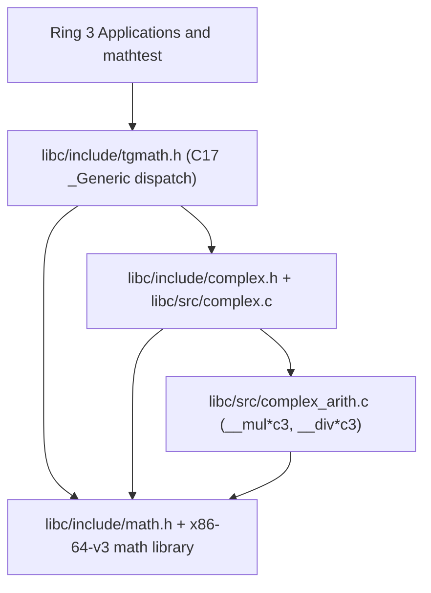

# ADR_0033 — Ring 3 ISO C17 <complex.h> and <tgmath.h> Over <math.h>

```{adr} Ring 3 ISO C17 <complex.h> and <tgmath.h> over <math.h>
:id: ADR_0033
:status: accepted

Implement `<complex.h>`, Annex G complex multiply/divide helpers, and a pure C17
`_Generic` `<tgmath.h>` in Ring 3 `libc` over `<math.h>` with zero Ring 0
changes (`ADR_0002`, `ADR_0026`, `BDR_0004`).
```

## Context

`SWR_LIBC_0011` requires ISO C17 and POSIX.1-2024 `<complex.h>` (66 functions
plus `CMPLX`/`CMPLXF`/`CMPLXL`) and `<tgmath.h>`. `microkernel` links
freestanding Ring 3 binaries with `-nostdlib` and no `compiler-rt`. For complex
arithmetic, Clang emits calls to `__mulsc3`, `__muldc3`, `__mulxc3`, `__divsc3`,
`__divdc3`, and `__divxc3`. Clang's bundled `<tgmath.h>` also relies on compiler
extensions rather than pure C17 `_Generic`.

## Architecture



## Decision

1. **Standard `<complex.h>` in `libc/include/complex.h` and `complex.c`:** Use
   `__builtin_complex` for `_Complex_I` and `CMPLX*` so signed zeros and NaNs
   stay intact with `-std=c17 -pedantic`. Implement all 66 `float`, `double`,
   and `long double` complex functions over `<math.h>` using standard Annex G
   identities and branch cuts.
2. **Freestanding Annex G runtime helpers in `libc/src/complex_arith.c`:**
   Supply `__mulsc3`, `__muldc3`, `__mulxc3`, `__divsc3`, `__divdc3`, and
   `__divxc3` with Annex G infinity and NaN recovery so C17 complex `*` and `/`
   link cleanly under `-nostdlib`.
3. **Pure C17 `<tgmath.h>` in `libc/include/tgmath.h`:** Override the compiler
   resource `tgmath.h` with a `_Generic` implementation that promotes integer
   arguments to `double` per ISO C17 7.25p3. This compiles cleanly under
   `-std=c17 -pedantic` and emits zero extra AST declarations in Gate 2.

## Rejected alternatives

- Relying on Clang's bundled `tgmath.h`, which uses non-standard overload
  attributes and can emit helper declarations into Gate 2 AST scans.
- Linking an external `compiler-rt` archive solely for `__mul*c3`/`__div*c3`,
  which adds third-party binary dependency complexity.

## Consequences

- `headers_base_implemented` rises from `49/70` to `51/70` (`complex.h` and
  `tgmath.h`), and `interfaces_base_implemented` rises by 69 (`751` to `820` of
  `1041`).
- `mathtest` and CTest Gates 1 and 2 verify all complex functions, runtime
  arithmetic, and `<tgmath.h>` type dispatch with zero kernel changes.
