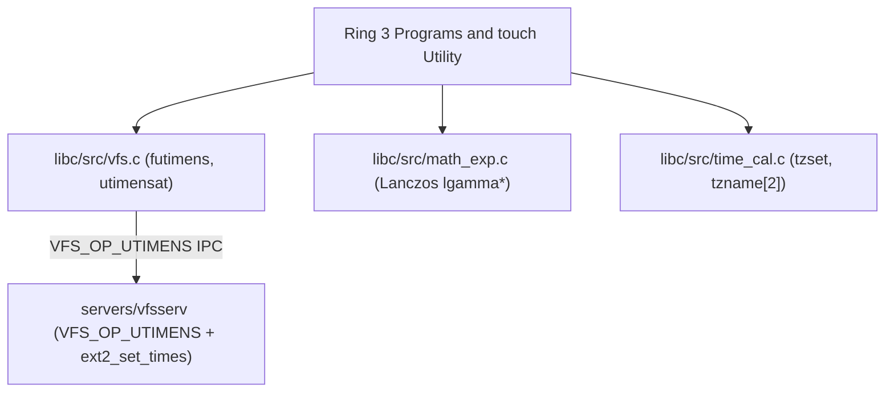

# ADR_0034 — Ring 3 Timestamp Updates, lgamma*, and Timezone State

```{adr} Ring 3 timestamp updates, lgamma*, and timezone state
:id: ADR_0034
:status: accepted

Implement `futimens`/`utimensat`, `lgamma`/`lgammaf`/`lgammal`, and
`tzset`/`tzname` in Ring 3 `libc` and `vfsserv` with zero Ring 0 changes
(`ADR_0002`, `ADR_0030`, `BDR_0004`).
```

## Context

`SWR_LIBC_0012` requires seven POSIX.1-2024 Base interfaces: `futimens` and
`utimensat` (`UTIME_NOW`, `UTIME_OMIT`) in `<sys/stat.h>`, `lgamma`, `lgammaf`,
and `lgammal` in `<math.h>` and `<tgmath.h>`, and `tzset` and `tzname` in
`<time.h>`. Under `CNV_0007`, file timestamps, floating-point math, and timezone
parsing belong strictly in Ring 3. XSI-only globals (`signgam`, `timezone`,
`daylight`) must stay hidden under `_POSIX_C_SOURCE=202405L`.

## Architecture



## Decision

1. **Timestamp updates over `/dev/vfs` IPC:** Add `VFS_OP_UTIMENS` and distinct
   `st_atime*`, `st_mtime*`, and `st_ctime*` fields in `libc/include/sys/vfs.h`
   (within the 512-byte IPC message limit). `vfsserv` validates `UTIME_NOW` and
   `UTIME_OMIT`, honors `AT_SYMLINK_NOFOLLOW`, enforces `EROFS` on read-only
   nodes, and persists timestamps to `ext2` through `ext2_set_times()`.
   `libc/src/vfs.c` keeps `futimens` and `utimensat` async-signal-safe, and
   `bin/utils/touch.c` uses `utimensat` directly.
2. **Shared Lanczos `lgamma*` in `libc/src/math_exp.c`:** Share the `g=7`
   Lanczos helper between `tgamma` and `lgamma`, apply the reflection formula
   for `x < 0.5`, and return `+Inf` with `ERANGE` at non-positive integer poles.
   Keep `signgam` hidden from the Base profile.
3. **POSIX `TZ` parser for `tzset` and `tzname`:** Export `char *tzname[2]` and
   `tzset()` from `libc/src/time_cal.c`, parsing standard, daylight, and quoted
   `<...>` abbreviations with POSIX sign conventions. Keep `timezone` and
   `daylight` hidden from the Base profile.

## Rejected alternatives

- Adding a kernel syscall for file timestamps, which violates `CNV_0007` because
  VFS nodes live in Ring 3 `vfsserv`.
- Exposing XSI globals (`signgam`, `timezone`, `daylight`) unconditionally,
  which violates `_POSIX_C_SOURCE=202405L` namespace hygiene.

## Consequences

- `interfaces_base_implemented` rises from `809/1037` to `816/1037` with zero
  Ring 0 changes (`arch.microkernel_boundary` stays green).
- `vfstest`, `mathtest`, `timetest`, and CTest Gates 1 to 3 verify timestamp
  semantics, async-signal-safety, `lgamma*` accuracy, and `tzset`/`tzname`.
