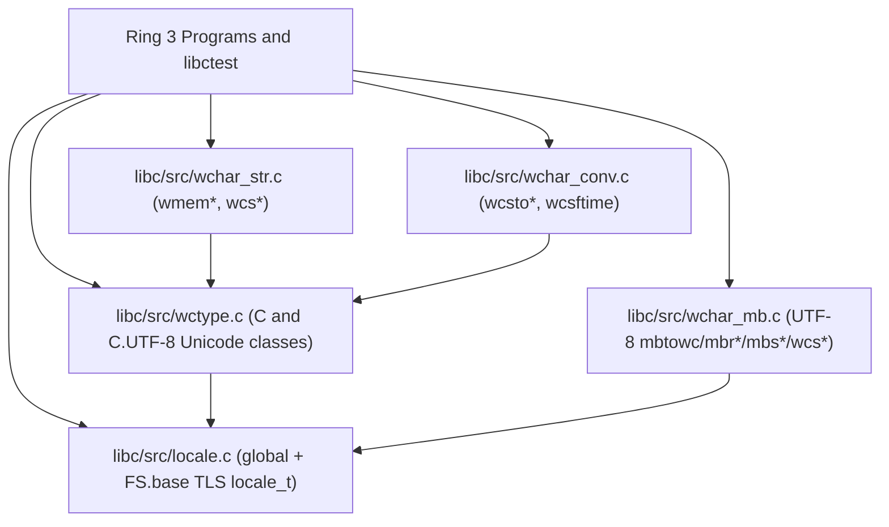

# ADR_0035 — Ring 3 Locale, Multibyte, and Core Wide Character Support

```{adr} Ring 3 locale, multibyte, and core wide character support
:id: ADR_0035
:status: accepted

Implement `<locale.h>`, `*_l` locale helpers, `<stdlib.h>` multibyte routines,
`<wctype.h>`, and core `<wchar.h>` in Ring 3 `libc` over `FS.base` TLS with zero
Ring 0 changes (`ADR_0002`, `ADR_0010`, `BDR_0004`).
```

## Context

`SWR_LIBC_0013` requires POSIX.1-2024 `<locale.h>` (`C` and `C.UTF-8` locales
with per-thread `uselocale` and `getlocalename_l`), locale-aware `*_l` helpers,
`<stdlib.h>` multibyte conversions, `<wctype.h>`, and core `<wchar.h>` plus
`<inttypes.h>` `wcstoimax`/`wcstoumax`. Under `CNV_0007`, all locale and text
encoding logic lives strictly in Ring 3. Headers must also share `locale_t` and
`mbstate_t` without polluting standard namespaces.

## Architecture



## Decision

1. **Shared opaque headers `<sys/_locale_t.h>` and `<sys/_mbstate_t.h>`:**
   Expose `locale_t` to `<locale.h>`, `<ctype.h>`, `<string.h>`, `<strings.h>`,
   `<time.h>`, `<wchar.h>`, and `<wctype.h>`, and share `mbstate_t` between
   `<uchar.h>` and `<wchar.h>` without cross-header symbol leakage.
2. **Thread-local `C` and `C.UTF-8` locale state in `libc/src/locale.c`:** Store
   a per-thread `locale_t` pointer in `__pthread_tls_t` (`FS.base` TLS) with
   `NULL` selecting the global locale. `MB_CUR_MAX` expands to
   `__libc_mb_cur_max()`, returning `1` in `C` and `4` in `C.UTF-8`.
3. **Unicode-aware `<wctype.h>` and UTF-8 `<wchar.h>`:** Implement restartable
   UTF-8 conversions (`mbrtowc`, `wcrtomb`, `mbsnrtowcs`, `wcsnrtombs`) and
   `<stdlib.h>` multibyte wrappers (`mblen`, `mbtowc`, `wctomb`, `mbstowcs`,
   `wcstombs`). Reuse `strto{d,f,ld}` and `strftime` inside `wcsto{d,f,ld}` and
   `wcsftime` to avoid duplicating arbitrary-precision math and calendar code.

## Rejected alternatives

- Treating `C` and `C.UTF-8` identically with a constant `MB_CUR_MAX == 1`,
  which breaks POSIX.1-2024 `C.UTF-8` multibyte behavior.
- Including full `<locale.h>` inside `<ctype.h>` or `<string.h>`, which leaks
  `LC_*` macros into unrelated headers under `_POSIX_C_SOURCE=202405L`.

## Consequences

- `headers_base_implemented` rises from `51/70` to `54/70` (`locale.h`,
  `wchar.h`, `wctype.h`), and `interfaces_base_implemented` rises from
  `816/1037` to `939/1037` (+123) with zero Ring 0 changes.
- `libctest` and CTest Gates 1 to 3 verify `C`/`C.UTF-8` locales, per-thread
  `uselocale`, UTF-8 conversions, wide strings, and async-signal-safety.
