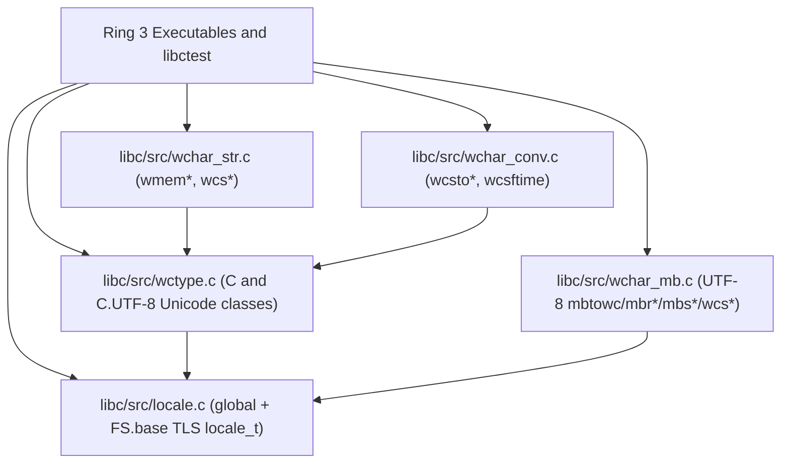

# ADR_0035 — Ring 3 Locale, Multibyte, and Core Wide Character Interfaces

```{adr} Ring 3 locale, multibyte, and core wide character interfaces
:id: ADR_0035
:status: accepted

Ring 3 `libc` adds `<locale.h>`, `*_l` locale helpers, `<stdlib.h>` multibyte
functions, `<wctype.h>`, and core `<wchar.h>` on `FS.base` TLS with no Ring 0
changes (`ADR_0002`, `ADR_0010`, `BDR_0004`).
```

## Context

`SWR_LIBC_0013` includes POSIX.1-2024 `<locale.h>` (`C` and `C.UTF-8` locales
with thread-local `uselocale` and `getlocalename_l`), locale `*_l` helpers,
`<stdlib.h>` multibyte functions, `<wctype.h>`, core `<wchar.h>`, and
`<inttypes.h>` `wcstoimax` and `wcstoumax`. In `CNV_0007`, all locale and text
code stays only in Ring 3. Headers must also use the same `locale_t` and
`mbstate_t` definitions without unwanted symbols in standard namespaces.

## Architecture



## Decision

1. **Internal headers `<sys/_locale_t.h>` and `<sys/_mbstate_t.h>`:** These
   headers give `locale_t` to `<locale.h>`, `<ctype.h>`, `<string.h>`,
   `<strings.h>`, `<time.h>`, `<wchar.h>`, and `<wctype.h>`. They also give
   `mbstate_t` to `<uchar.h>` and `<wchar.h>` without unwanted symbol exposure
   across headers.
2. **Thread-local `C` and `C.UTF-8` locale state in `libc/src/locale.c`:**
   `__pthread_tls_t` (`FS.base` TLS) keeps a `locale_t` pointer for each thread,
   and `NULL` selects the global locale. `MB_CUR_MAX` expands to
   `__libc_mb_cur_max()`, which gives `1` in `C` and `4` in `C.UTF-8`.
3. **Unicode `<wctype.h>` and UTF-8 `<wchar.h>`:** `libc` adds restartable UTF-8
   functions (`mbrtowc`, `wcrtomb`, `mbsnrtowcs`, `wcsnrtombs`) and `<stdlib.h>`
   multibyte wrappers (`mblen`, `mbtowc`, `wctomb`, `mbstowcs`, `wcstombs`).
   `wcsto{d,f,ld}` and `wcsftime` call `strto{d,f,ld}` and `strftime` to prevent
   duplicate math and calendar code.

## Rejected alternatives

- A constant `MB_CUR_MAX == 1` for the two locales (`C` and `C.UTF-8`) causes
  errors in POSIX.1-2024 `C.UTF-8` multibyte operations.
- Inclusion of `<locale.h>` directly in `<ctype.h>` or `<string.h>` puts `LC_*`
  macros into unrelated headers in `_POSIX_C_SOURCE=202405L`.

## Results

- `headers_base_implemented` increases from `51/70` to `54/70` (`locale.h`,
  `wchar.h`, `wctype.h`), and `interfaces_base_implemented` increases from
  `816/1037` to `939/1037` (+123) with no Ring 0 changes.
- `libctest` and CTest Gates 1 to 3 do tests of `C` and `C.UTF-8` locales,
  thread-local `uselocale`, UTF-8 functions, wide strings, and
  async-signal-safety.
