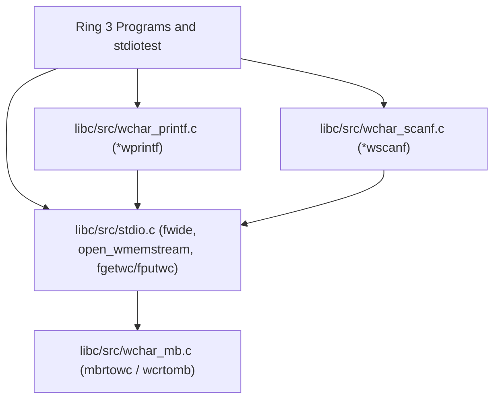

# ADR_0036 — Ring 3 Wide-Oriented FILE Streams and open_wmemstream

```{adr} Ring 3 wide-oriented FILE streams and open_wmemstream
:id: ADR_0036
:status: accepted

Extend Ring 3 `FILE` streams with wide orientation (`fwide`), wide character and
formatted I/O (`fgetwc*`, `fputwc*`, `*wprintf`, `*wscanf`), and
`open_wmemstream` with zero Ring 0 changes (`ADR_0002`, `ADR_0032`, `BDR_0004`).
```

## Context

`SWR_LIBC_0014` completes `<wchar.h>` and `<stdio.h>` wide stream I/O with 23
POSIX.1-2024 Base interfaces: `fwide`, `fgetwc`, `fgetws`, `fputwc`, `fputws`,
`getwc`, `getwchar`, `putwc`, `putwchar`, `ungetwc`, `open_wmemstream`, and the
`*wprintf` and `*wscanf` families. Under `CNV_0007`, stream buffering, wide
orientation, and character encoding stay strictly in Ring 3 `libc`.

## Architecture



## Decision

1. **Stream orientation and pushback in `struct __microkernel_file`:** Add
   `orient` (`0`, `-1`, `+1`), a wide pushback slot (`has_unget_wc`/`unget_wc`),
   and per-stream `mbstate_t wc_state` in `libc/src/stdio.c`. Byte operations
   lock orientation to `-1` and wide operations lock it to `+1`, while
   `freopen()` resets orientation to `0`.
2. **Wide memory streams via `STDIO_KIND_WMEMSTREAM`:** Implement
   `open_wmemstream()` in `libc/src/stdio.c` using `wchar_t`-unit offsets and
   automatic `L'\0'` termination on `fflush()` and `fclose()`. Keep
   `__stdio_fgetwc_unlocked`, `__stdio_fputwc_unlocked`, and
   `__stdio_ungetwc_unlocked` internal via `libc/src/stdio_internal.h`.
3. **Modular `*wprintf` and `*wscanf` engines:** Implement `*wprintf` in
   `libc/src/wchar_printf.c` (reusing `snprintf` for floating-point specifiers
   and returning `-1` with `EOVERFLOW` on `vswprintf` truncation) and `*wscanf`
   in `libc/src/wchar_scanf.c` (supporting width, scansets, `%m`, and `strtold`
   floating-point parsing). Keep `FILE` guarded by `_FILE_DEFINED` so
   `<wchar.h>` compiles standalone without leaking `<stdio.h>` macros.

## Rejected alternatives

- Converting entire wide streams through a temporary narrow buffer before
  writing, which breaks `fwide()`, `ungetwc()`, and `open_wmemstream()` seek
  semantics.
- Including `<stdio.h>` inside `<wchar.h>`, which leaks `<stdio.h>` macros such
  as `BUFSIZ` and `FOPEN_MAX` into `<wchar.h>`.

## Consequences

- `interfaces_base_implemented` rises from `939/1037` to `962/1037` (+23, 92.8%)
  with 100% of Base `<stdio.h>` and `<wchar.h>` implemented and zero Ring 0
  changes.
- `stdiotest` and CTest Gates 1 and 2 verify `fwide`, wide character I/O,
  `*wprintf`/`*wscanf`, and `open_wmemstream`.
