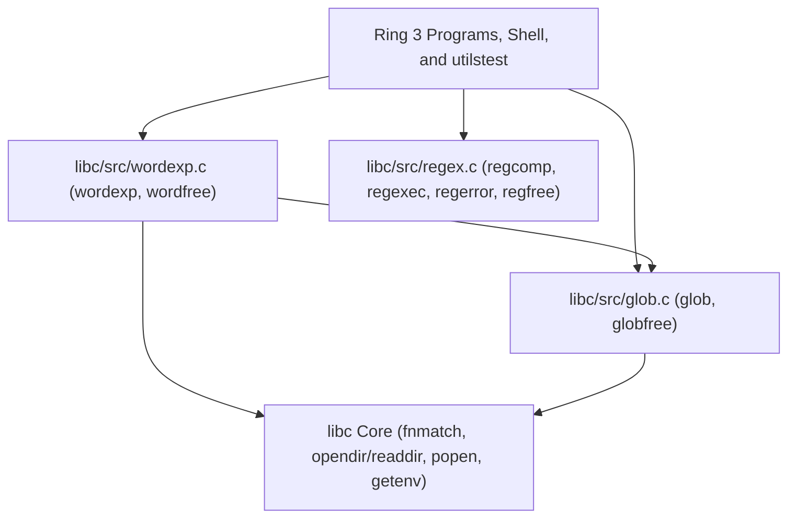

# ADR_0037 — Ring 3 Regex, Glob, Wordexp, and Archive Format Headers

```{adr} Ring 3 regex, glob, wordexp, and archive format headers
:id: ADR_0037
:status: accepted

Implement POSIX.1-2024 `<regex.h>`, `<glob.h>`, `<wordexp.h>`, `<tar.h>`, and
`<cpio.h>` in Ring 3 `libc` with zero Ring 0 changes (`ADR_0002`, `BDR_0004`).
```

## Context

`SWR_LIBC_0015` adds five POSIX.1-2024 Base headers (`<regex.h>`, `<glob.h>`,
`<wordexp.h>`, `<tar.h>`, and `<cpio.h>`) and eight Base interfaces (`regcomp`,
`regexec`, `regerror`, `regfree`, `glob`, `globfree`, `wordexp`, and
`wordfree`). Under `CNV_0007`, regular expression matching, directory globbing,
and shell word expansion stay strictly in Ring 3 `libc`.

## Architecture



## Decision

1. **Bytecode VM regex engine in `libc/src/regex.c`:** Compile POSIX BRE and ERE
   patterns into an instruction array (`OP_CHAR`, `OP_DOT`, `OP_CLASS`,
   `OP_BOL`, `OP_EOL`, `OP_BACKREF`, `OP_SAVE_SO`, `OP_SAVE_EO`, `OP_JMP`,
   `OP_SPLIT`, `OP_LOOP_GUARD`). Support 256-bit bracket classes with POSIX
   `[:class:]` expressions, `{m,n}` bounds, `REG_ICASE`, `REG_NEWLINE`,
   `REG_NOTBOL`, `REG_NOTEOL`, `REG_NOSUB`, and leftmost-longest matching.
2. **Directory globbing in `libc/src/glob.c`:** Read directory components with
   `opendir`, `readdir`, `fnmatch`, and `lstat`/`stat`, sorting matches with
   `qsort` and `strcoll`. Support `GLOB_DOOFFS`, `GLOB_APPEND`, `GLOB_MARK`,
   `GLOB_NOCHECK`, `GLOB_NOESCAPE`, `GLOB_NOSORT`, and `GLOB_ERR`.
3. **Word expansion in `libc/src/wordexp.c`:** Implement quote removal, tilde
   expansion, parameter expansion (`$VAR`, `${VAR}`, `${#VAR}`, `${VAR:-def}`,
   `${VAR:+alt}`), `$((...))` arithmetic evaluation, `popen` command
   substitution (when `WRDE_NOCMD` is clear), `IFS` field splitting, and `glob`
   pathname expansion.
4. **Pure macro headers `<tar.h>` and `<cpio.h>`:** Define POSIX.1-2024 `ustar`
   and `cpio` constants (`TMAGIC`, `TVERSION`, `*TYPE`, `T*`, `MAGIC`, `C_*`)
   with zero kernel dependencies.

## Rejected alternatives

- Placing globbing or regex state inside Ring 0 or `vfsserv`, which violates
  `CNV_0007` and adds privilege to pattern matching.
- Forwarding `wordexp` directly to `/boot/sh`, which starts a child process even
  when `WRDE_NOCMD` forbids command substitution.

## Consequences

- Gate 2 rises to `59/70` Base headers (+5) and `970/1037` Base interfaces (+8)
  with zero Ring 0 changes.
- `utilstest` and CTest Gates 1 and 2 verify standalone header hygiene and
  runtime behavior for all five headers.
