# ADR_0037 — Ring 3 Regex, Glob, Wordexp, and Archive Format Headers

```{adr} Ring 3 regex, glob, wordexp, and archive format headers
:id: ADR_0037
:status: accepted

Ring 3 `libc` adds POSIX.1-2024 `<regex.h>`, `<glob.h>`, `<wordexp.h>`,
`<tar.h>`, and `<cpio.h>` with no Ring 0 changes (`ADR_0002`, `BDR_0004`).
```

## Context

`SWR_LIBC_0015` adds five POSIX.1-2024 Base headers (`<regex.h>`, `<glob.h>`,
`<wordexp.h>`, `<tar.h>`, and `<cpio.h>`) and eight Base interfaces (`regcomp`,
`regexec`, `regerror`, `regfree`, `glob`, `globfree`, `wordexp`, and
`wordfree`). In `CNV_0007`, regular expression operations, directory glob
operations, and shell word expansion stay only in Ring 3 `libc`.

## Architecture

```mermaid
flowchart TD
    APP["Ring 3 Executables, Shell, and utilstest"]
    WE["libc/src/wordexp.c (wordexp, wordfree)"]
    GL["libc/src/glob.c (glob, globfree)"]
    RE["libc/src/regex.c (regcomp, regexec, regerror, regfree)"]
    BASE["libc Core (fnmatch, opendir/readdir, popen, getenv)"]

    APP --> WE
    APP --> GL
    APP --> RE
    WE --> GL
    WE --> BASE
    GL --> BASE
```



## Decision

1. **Bytecode VM regex engine in `libc/src/regex.c`:** `regcomp` compiles POSIX
   BRE and ERE patterns into an instruction array (`OP_CHAR`, `OP_DOT`,
   `OP_CLASS`, `OP_BOL`, `OP_EOL`, `OP_BACKREF`, `OP_SAVE_SO`, `OP_SAVE_EO`,
   `OP_JMP`, `OP_SPLIT`, `OP_LOOP_GUARD`). The engine operates with 256-bit
   bracket classes, POSIX `[:class:]` expressions, `{m,n}` limits, `REG_ICASE`,
   `REG_NEWLINE`, `REG_NOTBOL`, `REG_NOTEOL`, `REG_NOSUB`, and leftmost-longest
   results.
2. **Directory glob engine in `libc/src/glob.c`:** `glob` reads directory
   components with `opendir`, `readdir`, `fnmatch`, `lstat`, and `stat`. It
   sorts results with `qsort` and `strcoll`. The engine operates with
   `GLOB_DOOFFS`, `GLOB_APPEND`, `GLOB_MARK`, `GLOB_NOCHECK`, `GLOB_NOESCAPE`,
   `GLOB_NOSORT`, and `GLOB_ERR`.
3. **Word expansion in `libc/src/wordexp.c`:** `wordexp` adds quotation-mark
   removal, tilde expansion, and parameter expansion (`$VAR`, `${VAR}`,
   `${#VAR}`, `${VAR:-def}`, `${VAR:+alt}`). It also adds `$((...))` arithmetic,
   `popen` command substitution when `WRDE_NOCMD` is off, `IFS` field division,
   and `glob` pathname expansion.
4. **Pure macro headers `<tar.h>` and `<cpio.h>`:** These headers set
   POSIX.1-2024 `ustar` and `cpio` constants (`TMAGIC`, `TVERSION`, `*TYPE`,
   `T*`, `MAGIC`, `C_*`) with no kernel dependencies.

## Rejected alternatives

- Glob or regex state in Ring 0 or `vfsserv` does not obey `CNV_0007` and gives
  privilege that is not necessary to pattern operations.
- Calls from `wordexp` directly to `/boot/sh` start a child process when
  `WRDE_NOCMD` prevents command substitution.

## Results

- Gate 2 increases to `59/70` Base headers (+5) and `970/1037` Base interfaces
  (+8) with no Ring 0 changes.
- `utilstest` and CTest Gates 1 and 2 do tests of standalone header hygiene and
  runtime operations for all five headers.
