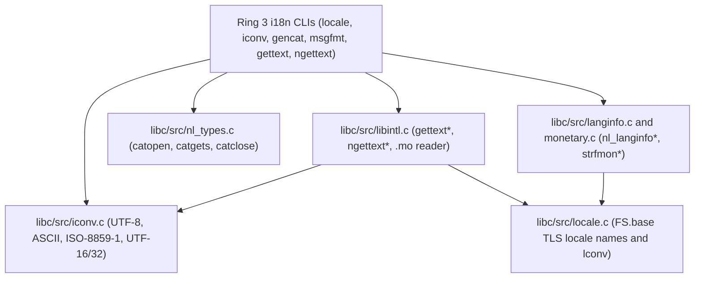

# ADR_0038 — Ring 3 i18n Headers, Message Catalogs, and CLI Utilities

```{adr} Ring 3 i18n headers, message catalogs, and CLI utilities
:id: ADR_0038
:status: accepted

Implement POSIX.1-2024 `<langinfo.h>`, `<monetary.h>`, `<nl_types.h>`,
`<iconv.h>`, and `<libintl.h>` plus `locale`, `localedef`, `iconv`, `gencat`,
`msgfmt`, `gettext`, and `ngettext` strictly in Ring 3 (`ADR_0002`, `BDR_0004`).
```

## Context

`SWR_LIBC_0016` supplies the five remaining POSIX.1-2024 Base i18n headers
(`<langinfo.h>`, `<monetary.h>`, `<nl_types.h>`, `<iconv.h>`, `<libintl.h>`), 25
Base interfaces, and 7 Base XCU utilities (`locale`, `localedef`, `iconv`,
`gencat`, `msgfmt`, `gettext`, `ngettext`). Under `CNV_0007`, character set
conversion, message catalog parsing, and locale tools stay strictly in Ring 3.

## Architecture



## Decision

1. **Streaming `iconv` engine in `libc/src/iconv.c`:** Convert between
   `US-ASCII`, `ISO-8859-1`, `UTF-8`, `UTF-16`/`UTF-16LE`/`UTF-16BE` (with
   surrogate pairs), and `UTF-32`/`UTF-32LE`/`UTF-32BE`/`WCHAR_T`. Support
   `//IGNORE` and `//TRANSLIT` suffixes and exact `EINVAL`/`EILSEQ`/`E2BIG`
   reporting.
2. **Standard binary `.mo` catalogs in `libc/src/libintl.c` and `msgfmt`:**
   Compile `.po` files (including `msgctxt`, `msgid_plural`, `msgstr[N]`, and
   `Plural-Forms`) into standard GNU/POSIX little-endian `.mo` files
   (`0x950412de`). Read both little-endian and big-endian `.mo` catalogs with
   binary search, `Plural-Forms` evaluation, and optional `iconv` codeset
   transcoding via `bind_textdomain_codeset`.
3. **Binary `MKCAT01` catalogs in `libc/src/nl_types.c` and `gencat`:** Store
   sorted `(set_id, msg_id)` entries and a NUL-terminated string pool so
   `catopen`/`catgets`/`catclose` support `NLSPATH` expansion and binary-search
   lookups.
4. **Locale name retention in `libc/src/locale.c`:** Retain UTF-8 locale names
   (such as `fr_FR.UTF-8`) in `struct __microkernel_locale` so `nl_langinfo_l`,
   `strfmon_l`, and `*_l` `<libintl.h>` functions resolve per-thread locales
   accurately.

## Rejected alternatives

- Stubbing `gettext` or `catgets` to return the fallback string without reading
  catalogs, which fails end-to-end verification with `msgfmt` and `gencat`.
- Storing catalog tables in a Ring 3 daemon, which adds IPC overhead for
  read-only files already served by `vfsserv`.

## Consequences

- Gate 2 rises to `64/70` Base headers (+5), `995/1037` Base interfaces (+25,
  95.9%), and `55/108` Base utilities (+7) with zero Ring 0 changes.
- `utilstest` and CTest Gates 1 and 2 verify all five headers, 25 interfaces,
  and all seven i18n CLI utilities in QEMU.
