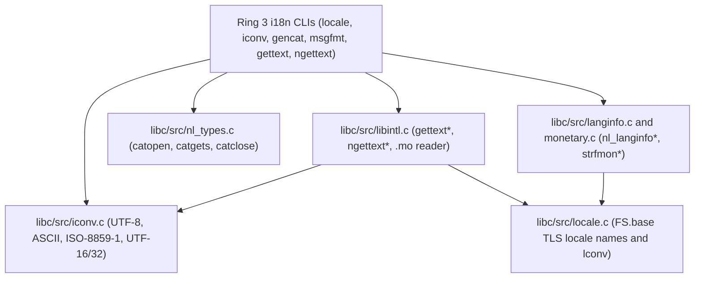

# ADR_0038 — Ring 3 i18n Headers, Message Catalogs, and CLI Utilities

```{adr} Ring 3 i18n headers, message catalogs, and CLI utilities
:id: ADR_0038
:status: accepted

Ring 3 adds POSIX.1-2024 `<langinfo.h>`, `<monetary.h>`, `<nl_types.h>`,
`<iconv.h>`, and `<libintl.h>` with `locale`, `localedef`, `iconv`, `gencat`,
`msgfmt`, `gettext`, and `ngettext` (`ADR_0002`, `BDR_0004`).
```

## Context

`SWR_LIBC_0016` gives the five remaining POSIX.1-2024 Base i18n headers
(`<langinfo.h>`, `<monetary.h>`, `<nl_types.h>`, `<iconv.h>`, `<libintl.h>`), 25
Base interfaces, and 7 Base XCU utilities (`locale`, `localedef`, `iconv`,
`gencat`, `msgfmt`, `gettext`, `ngettext`). In `CNV_0007`, character set
changes, message catalog readers, and locale utilities stay only in Ring 3.

## Architecture



## Decision

1. **Stream `iconv` engine in `libc/src/iconv.c`:** `iconv` changes bytes
   between `US-ASCII`, `ISO-8859-1`, `UTF-8`, `UTF-16`, `UTF-16LE`, `UTF-16BE`
   (with surrogate pairs), and `UTF-32`, `UTF-32LE`, `UTF-32BE`, `WCHAR_T`. The
   engine operates with `//IGNORE` and `//TRANSLIT` suffixes and accurate
   `EINVAL`, `EILSEQ`, and `E2BIG` error codes.
2. **Standard binary `.mo` catalogs in `libc/src/libintl.c` and `msgfmt`:**
   `msgfmt` compiles `.po` files (with `msgctxt`, `msgid_plural`, `msgstr[N]`,
   and `Plural-Forms`) into standard GNU and POSIX `LE` `.mo` files
   (`0x950412de`). `libintl.c` reads `LE` and `BE` `.mo` catalogs with binary
   lookup, `Plural-Forms` rules, and optional `iconv` codeset changes through
   `bind_textdomain_codeset`.
3. **Binary `MKCAT01` catalogs in `libc/src/nl_types.c` and `gencat`:** `gencat`
   writes sorted `(set_id, msg_id)` entries and a NUL-terminated string pool.
   Thus, `catopen`, `catgets`, and `catclose` operate with `NLSPATH` expansion
   and binary lookup.
4. **Locale name storage in `libc/src/locale.c`:** `struct __microkernel_locale`
   keeps UTF-8 locale names (for example `fr_FR.UTF-8`). Thus, `nl_langinfo_l`,
   `strfmon_l`, and `*_l` `<libintl.h>` functions find thread-local locales
   accurately.

## Rejected alternatives

- Stub `gettext` or `catgets` functions that give the fallback string without
  catalog files cause errors in end-to-end tests with `msgfmt` and `gencat`.
- A Ring 3 daemon for catalog tables adds IPC overhead for read-only files that
  `vfsserv` gives.

## Results

- Gate 2 increases to `64/70` Base headers (+5), `995/1037` Base interfaces
  (+25, 95.9%), and `55/108` Base utilities (+7) with no Ring 0 changes.
- `utilstest` and CTest Gates 1 and 2 do tests of all five headers, 25
  interfaces, and all seven i18n CLI utilities in QEMU.
