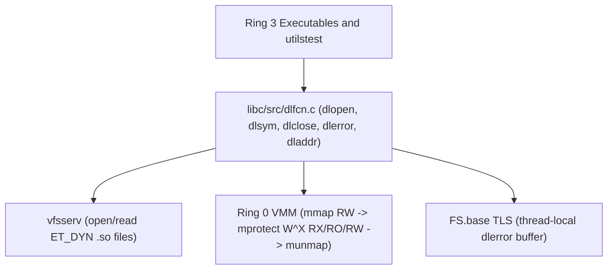

# ADR_0039 — Ring 3 ELF64 ET_DYN Loader and <dlfcn.h>

```{adr} Ring 3 ELF64 ET_DYN loader and <dlfcn.h>
:id: ADR_0039
:status: accepted

Ring 3 `libc` adds POSIX.1-2024 `<dlfcn.h>` (`dlopen`, `dlsym`, `dlclose`,
`dlerror`, `dladdr`) as an ELF64 `ET_DYN` loader with W^X `mmap` and `mprotect`
and no Ring 0 changes (`ADR_0002`, `BDR_0004`).
```

## Context

`SWR_LIBC_0017` completes the last non-network POSIX.1-2024 Base header
(`<dlfcn.h>`) and five Base interfaces (`dlopen`, `dlsym`, `dlclose`, `dlerror`,
`dladdr`). In `CNV_0007`, ELF readers, relocations, and symbol lookups for
shared objects stay only in Ring 3 `libc`.

## Architecture



## Decision

1. **Adjacent W^X loader in `libc/src/dlfcn.c`:** `dlopen` examines `ELF64` `LE`
   `x86-64` `ET_DYN` files and rejects `PF_W | PF_X` segments. It allocates one
   adjacent `PROT_READ | PROT_WRITE` anonymous region with `mmap`, writes
   `PT_LOAD` segments, and does `DT_RELA` and `DT_JMPREL` relocations
   (`R_X86_64_RELATIVE`, `R_X86_64_64`, `R_X86_64_GLOB_DAT`,
   `R_X86_64_JUMP_SLOT`). Then it calls `mprotect` to set last W^X permissions
   before it calls `DT_INIT` and `DT_INIT_ARRAY`.
2. **Symbol lookup and `dladdr`:** `dlfcn.c` operates with SysV `DT_HASH` and
   GNU `DT_GNU_HASH` symbol counts, recursive `DT_NEEDED` loads, `RTLD_GLOBAL`
   and `RTLD_LOCAL` visibility, `RTLD_DEFAULT`, `RTLD_NEXT`, and an internal
   host `libc` table. `dladdr` (`Dl_info_t`) finds symbols in loaded object
   ranges and dynamic symbol tables without changes to `dlerror`.
3. **Thread-safe state and thread-local `dlerror`:** A mutex locks the loaded
   object table and use counts. `dlclose` calls `DT_FINI_ARRAY`, `DT_FINI`, and
   `munmap` when the last use count is `0`. `FS.base` TLS keeps `dlerror` text
   for each thread. Thus, read calls erase the error text for POSIX.1-2024.
4. **Shared-object build helper:** `CMakeLists.txt` adds
   `microkernel_add_user_shared_library` with `-fPIC` and `ld.lld -shared -z
   separate-code --hash-style=both`. Thus, `tests/utilstest/dlplugin.c`
   (`libdltest.so`) goes into `boot.tar` for QEMU tests.

## Rejected alternatives

- An in-kernel dynamic loader syscall does not obey `CNV_0007` because Ring 3
  `mmap` and `mprotect` set W^X permissions.
- A stub `dlopen` that stops with `ENOSYS` causes errors in POSIX.1-2024 runtime
  tests for `ET_DYN` plugins, relocations, and `dladdr`.

## Results

- Gate 2 increases to `65/70` Base headers (100% of non-network Base headers)
  and `1000/1037` Base interfaces (+5, 96.4%) with no Ring 0 changes.
- `utilstest` does tests of `ET_DYN` loads (`libdltest.so`), relocations, host
  `libc` calls, `dladdr`, use counts, and constructors and destructors in QEMU.
