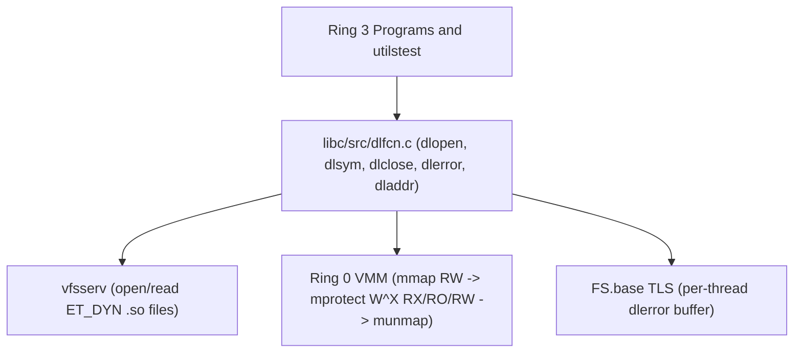

# ADR_0039 — Ring 3 ELF64 ET_DYN Loader and <dlfcn.h>

```{adr} Ring 3 ELF64 ET_DYN loader and <dlfcn.h>
:id: ADR_0039
:status: accepted

Implement POSIX.1-2024 `<dlfcn.h>` (`dlopen`, `dlsym`, `dlclose`, `dlerror`,
`dladdr`) as a Ring 3 ELF64 `ET_DYN` loader over W^X `mmap`/`mprotect` with zero
Ring 0 changes (`ADR_0002`, `BDR_0004`).
```

## Context

`SWR_LIBC_0017` completes the final non-network POSIX.1-2024 Base header
(`<dlfcn.h>`) and five Base interfaces (`dlopen`, `dlsym`, `dlclose`, `dlerror`,
`dladdr`). Under `CNV_0007`, ELF parsing, relocation, and symbol lookup for
shared objects belong strictly in Ring 3 `libc`.

## Architecture



## Decision

1. **Contiguous W^X loading in `libc/src/dlfcn.c`:** Validate `ELF64`
   little-endian `x86-64` `ET_DYN` files and reject any `PF_W | PF_X` segment.
   Allocate one contiguous `PROT_READ | PROT_WRITE` anonymous mapping with
   `mmap`, copy `PT_LOAD` segments, and process `DT_RELA`/`DT_JMPREL`
   relocations (`R_X86_64_RELATIVE`, `R_X86_64_64`, `R_X86_64_GLOB_DAT`,
   `R_X86_64_JUMP_SLOT`). Then call `mprotect` to enforce final W^X protections
   before invoking `DT_INIT`/`DT_INIT_ARRAY`.
2. **Symbol resolution and `dladdr`:** Support SysV `DT_HASH` and GNU
   `DT_GNU_HASH` symbol counting, `DT_NEEDED` recursive loading, `RTLD_GLOBAL`
   and `RTLD_LOCAL` visibility, `RTLD_DEFAULT`, `RTLD_NEXT`, and a built-in host
   `libc` table. Resolve `dladdr` (`Dl_info_t`) over loaded object ranges and
   dynamic symbol tables without modifying `dlerror`.
3. **Thread-safe state and per-thread `dlerror`:** Guard the loaded-object list
   and refcounts with a mutex. Run `DT_FINI_ARRAY`/`DT_FINI` and `munmap` when
   the final refcount drops to zero. Store `dlerror` text in per-thread
   `FS.base` TLS so errors clear on read per POSIX.1-2024.
4. **Shared-object build helper:** Add `microkernel_add_user_shared_library` in
   `CMakeLists.txt` using `-fPIC` and `ld.lld -shared -z separate-code
   --hash-style=both` so `tests/utilstest/dlplugin.c` (`libdltest.so`) packs
   into `boot.tar` for QEMU verification.

## Rejected alternatives

- Adding an in-kernel dynamic loader syscall, which violates `CNV_0007` when
  Ring 3 `mmap`/`mprotect` already enforces W^X.
- Stubbing `dlopen` to fail with `ENOSYS`, which fails POSIX.1-2024 runtime
  verification for `ET_DYN` plugins, relocations, and `dladdr`.

## Consequences

- Gate 2 reaches `65/70` Base headers (100% of non-network Base headers) and
  `1000/1037` Base interfaces (+5, 96.4%) with zero Ring 0 changes.
- `utilstest` verifies real `ET_DYN` loading (`libdltest.so`), relocations, host
  `libc` calls, `dladdr`, refcounting, and constructors/destructors in QEMU.
