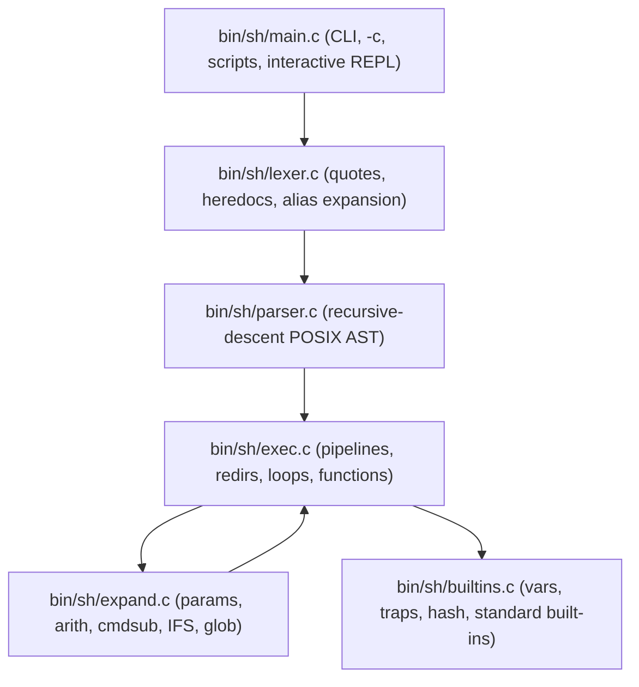

# ADR_0040 — Modular Ring 3 POSIX.1-2024 Shell Grammar and Built-ins

```{adr} Modular Ring 3 POSIX.1-2024 shell grammar and built-ins
:id: ADR_0040
:status: accepted

Refactor `/boot/sh` into a modular Ring 3 AST shell (`lexer`, `parser`,
`expand`, `exec`, `builtins`) with zero Ring 0 changes (`ADR_0002`, `BDR_0004`).
Support POSIX.1-2024 compound grammar, expansions, here-documents, `<glob.h>`,
`trap`, and standard built-ins.
```

## Context

`SWR_LIBC_0018` extends `/boot/sh` into a POSIX.1-2024 XCU shell with compound
commands (`if`, `for`, `while`, `until`, `case`, subshells, brace groups),
functions, and here-documents. It also adds deferred expansions (`$(...)`,
`$((...))`, `${...}`, `<glob.h>`), `trap`, and remaining standard built-ins
(`.`, `:`, `alias`, `unalias`, `command`, `eval`, `exec`, `getopts`, `hash`,
`return`, `shift`, `times`, `break`, `continue`, `readonly`).

## Architecture



## Decision

1. **Deferred execution-time expansion:** Keep raw quotes and `$` constructs in
   the AST (`bin/sh/lexer.c`, `bin/sh/parser.c`). Expand words inside
   `bin/sh/expand.c` on each execution so loops, functions, and `eval` see fresh
   variable values.
2. **Compound commands and saved redirections:** Execute `if`/`elif`/`else`,
   `for`, `while`, `until`, `case` (`fnmatch`), brace groups, and functions
   in-process with saved/restored file descriptors (`F_DUPFD_CLOEXEC`). Run
   subshells `( ... )`, pipelines, and `$(...)` via `fork()`.
3. **Here-documents and `<glob.h>`:** Queue pending `<<` and `<<-` bodies during
   lexing and attach them to redirection nodes. Feed small heredocs via
   `pipe2()` and larger bodies via unlinked `/tmp` descriptors. Expand unquoted
   wildcards via `<glob.h>` unless `set -f` is active.
4. **Standard built-ins and traps:** Implement `.`, `:`, `alias`, `unalias`,
   `command`, `eval`, `exec`, `getopts`, `hash`, `return`, `shift`, `times`,
   `trap`, `break`, `continue`, and `readonly` in `bin/sh/builtins.c`. Record
   caught signals in `sig_atomic_t` flags and dispatch trap actions safely
   between commands.

## Rejected alternatives

- Extending the flat line-oriented tokenizer in one `main.c` file, which cannot
  parse nested loops, functions, or multi-line here-documents cleanly.
- Spawning external binaries for `.`, `:`, `alias`, `unalias`, `command`,
  `getopts`, or `hash`, which cannot mutate shell state per POSIX.1-2024.

## Consequences

- Gate 2 `utilities_base_implemented` rises from `55/108` to `62/108` (+7,
  57.4%) with zero Ring 0 changes.
- `shtest` verifies compound grammar, functions, expansions, here-documents,
  globbing, `trap`, and all newly added built-ins in QEMU.
