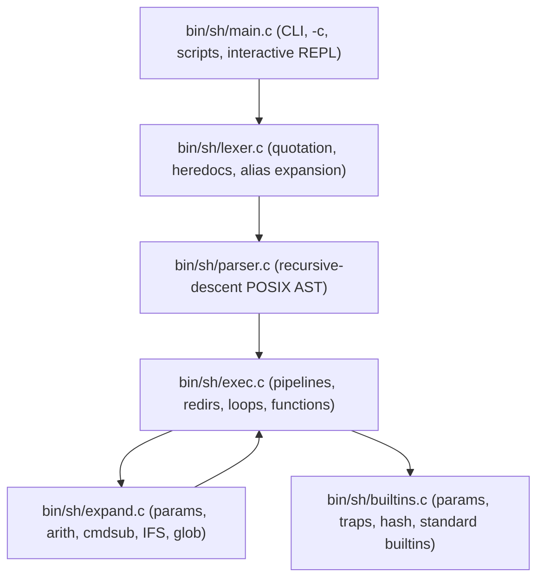

# ADR_0040 — Modular Ring 3 POSIX.1-2024 Shell Grammar and Builtins

```{adr} Modular Ring 3 POSIX.1-2024 shell grammar and builtins
:id: ADR_0040
:status: accepted

Ring 3 `/boot/sh` changes to a modular AST shell (`lexer`, `parser`, `expand`,
`exec`, `builtins`) with no Ring 0 changes (`ADR_0002`, `BDR_0004`). It operates
with POSIX.1-2024 compound grammar, expansions, here-documents, `<glob.h>`,
`trap`, and standard builtins.
```

## Context

`SWR_LIBC_0018` extends `/boot/sh` into a POSIX.1-2024 XCU shell with compound
commands (`if`, `for`, `while`, `until`, `case`, subshells, `{ ... }` groups),
functions, and here-documents. It also adds deferred expansions (`$(...)`,
`$((...))`, `${...}`, `<glob.h>`), `trap`, and the remaining standard builtins
(`. `, `:`, `alias`, `unalias`, `command`, `eval`, `exec`, `getopts`, `hash`,
`return`, `shift`, `times`, `break`, `continue`, `readonly`).

## Architecture



## Decision

1. **Deferred runtime expansion:** `bin/sh/lexer.c` and `bin/sh/parser.c` keep
   raw quotation marks and `$` syntax in the AST. `bin/sh/expand.c` expands
   words on each command call. Thus, loops, functions, and `eval` read new
   parameter values.
2. **Compound commands and kept redirections:** `bin/sh/exec.c` does `if`,
   `elif`, `else`, `for`, `while`, `until`, `case` (`fnmatch`), `{ ... }`
   groups, and functions in the same process with kept file descriptors
   (`F_DUPFD_CLOEXEC`). Subshells `( ... )`, pipelines, and `$(...)` start
   through `fork()`.
3. **Here-documents and `<glob.h>`:** The lexer queues `<<` and `<<-` bodies and
   attaches them to redirection nodes. Small heredocs use `pipe2()`, and larger
   bodies use unlinked `/tmp` descriptors. Unquoted wildcards expand through
   `<glob.h>` when `set -f` is off.
4. **Standard builtins and traps:** `bin/sh/builtins.c` adds `.`, `:`, `alias`,
   `unalias`, `command`, `eval`, `exec`, `getopts`, `hash`, `return`, `shift`,
   `times`, `trap`, `break`, `continue`, and `readonly`. Signal handlers record
   received signals in `sig_atomic_t` flags and dispatch trap commands safely
   between commands.

## Rejected alternatives

- A flat line tokenizer in one `main.c` file cannot parse nested loops,
  functions, or multi-line here-documents without errors.
- External executables for `.`, `:`, `alias`, `unalias`, `command`, `getopts`,
  or `hash` cannot change shell state for POSIX.1-2024.

## Results

- Gate 2 `utilities_base_implemented` increases from `55/108` to `62/108` (+7,
  57.4%) with no Ring 0 changes.
- `shtest` does tests of compound grammar, functions, expansions,
  here-documents, glob operations, `trap`, and all new builtins in QEMU.
