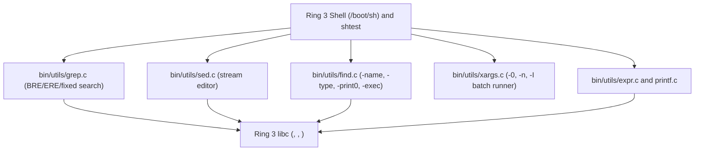

# ADR_0041 — Ring 3 Regex, Find, and Core Stream Utilities

```{adr} Ring 3 regex, find, and core stream utilities
:id: ADR_0041
:status: accepted

Implement POSIX.1-2024 XCU `grep`, `sed`, `find`, `xargs`, `expr`, and `printf`
in Ring 3 over `<regex.h>` and `<fnmatch.h>` with zero Ring 0 changes
(`ADR_0002`, `BDR_0004`).
```

## Context

`SWR_LIBC_0019` supplies six core POSIX.1-2024 XCU text and file-traversal
utilities (`grep`, `sed`, `find`, `xargs`, `expr`, and `printf`). They build
directly on the Ring 3 `<regex.h>`, `<fnmatch.h>`, `vfsserv`, and `pipeserv`
APIs under `CNV_0007`.

## Architecture



## Decision

1. **Pattern search and editing (`grep.c`, `sed.c`):** Implement `grep` with
   `-E`, `-F`, `-c`, `-l`, `-q`, `-n`, `-i`, `-v`, `-x`, `-s`, `-e`, and `-f`
   over `<regex.h>`. Implement `sed` with `-n`, `-E`, `-e`, `-f`, line/last/
   regex addresses, `s///g` with `\1`..`\9` backreferences, hold space
   (`h`/`H`/`g`/`G`/`x`), `y///`, `a`/`i`/`c`, branches (`b`/`t`/`:`), and
   `{...}` blocks.
2. **Tree walk and batching (`find.c`, `xargs.c`):** Implement `find` with
   Boolean expressions (`(`, `)`, `!`, `-a`, `-o`), `-name`, `-path`, `-type`,
   `-size`, `-perm`, `-newer`, `-depth`, `-prune`, `-print`, Issue 8 `-print0`,
   and `-exec ... \;` / `+`. Implement `xargs` with Issue 8 `-0`, `-n`, `-L`,
   `-I`, `-E`, `-r`, and `-t`.
3. **Expressions and formatting (`expr.c`, `printf.c`):** Implement `expr` with
   recursive-descent `|`, `&`, comparisons, 64-bit arithmetic, and anchored BRE
   `:` matching. Implement `printf` with format reuse, `*` width/precision,
   `%b`, and character constant operands.

## Rejected alternatives

- Embedding `grep`, `sed`, or `printf` only as shell built-ins, which fails
  standalone `/bin/*` execution from `execve`, `find -exec`, and `xargs`.

## Consequences

- Gate 2 `utilities_base_implemented` rises from `62/108` to `68/108` (+6,
  63.0%) with zero Ring 0 changes.
- `shtest` verifies all six utilities end-to-end in QEMU.
