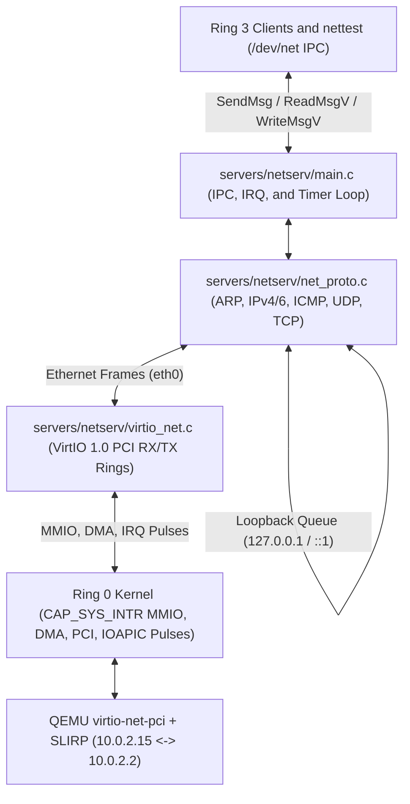

# ADR_0042 — Ring 3 PCI virtio-net Driver and TCP/IP Server

```{adr} Ring 3 PCI virtio-net driver and TCP/IP network server
:id: ADR_0042
:status: accepted

One Ring 3 server (`servers/netserv/`) adds the PCI `virtio-net` driver and
TCP/IP and loopback stack on the active `CAP_SYS_INTR` MMIO, DMA, and IOAPIC IRQ
pulses. Ring 0 stays unchanged (`ADR_0002`, `ADR_0031`, `BDR_0004`).
```

## Context

`SWR_IPC_0013` includes a Ring 3 PCI `virtio-net` driver and a TCP/IP and
loopback network server. In `CNV_0007`, device drivers, packet frames, routing,
ARP tables, and network protocols must stay out of Ring 0. The kernel gives
`SYS_VM_MAP_MMIO`, `SYS_DMA_ALLOC`, `SYS_PCI_CFG`, and `SYS_INTR_ATTACH_EVENT`
for `CAP_SYS_INTR` (`ADR_0031`).

## Architecture



## Decision

1. **Unified Ring 3 server (`servers/netserv/`):** One Ring 3 server at
   `/dev/net` includes the VirtIO 1.0 PCI driver (`virtio_net.c`), protocol
   stack (`net_proto.c`), and IPC loop (`main.c`). This design prevents more IPC
   copies on each packet and keeps Ring 0 unchanged.
2. **One event loop with IRQ and timer pulses:** `netserv` attaches PCI IOAPIC
   IRQ pulses (`PULSE_CODE_IRQ`) and a futex 5 ms timer ticker
   (`PULSE_CODE_NET_TICK`) to the primary `/dev/net` IPC channel. The ticker
   uses `0` CPU time when no timer waiter is active.
3. **Modern VirtIO 1.0 virtqueues:** The driver negotiates `VIRTIO_F_VERSION_1`
   and `VIRTIO_NET_F_MAC` with 12-byte `virtio_net_hdr` headers. It allocates
   one adjacent 17-page DMA region (`DMAAlloc`) for 16 RX buffers (queue 0) and
   16 TX buffers (queue 1).
4. **Packet-accurate loopback and dual-stack protocols:** `net_proto.c` sends
   `127.0.0.0/8`, `::1`, and local `eth0` addresses through a FIFO loopback
   queue. Each loopback ICMP, UDP, and TCP packet goes through packet frames and
   RFC 1071 checksum checks. `libc/include/sys/net.h` gives a `/dev/net` IPC ABI
   for subsequent `AF_INET` and `AF_INET6` POSIX socket integration.

## Rejected alternatives

- **Ring 0 network stack:** This alternative does not obey `CNV_0007` and
  `ADR_0002` because it adds device drivers and protocol state machines to the
  microkernel.
- **Two isolated Ring 3 servers (`netdrv` and `netserv`):** This alternative
  doubles IPC copy overhead on each Ethernet frame and adds one more server
  process with no privilege benefit for one NIC.

## Results

- `arch.microkernel_boundary` stays green with no new `SYS_*` syscalls, no new
  `kernel/core/*.c` modules, and no `struct __k_fd_entry` changes.
- `tests/test_runner.py` and `scripts/env.sh` attach a QEMU `virtio-net-pci`
  device with `-netdev user` (SLIRP). `nettest` does tests of hardware ARP and
  ICMPv4 traffic to `10.0.2.2` with IPv4 and IPv6 loopback UDP and TCP.
