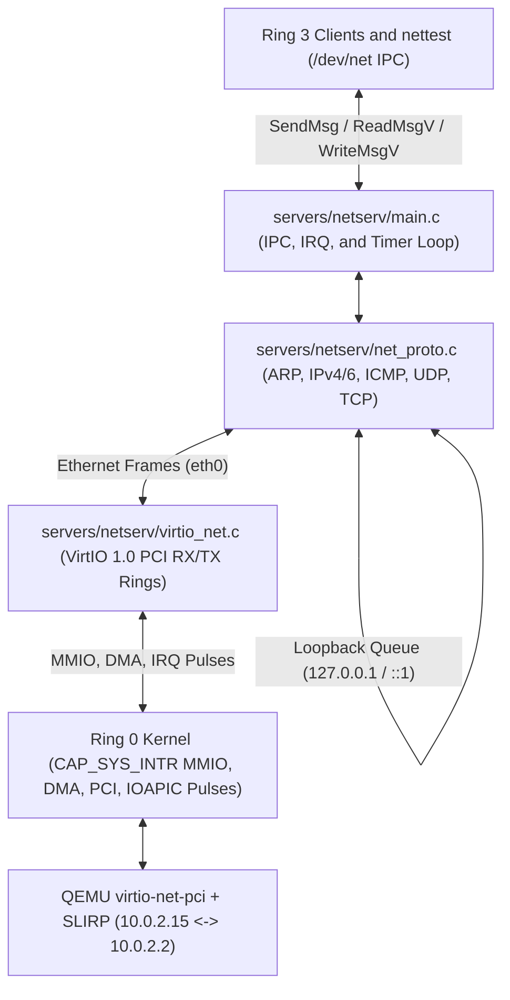

# ADR_0042 — Ring 3 PCI virtio-net Driver and TCP/IP Server

```{adr} Ring 3 PCI virtio-net driver and TCP/IP network server
:id: ADR_0042
:status: accepted

Implement the PCI `virtio-net` driver and TCP/IP/loopback stack inside one Ring
3 server (`servers/netserv/`) over existing `CAP_SYS_INTR` MMIO, DMA, and IOAPIC
IRQ pulses. Keep Ring 0 unchanged (`ADR_0002`, `ADR_0031`, `BDR_0004`).
```

## Context

`SWR_IPC_0013` requires a Ring 3 PCI `virtio-net` driver and a TCP/IP/loopback
network server. Under `CNV_0007`, device drivers, packet framing, routing, ARP
caches, and transport protocols must stay out of Ring 0. The kernel already
supplies `SYS_VM_MAP_MMIO`, `SYS_DMA_ALLOC`, `SYS_PCI_CFG`, and
`SYS_INTR_ATTACH_EVENT` under `CAP_SYS_INTR` (`ADR_0031`).

## Architecture



## Decision

1. **Unified Ring 3 server (`servers/netserv/`):** Place the VirtIO 1.0 PCI
   driver (`virtio_net.c`), protocol stack (`net_proto.c`), and IPC loop
   (`main.c`) in one Ring 3 server registered as `/dev/net`. This avoids extra
   IPC copies on every packet while keeping Ring 0 unchanged.
2. **Single event loop with IRQ and timer pulses:** Attach PCI IOAPIC IRQ pulses
   (`PULSE_CODE_IRQ`) and a futex-parked 5 ms timer ticker
   (`PULSE_CODE_NET_TICK`) to the main `/dev/net` IPC channel. The ticker sleeps
   at zero CPU when no timed waiter is active.
3. **Modern VirtIO 1.0 split virtqueues:** Negotiate `VIRTIO_F_VERSION_1` and
   `VIRTIO_NET_F_MAC` with 12-byte `virtio_net_hdr` headers. Allocate one
   contiguous 17-page DMA region (`DMAAlloc`) for 16 RX buffers (queue 0) and 16
   TX buffers (queue 1).
4. **Wire-accurate loopback and dual-stack protocols:** Route `127.0.0.0/8`,
   `::1`, and local `eth0` addresses through a FIFO loopback queue. Every
   loopback ICMP, UDP, and TCP packet runs through wire framing and RFC 1071
   checksum checks. Expose a socket-ready `/dev/net` IPC ABI
   (`libc/include/sys/net.h`) for subsequent `AF_INET` and `AF_INET6` POSIX
   socket integration.

## Rejected alternatives

- **Ring 0 network stack:** Violates `CNV_0007` and `ADR_0002` by adding device
  drivers and protocol state machines to the microkernel.
- **Two separate Ring 3 servers (`netdrv` and `netserv`):** Doubles IPC copy
  overhead on every Ethernet frame and adds another persistent process slot with
  no privilege isolation benefit for a single NIC.

## Consequences

- `arch.microkernel_boundary` stays green with zero new `SYS_*` syscalls, zero
  new `kernel/core/*.c` modules, and zero `struct __k_fd_entry` changes.
- `tests/test_runner.py` and `scripts/env.sh` attach a QEMU `virtio-net-pci`
  device backed by `-netdev user` (SLIRP). `nettest` verifies real hardware ARP
  and ICMPv4 traffic against `10.0.2.2` alongside IPv4/IPv6 loopback UDP and
  TCP.
