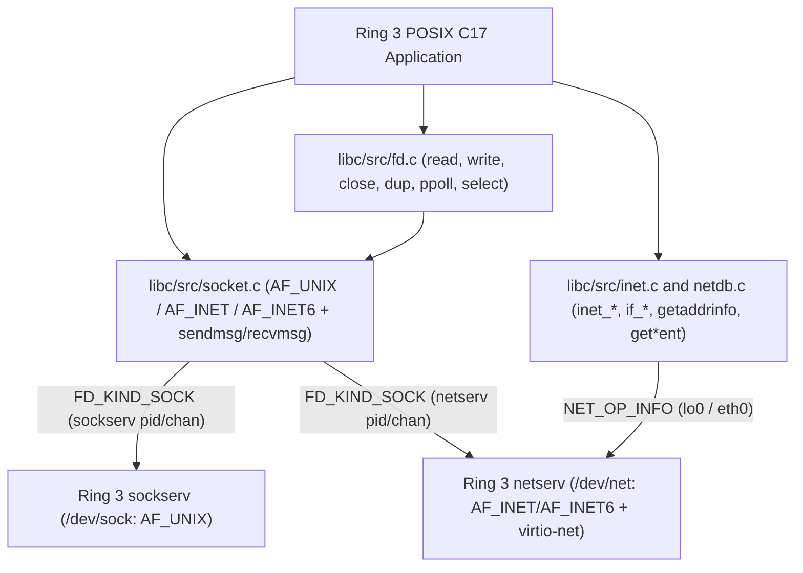

# ADR_0043 — Ring 3 Network Base Headers and Dual-Server Socket Dispatch

```{adr} Ring 3 network Base headers and dual-server socket dispatch
:id: ADR_0043
:status: accepted

Supply the five POSIX.1-2024 network Base headers (`<netinet/in.h>`,
`<netinet/tcp.h>`, `<arpa/inet.h>`, `<net/if.h>`, and `<netdb.h>`) and wire
`AF_INET` and `AF_INET6` into `libc` over `/dev/net` with zero Ring 0 changes
(`ADR_0002`, `ADR_0042`, `BDR_0004`).
```

## Context

`SWR_LIBC_0020` completes the remaining five POSIX.1-2024 Base C headers and 37
Base C interfaces (`sendmsg`, `recvmsg`, `sockatmark`, `hton*`/`ntoh*`,
`inet_*`, `if_*`, `getaddrinfo`, `getnameinfo`, `gai_strerror`, and `get*ent`).
Under `CNV_0007`, Ring 0 must not gain socket families, resolvers, or new
`struct __k_fd_entry` fields.

## Architecture



## Decision

1. **Reuse `FD_KIND_SOCK` for zero Ring 0 changes:** Store `netserv` PID and
   channel ID in the existing `srv_pid` and `srv_chanid` fields of `struct
   __k_fd_entry`. Process exit and `O_CLOEXEC` `execve` already send
   `PULSE_CODE_FD_CLOSE` to that server automatically.
2. **Dual-server dispatch in `libc/src/socket.c` and `fd.c`:** Route `AF_UNIX`
   descriptors to `/dev/sock` and `AF_INET`/`AF_INET6` descriptors to `/dev/net`
   across all `<sys/socket.h>` APIs, `read`, `write`, `dup*`, `close`, `ppoll`,
   and `select`. Keep all socket wrappers stack-buffered and async-signal-safe,
   with `__libc_cancel_point()` in `sendmsg` and `recvmsg`.
3. **Standalone Ring 3 address, interface, and resolver APIs:** Implement
   `hton*`/`ntoh*`, `inet_addr`, `inet_ntoa`, RFC 5952 `inet_pton`/`inet_ntop`,
   and live `/dev/net` `if_*` queries in `libc/src/inet.c`. Implement
   `getaddrinfo`, `freeaddrinfo`, `getnameinfo`, `gai_strerror`, `/etc/hosts`
   parsing, and host/network/protocol/service tables in `libc/src/netdb.c`.

## Rejected alternatives

- **Add a new `FD_KIND_NET` in Ring 0:** Unnecessary because `FD_KIND_SOCK`
  already carries the owning server PID and channel ID for close pulses.
- **Heap-allocate bounce buffers inside `sendmsg`/`recvmsg`:** Violates
  POSIX.1-2024 async-signal-safety (Gate 3 `posix.async_signal_safe`).

## Consequences

- `microkernel` reaches 70/70 POSIX.1-2024 Base C headers and 1037/1037 Base C
  interfaces in Gate 2 (`posix.symbol_diff`) with zero Ring 0 changes.
- `ppoll` and `select` multiplex `/dev/net` sockets alongside `/dev/sock`,
  `/dev/pipe`, and `/dev/tty` descriptors in one event loop.
