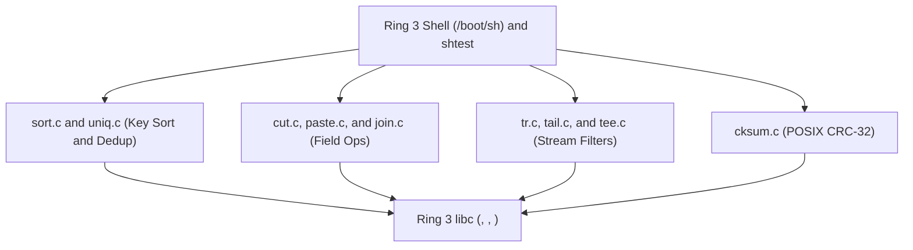

# ADR_0044 — Ring 3 Sort, Field, and Checksum Text Utilities

```{adr} Ring 3 sort, field, and checksum text utilities
:id: ADR_0044
:status: accepted

Implement POSIX.1-2024 XCU `sort`, `uniq`, `cut`, `tr`, `tail`, `tee`, `paste`,
`join`, and `cksum` in Ring 3 `bin/utils/`. Keep Ring 0 unchanged (`ADR_0002`,
`BDR_0004`).
```

## Context

`SWR_LIBC_0021` supplies nine core POSIX.1-2024 XCU text-pipeline and checksum
utilities (`sort`, `uniq`, `cut`, `tr`, `tail`, `tee`, `paste`, `join`, and
`cksum`). Under `CNV_0007`, all text processing and checksum logic runs in Ring
3 over `libc` streams, `vfsserv`, and `pipeserv`.

## Architecture



## Decision

1. **Sorting and deduplication (`sort.c`, `uniq.c`):** Implement `sort` with
   `-b`, `-c`/`-C`, `-d`, `-f`, `-i`, `-k` multi-key ranges, `-m`, `-n`, `-o`,
   `-r`, `-t`, and `-u`. Implement `uniq` with `-c`, `-d`, `-u`, `-i`, `-f`, and
   `-s`.
2. **Column and relational field tools (`cut.c`, `paste.c`, `join.c`):**
   Implement `cut` with `-b`/`-c`/`-f` range lists, `-d`, and `-s`. Implement
   `paste` with parallel and serial (`-s`) modes and cycling `-d` delimiters.
   Implement `join` with `-1`/`-2`, `-a`/`-v`, `-e`, `-i`, `-o`, `-t`, and
   many-to-many key groups.
3. **Stream filters and CRC-32 (`tr.c`, `tail.c`, `tee.c`, `cksum.c`):**
   Implement `tr` with `-c`/`-C`, `-d`, `-s`, escapes, ranges, character
   classes, and repeats. Implement `tail` (`-n`, `-c`, `+N` offsets), `tee`
   (`-a`, `-i`), and `cksum` with the POSIX.1-2024 polynomial `0x04C11DB7` and
   appended octet length.

## Rejected alternatives

- **Combine all nine tools into one multi-call binary:** Separate executables in
  `bin/utils/` match existing `bin/CMakeLists.txt` layout and Gate 2 utility
  discovery cleanly.

## Consequences

- Gate 2 (`posix.symbol_diff`) advances from 68/108 to 77/108 POSIX.1-2024 Base
  XCU utilities with zero Ring 0 changes.
- `tests/shtest/test_sh.c` exercises all nine utilities end-to-end in headless
  QEMU pipelines.
