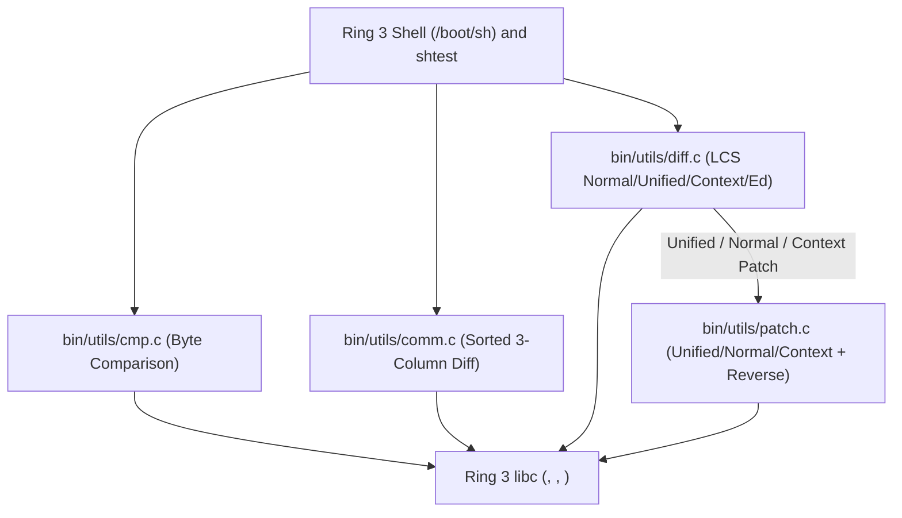

# ADR_0045 — Ring 3 Diff, Cmp, Comm, and Patch Utilities

```{adr} Ring 3 diff, cmp, comm, and patch utilities
:id: ADR_0045
:status: accepted

Implement POSIX.1-2024 XCU `diff`, `cmp`, `comm`, and `patch` in Ring 3
`bin/utils/` with zero Ring 0 changes (`ADR_0002`, `BDR_0004`).
```

## Context

`SWR_LIBC_0022` supplies POSIX.1-2024 XCU file comparison and patching tools
(`diff`, `cmp`, `comm`, and `patch`). Under `CNV_0007`, comparison algorithms
and patch application run entirely in Ring 3 over `libc` streams and `vfsserv`.

## Architecture



## Decision

1. **Byte and sorted-line comparison (`cmp.c`, `comm.c`):** Implement `cmp` with
   `-l` octal listing, `-s` silent status, and POSIX exit codes (`0`/`1`/`2`).
   Implement `comm` with `-1`, `-2`, and `-3` column suppression.
2. **LCS diff engine (`diff.c`):** Trim matching prefixes and suffixes, then
   build an LCS edit script. Emit normal, unified (`-u`/`-U`), context
   (`-c`/`-C`), `ed` (`-e`), brief (`-q`), and recursive directory (`-r`/`-N`)
   diffs with `-b`, `-w`, `-i`, and `-L`.
3. **Multi-format patch applier (`patch.c`):** Auto-detect unified, context, and
   normal diffs. Support `-p` path stripping, `-i`, `-o`, `-R` reversal, `-b`
   backups, `-d` chdir, and hunk-offset matching.

## Rejected alternatives

- **Unified-only `diff` and `patch`:** POSIX.1-2024 requires normal, context,
  unified, and `ed` formats. Supporting all formats makes full round-trips
  possible.

## Consequences

- Gate 2 (`posix.symbol_diff`) advances from 77/108 to 81/108 POSIX.1-2024 Base
  XCU utilities with zero Ring 0 changes.
- `tests/shtest/test_sh.c` verifies `cmp`, `comm`, and `diff`/`patch` round
  trips across unified, normal, context, and reverse modes in headless QEMU.
