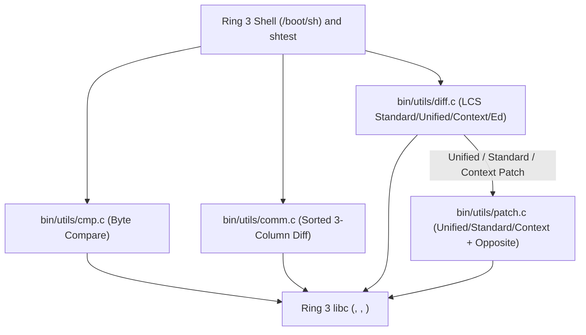

# ADR_0045 — Ring 3 Diff, Cmp, Comm, and Patch Utilities

```{adr} Ring 3 diff, cmp, comm, and patch utilities
:id: ADR_0045
:status: accepted

Ring 3 `bin/utils/` adds POSIX.1-2024 XCU `diff`, `cmp`, `comm`, and `patch`
with no Ring 0 changes (`ADR_0002`, `BDR_0004`).
```

## Context

`SWR_LIBC_0022` gives POSIX.1-2024 XCU file diff and patch utilities (`diff`,
`cmp`, `comm`, and `patch`). In `CNV_0007`, diff algorithms and patch operations
operate fully in Ring 3 with `libc` streams and `vfsserv`.

## Architecture



## Decision

1. **Byte and sorted-line diff (`cmp.c`, `comm.c`):** `cmp` adds `-l` octal
   output, `-s` silent status, and POSIX exit codes (`0`, `1`, `2`). `comm` adds
   `-1`, `-2`, and `-3` column suppression.
2. **LCS diff engine (`diff.c`):** `diff` removes equal prefixes and suffixes,
   then makes an LCS edit script. It writes `normal`, unified (`-u`, `-U`),
   context (`-c`, `-C`), `ed` (`-e`), brief (`-q`), and recursive directory
   (`-r`, `-N`) diffs with `-b`, `-w`, `-i`, and `-L`.
3. **Multi-format patch utility (`patch.c`):** `patch` automatically finds
   unified, context, and `normal` diff formats. It operates with `-p` path
   prefix removal, `-i`, `-o`, `-R` reversal, `-b` saved copies, `-d` directory
   changes, and hunk-offset lookups.

## Rejected alternatives

- **Unified-only `diff` and `patch`:** POSIX.1-2024 specifies `normal`, context,
  unified, and `ed` formats. All four formats make full diff and patch cycles
  possible.

## Results

- Gate 2 (`posix.symbol_diff`) increases from 77/108 to 81/108 POSIX.1-2024 Base
  XCU utilities with no Ring 0 changes.
- `tests/shtest/test_sh.c` does tests of `cmp`, `comm`, and `diff` with `patch`
  cycles across unified, `normal`, context, and `-R` modes in headless QEMU.
