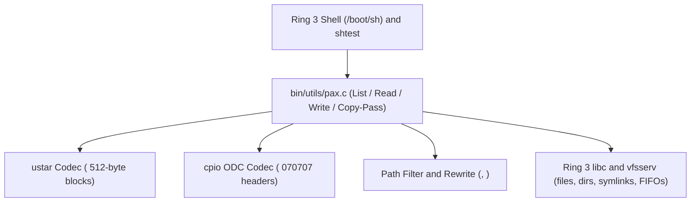

# ADR_0046 — Ring 3 Portable Archive Interchange Utility (pax)

```{adr} Ring 3 portable archive interchange utility (pax)
:id: ADR_0046
:status: accepted

Implement POSIX.1-2024 XCU `pax` in Ring 3 `bin/utils/pax.c` supporting `ustar`
(`<tar.h>`), `cpio` (`<cpio.h>`), `-s` substitution, and `-rw` copy-pass with
zero Ring 0 changes (`ADR_0002`, `BDR_0004`).
```

## Context

`SWR_LIBC_0023` supplies POSIX.1-2024 XCU `pax` over `<tar.h>`, `<cpio.h>`,
`<regex.h>`, `<fnmatch.h>`, and `vfsserv`. Under `CNV_0007`, archive framing and
directory traversal stay entirely in Ring 3.

## Architecture



## Decision

1. **Four POSIX modes:** Implement list (default), extract (`-r`), archive write
   (`-w`), and direct tree copy (`-r -w`) over regular files, directories,
   symlinks, and FIFOs.
2. **Dual format codecs with auto-detection:** Encode and decode `<tar.h>`
   512-byte `ustar` (including `prefix`/`name` splitting) and `<cpio.h>` ODC
   (`070707`) streams. Auto-detect format on read and list from the leading six
   bytes.
3. **Filtering and substitution:** Implement `-s /old/new/[gp]` with `<regex.h>`
   backreferences, pattern matching with `<fnmatch.h>`, `-c` complement, `-d`,
   `-k`, `-u`, `-l`, `-L`, and `-v`.

## Rejected alternatives

- **Support only `ustar`:** POSIX.1-2024 XCU `pax` requires both `ustar` and
  `cpio` archive interchange formats.

## Consequences

- Gate 2 (`posix.symbol_diff`) advances from 81/108 to 82/108 POSIX.1-2024 Base
  XCU utilities with zero Ring 0 changes.
- `tests/shtest/test_sh.c` verifies `ustar`, `cpio`, `-s` path rewriting,
  symlink preservation, and `-rw` copy-pass in headless QEMU.
