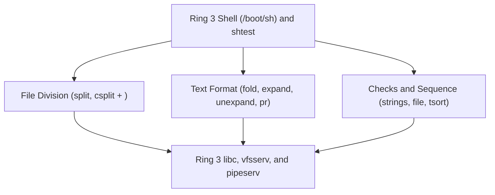

# ADR_0047 — Ring 3 File Division, Format, and Type-Check Utilities

```{adr} Ring 3 file division, format, and type-check utilities
:id: ADR_0047
:status: accepted

Ring 3 `bin/utils/` adds nine POSIX.1-2024 XCU utilities (`split`, `csplit`,
`fold`, `expand`, `unexpand`, `strings`, `tsort`, `file`, and `pr`) as
standalone executables with no Ring 0 changes (`ADR_0002`, `BDR_0004`).
```

## Context

`SWR_LIBC_0024` extends the user-space XCU utility set with file division, text
format, executable string lookup, topological sort, file type checks, and page
output. In `CNV_0007`, all parsers, dependency walks, and format functions stay
in Ring 3 with `libc`, `vfsserv`, and `pipeserv`.

## Architecture



## Decision

1. **File division:** `split` operates with `-l`, `-b` (`k` and `m`
   multipliers), and `-a` base-26 suffixes. `csplit` operates with numeric line
   breaks, `<regex.h>` `/re/` and `%re%` boundaries with offsets, `-f`, `-n`,
   `-k`, `-s`, and `{num}` and `{*}` counts.
2. **Line and page format:** `fold` divides lines by display columns or `-b`
   bytes with optional `-s` space breaks. `expand` and `unexpand` change tabs
   across constant intervals or custom `-t` tab-stop arrays. `pr` formats
   one-file, multi-column, and `-m` merged streams with `-h`, `-l`, `-w`, `-o`,
   `-n`, `-s`, `-d`, `-t`, `-F`, and `+<page>`.
3. **Checks and topological sequence:** `strings` finds printable runs with
   `-n`, `-a`, and `-t d|o|x`. `tsort` does deterministic Kahn sort with cycle
   diagnostics. `file` identifies directories, symlinks, FIFOs, ELF headers,
   `ustar` and `cpio` archives, scripts, C source, text, and binary data.

## Rejected alternatives

- **One multi-call executable for all utilities:** Isolated `bin/utils/`
  executables agree with all active XCU utilities and keep `boot.tar` layout and
  coverage attribution clear.

## Results

- Gate 2 (`posix.symbol_diff`) increases from 82/108 to 91/108 POSIX.1-2024 Base
  XCU utilities with no Ring 0 changes.
- `tests/shtest/test_sh.c` does tests of all nine utilities in headless QEMU.
