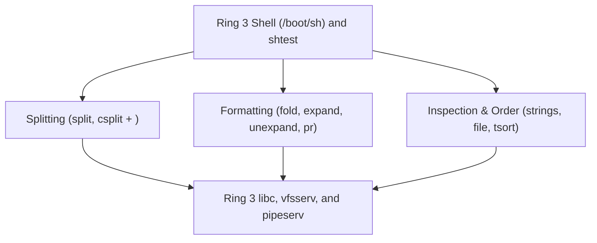

# ADR_0047 — Ring 3 Split, Format, and Inspection Utilities

```{adr} Ring 3 split, format, and inspection utilities
:id: ADR_0047
:status: accepted

Implement nine POSIX.1-2024 XCU utilities (`split`, `csplit`, `fold`, `expand`,
`unexpand`, `strings`, `tsort`, `file`, and `pr`) as standalone Ring 3 binaries
in `bin/utils/` with zero Ring 0 changes (`ADR_0002`, `BDR_0004`).
```

## Context

`SWR_LIBC_0024` expands the user-space XCU utility set with file splitting, text
formatting, binary string scanning, topological sorting, file classification,
and paginated printing. Under `CNV_0007`, all parsing, graph traversal, and
formatting stay in Ring 3 over `libc`, `vfsserv`, and `pipeserv`.

## Architecture



## Decision

1. **File splitting:** `split` handles `-l`, `-b` (`k`/`m` multipliers), and
   `-a` base-26 suffixes. `csplit` handles numeric line breaks, `<regex.h>`
   `/re/` and `%re%` boundaries with offsets, `-f`, `-n`, `-k`, `-s`, and
   `{num}`/`{*}` repeat counts.
2. **Line and page formatting:** `fold` wraps by display columns or `-b` bytes
   with optional `-s` blank breaks. `expand` and `unexpand` convert tabs across
   uniform intervals or custom `-t` stop lists. `pr` formats single-file,
   multi-column, and `-m` merged streams with `-h`, `-l`, `-w`, `-o`, `-n`,
   `-s`, `-d`, `-t`, `-F`, and `+<page>`.
3. **Inspection and topological order:** `strings` scans printable runs with
   `-n`, `-a`, and `-t d|o|x`. `tsort` runs deterministic Kahn sorting with
   cycle diagnostics. `file` classifies directories, symlinks, FIFOs, ELF
   headers, `ustar`/`cpio` archives, scripts, C source, text, and binary data.

## Rejected alternatives

- **Combine utilities into a single multicall binary:** Separate `bin/utils/`
  executables match every existing XCU utility and keep `boot.tar` layout and
  coverage attribution clear.

## Consequences

- Gate 2 (`posix.symbol_diff`) advances from 82/108 to 91/108 POSIX.1-2024 Base
  XCU utilities with zero Ring 0 changes.
- `tests/shtest/test_sh.c` verifies all nine utilities in headless QEMU.
