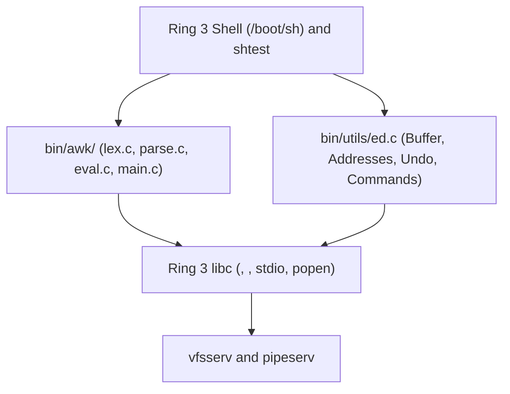

# ADR_0048 — Ring 3 Pattern-Scanning Language (awk) and Line Editor (ed)

```{adr} Ring 3 pattern-scanning language (awk) and line editor (ed)
:id: ADR_0048
:status: accepted

Implement POSIX.1-2024 XCU `awk` in `bin/awk/` and `ed` in `bin/utils/ed.c` as
Ring 3 executables over `<regex.h>` and `<math.h>` (`ADR_0002`, `BDR_0004`).
```

## Context

`SWR_LIBC_0025` supplies the programmable pattern-scanning language `awk` and
the standard line editor `ed`. Under `CNV_0007`, lexing, parsing, expression
evaluation, buffer editing, and regular expression matching stay in Ring 3 over
`libc`, `vfsserv`, and `pipeserv`.

## Architecture



## Decision

1. **Modular `awk` interpreter:** Split `awk` into `awk.h`, `lex.c`, `parse.c`,
   `eval.c`, and `main.c`. Support `-F`, `-f`, `-v`, `BEGIN`/`END` and range
   rules, associative arrays, `for (k in a)`, user functions, `getline`, output
   redirections (`>`, `>>`, `|`), `<regex.h>` matching (`~`, `match`, `sub`,
   `gsub`, `split`), and `<math.h>` built-ins.
2. **Complete Ring 3 `ed` line editor:** Implement `-p`, `-s`, and full line
   addressing (`.`, `$`, `n`, `+`/`-`, `/re/`, `?re?`, `'x`, `%`, `,`, `;`).
   Support text editing (`a`, `i`, `c`, `d`, `j`, `m`, `t`, `p`, `n`, `l`, `=`)
   and BRE substitution (`s`). Also support global commands (`g`/`v`), file and
   pipe I/O (`e`, `E`, `f`, `r`, `w`, `wq`, `!`), and single-level undo (`u`).

## Rejected alternatives

- **Single-file monolithic `awk`:** Splitting `awk` into lexer, parser, VM, and
  CLI files keeps each module concise, maintainable, and easy to analyze with
  `clang-tidy`.

## Consequences

- Gate 2 (`posix.symbol_diff`) advances from 91/108 to 93/108 POSIX.1-2024 Base
  XCU utilities with zero Ring 0 changes.
- `tests/shtest/test_sh.c` verifies both `awk` and `ed` in headless QEMU.
