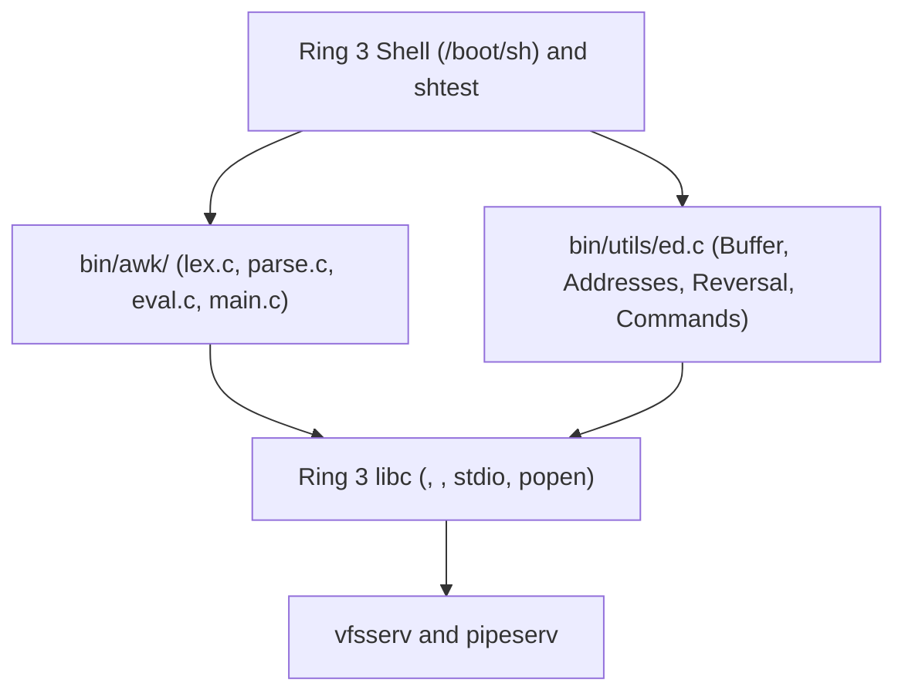

# ADR_0048 — Ring 3 Pattern-Match Language (awk) and Line Editor (ed)

```{adr} Ring 3 pattern-match language (awk) and line editor (ed)
:id: ADR_0048
:status: accepted

Ring 3 adds POSIX.1-2024 XCU `awk` in `bin/awk/` and `ed` in `bin/utils/ed.c` as
executables on `<regex.h>` and `<math.h>` (`ADR_0002`, `BDR_0004`).
```

## Context

`SWR_LIBC_0025` gives the programmable pattern-match language `awk` and the
standard line editor `ed`. In `CNV_0007`, lexical analysis, syntax parsers,
expression arithmetic, buffer edits, and regular expression operations stay in
Ring 3 with `libc`, `vfsserv`, and `pipeserv`.

## Architecture



## Decision

1. **Modular `awk` interpreter:** `bin/awk/` divides `awk` into `awk.h`,
   `lex.c`, `parse.c`, `eval.c`, and `main.c`. It operates with `-F`, `-f`,
   `-v`, `BEGIN`, `END`, range rules, associative arrays, `for (k in a)`, user
   functions, `getline`, output redirections (`>`, `>>`, `|`), `<regex.h>`
   operations (`~`, `match`, `sub`, `gsub`, `split`), and `<math.h>` builtins.
2. **Full Ring 3 `ed` line editor:** `ed` adds `-p`, `-s`, and full line
   addresses (`.`, `$`, `n`, `+`, `-`, `/re/`, `?re?`, `'x`, `%`, `,`, `;`). It
   operates with text edits (`a`, `i`, `c`, `d`, `j`, `m`, `t`, `p`, `n`, `l`,
   `=`) and BRE substitution (`s`). It also operates with global commands (`g`,
   `v`), file and pipe I/O (`e`, `E`, `f`, `r`, `w`, `wq`, `!`), and one-level
   change reversal (`u`).

## Rejected alternatives

- **One-file monolithic `awk`:** Division of `awk` into lexer, parser, VM, and
  CLI files keeps each module concise, maintainable, and easy to examine with
  `clang-tidy`.

## Results

- Gate 2 (`posix.symbol_diff`) increases from 91/108 to 93/108 POSIX.1-2024 Base
  XCU utilities with no Ring 0 changes.
- `tests/shtest/test_sh.c` does tests of `awk` and `ed` in headless QEMU.
