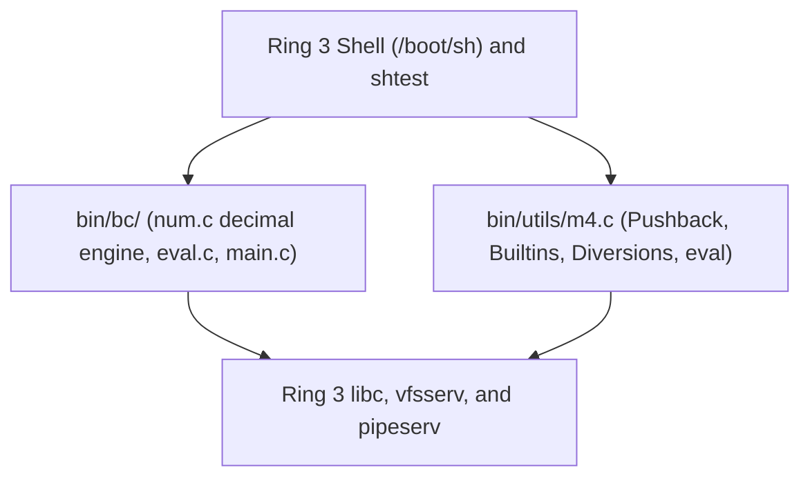

# ADR_0049 — Ring 3 Arbitrary-Precision Calculator (bc) and Macro Processor (m4)

```{adr} Ring 3 arbitrary-precision calculator (bc) and macro processor (m4)
:id: ADR_0049
:status: accepted

Ring 3 adds POSIX.1-2024 XCU `bc` in `bin/bc/` and `m4` in `bin/utils/m4.c` as
executables with no Ring 0 changes (`ADR_0002`, `BDR_0004`).
```

## Context

`SWR_LIBC_0026` gives the arbitrary-precision calculator `bc` and the macro
processor `m4`. In `CNV_0007`, decimal arithmetic, recursive function calls, and
macro expansion stay fully in Ring 3 with `libc`, `vfsserv`, and `pipeserv`.

## Architecture



## Decision

1. **Arbitrary-precision decimal `bc`:** `bin/bc/num.c` keeps numbers as base-10
   digit arrays with explicit `scale`. `bc` operates with `ibase`, `obase`,
   `sqrt`, `length`, `scale`, user `define` functions with `auto` local items,
   loops, and `-l` math functions (`e`, `l`, `s`, `c`, `a`, `j`).
2. **Macro processor `m4`:** `bin/utils/m4.c` adds a LIFO pushback scanner with
   configurable quotation marks and comments. `m4` operates with `-D`, `-U`,
   `-s`, `define`, `pushdef`, `popdef`, `ifdef`, `ifelse`, `eval`, `divert`,
   `undivert`, `include`, `translit`, `substr`, `shift`, `syscmd`, and `m4wrap`.

## Rejected alternatives

- **IEEE-754 `double` in `bc`:** Fixed 53-bit precision cannot calculate
  arbitrary-precision expressions such as `2^100` or arbitrary `scale`
  divisions.

## Results

- Gate 2 (`posix.symbol_diff`) increases from 93/108 to 95/108 POSIX.1-2024 Base
  XCU utilities with no Ring 0 changes.
- `tests/shtest/test_sh.c` does tests of `bc` and `m4` in headless QEMU.
