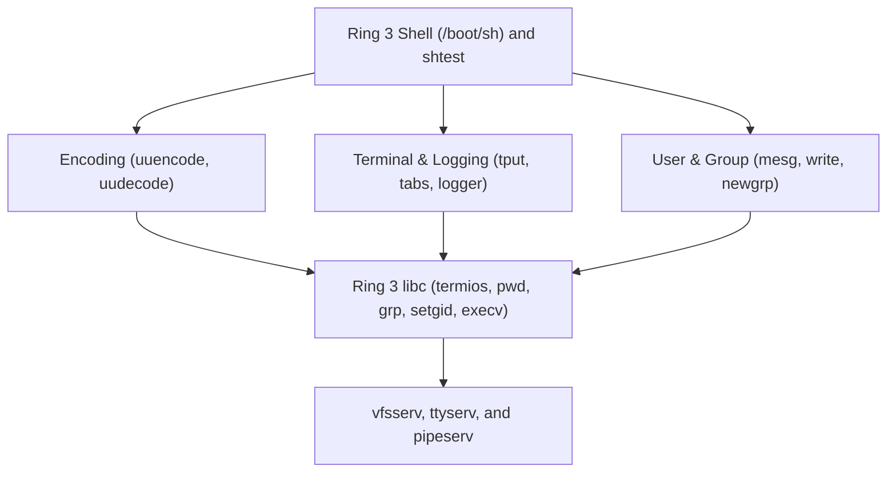

# ADR_0050 — Ring 3 Encoding, Logging, Terminal, and User Utilities

```{adr} Ring 3 encoding, logging, terminal, and user utilities
:id: ADR_0050
:status: accepted

Implement eight POSIX.1-2024 XCU utilities (`uuencode`, `uudecode`, `logger`,
`tput`, `tabs`, `mesg`, `write`, and `newgrp`) as Ring 3 binaries in
`bin/utils/` with zero Ring 0 changes (`ADR_0002`, `BDR_0004`).
```

## Context

`SWR_LIBC_0027` supplies binary-to-text encoding, syslog entry logging, terminal
capability and tab-stop control, inter-user messaging, and primary group
switching. Under `CNV_0007`, all formatting, file state, and `execv` transitions
stay in Ring 3 over `libc`, `vfsserv`, and `ttyserv`.

## Architecture



## Decision

1. **Encoding (`uuencode`, `uudecode`):** Support both historical uuencoding and
   `-m` Base64 framing, auto-detecting `begin` and `begin-base64` headers, with
   `-o` output redirection and permission restoration via `chmod`.
2. **Logging and terminal control (`logger`, `tput`, `tabs`):** `logger` appends
   timestamped entries to `/tmp/syslog` (`-t`, `-p`, `-i`, `-s`). `tput` queries
   `tcgetwinsize` and emits ANSI/ECMA-48 capability sequences. `tabs` clears and
   sets hardware tab stops with `-n`, custom lists, and POSIX presets.
3. **Messaging and group switching (`mesg`, `write`, `newgrp`):** `mesg` and
   `write` manage message permissions and deliver formatted messages to
   recipient targets. `newgrp` resolves groups through `<grp.h>`, calls
   `setgid`, and replaces the process with the user shell via `execv`.

## Rejected alternatives

- **Add a dedicated Ring 3 syslog daemon for `logger`:** Appending timestamped
  records to `/tmp/syslog` keeps the boot process set minimal while fulfilling
  POSIX.1-2024 `logger` semantics.

## Consequences

- Gate 2 (`posix.symbol_diff`) advances from 95/108 to 103/108 POSIX.1-2024 Base
  XCU utilities with zero Ring 0 changes.
- `tests/shtest/test_sh.c` verifies all eight utilities in headless QEMU.
