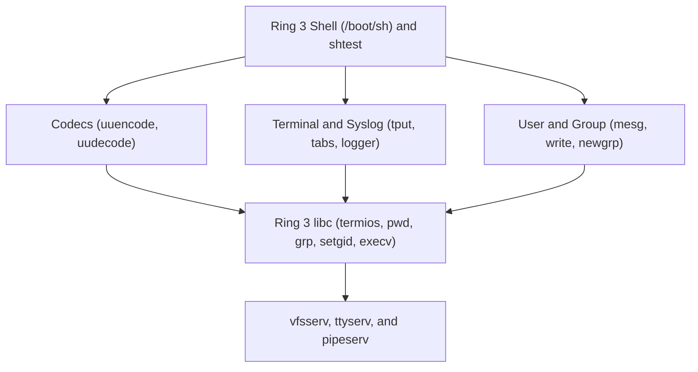

# ADR_0050 — Ring 3 Codec, Syslog, Terminal, and User Utilities

```{adr} Ring 3 codec, syslog, terminal, and user utilities
:id: ADR_0050
:status: accepted

Ring 3 `bin/utils/` adds eight POSIX.1-2024 XCU utilities (`uuencode`,
`uudecode`, `logger`, `tput`, `tabs`, `mesg`, `write`, and `newgrp`) as
executables with no Ring 0 changes (`ADR_0002`, `BDR_0004`).
```

## Context

`SWR_LIBC_0027` gives binary-to-text codecs, syslog record output, terminal
function and tab-stop control, inter-user messages, and primary group changes.
In `CNV_0007`, all text formats, file state, and `execv` changes stay in Ring 3
with `libc`, `vfsserv`, and `ttyserv`.

## Architecture



## Decision

1. **Codecs (`uuencode`, `uudecode`):** The utilities operate with historical
   `uuencode` format and `-m` Base64 format. They automatically find `begin` and
   `begin-base64` headers, obey `-o` output redirection, and set file
   permissions through `chmod`.
2. **Syslog and terminal control (`logger`, `tput`, `tabs`):** `logger` adds
   timestamped entries to the end of `/tmp/syslog` (`-t`, `-p`, `-i`, `-s`).
   `tput` queries `tcgetwinsize` and writes ANSI and ECMA-48 control sequences.
   `tabs` removes and sets hardware tab stops with `-n`, custom arrays, and
   POSIX default stops.
3. **Messages and group changes (`mesg`, `write`, `newgrp`):** `mesg` and
   `write` control message permissions and send formatted messages to target
   terminals. `newgrp` finds groups through `<grp.h>`, calls `setgid`, and
   replaces the process with the user shell through `execv`.

## Rejected alternatives

- **A dedicated Ring 3 syslog daemon for `logger`:** Timestamped entries at the
  end of `/tmp/syslog` keep the boot process set small and obey POSIX.1-2024
  `logger` rules.

## Results

- Gate 2 (`posix.symbol_diff`) increases from 95/108 to 103/108 POSIX.1-2024
  Base XCU utilities with no Ring 0 changes.
- `tests/shtest/test_sh.c` does tests of all eight utilities in headless QEMU.
