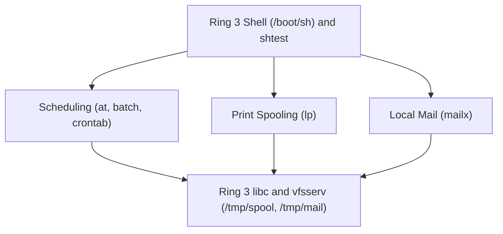

# ADR_0051 — Ring 3 Scheduling, Spooling, and Local Mail Utilities

```{adr} Ring 3 scheduling, spooling, and local mail utilities
:id: ADR_0051
:status: accepted

Implement the remaining five POSIX.1-2024 Base XCU utilities (`at`, `batch`,
`crontab`, `lp`, and `mailx`) as Ring 3 binaries in `bin/utils/` with zero Ring
0 changes (`ADR_0002`, `BDR_0004`).
```

## Context

`SWR_LIBC_0028` supplies deferred job scheduling (`at`, `batch`), periodic
schedule tables (`crontab`), print spooling (`lp`), and local electronic mail
(`mailx`). Under `CNV_0007`, all job queues, schedule validation, spool files,
and `mbox` storage stay completely in Ring 3 over `libc` and `vfsserv`.

## Architecture



## Decision

1. **Deferred and periodic scheduling (`at`, `batch`, `crontab`):** `at` stores
   job scripts and metadata under `/tmp/spool/at/`, supporting `-t`, timespecs,
   `-f`, `-q`, `-m`, `-l`, and `-r`. `batch` delegates directly to `at -q b -m
   now` through `execv`. `crontab` validates 5-field cron entries and manages
   per-user tables under `/tmp/spool/cron/` (`-l`, `-r`, `-e`).
2. **Print spooling (`lp`):** Spool files and metadata under `/tmp/spool/lp/`
   per destination (`-d`, `$LPDEST`, `$PRINTER`, `-n`, `-t`, `-s`) and print the
   request identifier.
3. **Local mail (`mailx`):** Support sending messages (`-s`, `-r`) into `mbox`
   files under `/tmp/mail/` and reading or managing mailboxes (`-e`, `-H`, `-N`,
   `-f`, `-u`, `p`/`t`, `h`, `d`, `u`, `q`, `x`).

## Rejected alternatives

- **Add persistent Ring 3 cron, atd, and lpd daemons at boot:** Spool-backed
  Ring 3 CLIs keep the boot process set minimal while exercising every
  POSIX.1-2024 utility contract in headless QEMU.

## Consequences

- Gate 2 (`posix.symbol_diff`) reaches 108/108 POSIX.1-2024 Base XCU utilities
  alongside 70/70 Base headers and 1037/1037 Base C interfaces, with zero Ring 0
  changes.
- `tests/shtest/test_sh.c` verifies all five utilities in headless QEMU.
